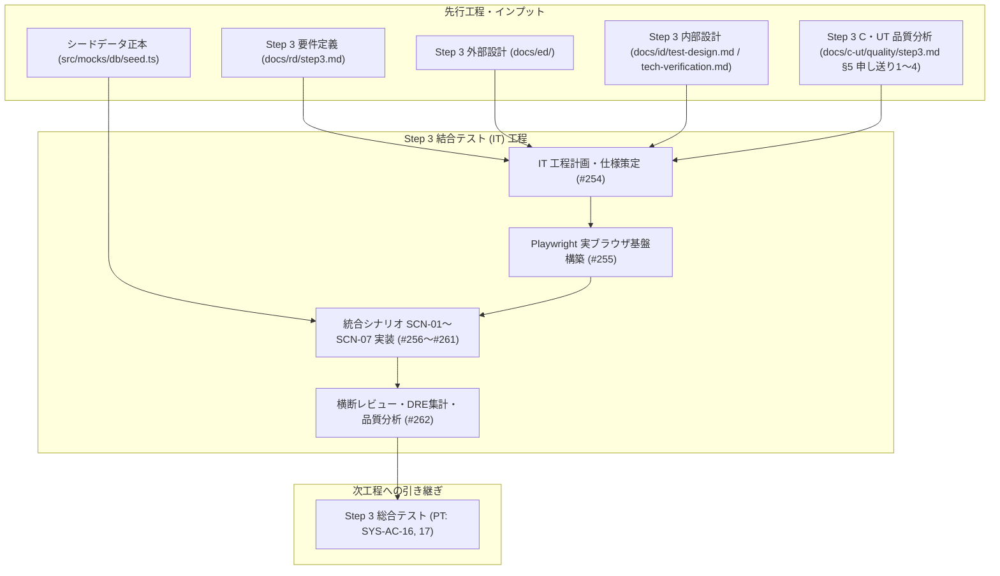
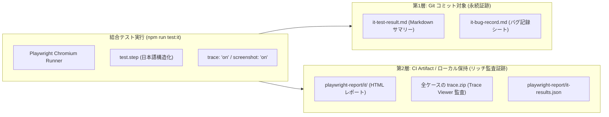
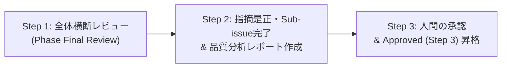

# Step 3 結合テスト（IT）工程計画書

| 項目                | 内容                                                                                                                                                                                                                                                                                                                                                                                                                                                                                                                                                                                                                                                                                                                                                                                                                  |
| ------------------- | --------------------------------------------------------------------------------------------------------------------------------------------------------------------------------------------------------------------------------------------------------------------------------------------------------------------------------------------------------------------------------------------------------------------------------------------------------------------------------------------------------------------------------------------------------------------------------------------------------------------------------------------------------------------------------------------------------------------------------------------------------------------------------------------------------------------- |
| 状態                | `Review (Step 3)`                                                                                                                                                                                                                                                                                                                                                                                                                                                                                                                                                                                                                                                                                                                                                                                                     |
| 更新日              | `2026-10-24`                                                                                                                                                                                                                                                                                                                                                                                                                                                                                                                                                                                                                                                                                                                                                                                                          |
| 関連する ED/ID 項目 | `docs/rd/step3.md#33-it結合テストの実施トレース記録ルール`<br>`docs/ed/01-system-overview.md`<br>`docs/ed/02-screen-list.md`<br>`docs/ed/03-screen-transition.md`<br>`docs/ed/screens/`<br>`docs/id/01-frontend-architecture.md`<br>`docs/id/state-management.md`<br>`docs/id/api-client.md`<br>`docs/id/test-design.md#7-単体テストutと結合テストitの責務境界とplaywright実ブラウザit設計`<br>`docs/id/tech-verification.md#5-検証テーマ-4-playwright-実ブラウザ-ittrace-onにおけるシードデータ初期化同期方式の検証`<br>`docs/c-ut/quality/step3.md#5-残存課題および後続-it結合テスト工程への重点検証申し送り事項`<br>`docs/it/quality/step2.md#5-今後の標準化次期-step-への提言`<br>`src/mocks/db/seed.ts`<br>`.github/skills/waterfall-github-task-management/SKILL.md`<br>`.github/skills/c-ut-workflow/SKILL.md` |

このドキュメントでは、承認された要件定義（RD: `docs/rd/step3.md`）、外部設計（ED: `docs/ed/`）、内部設計・テスト設計（ID: `docs/id/test-design.md`, `docs/id/tech-verification.md`）、および先行する Step 3 C・UT 工程の品質分析結果（`docs/c-ut/quality/step3.md`）に基づき、Step 3 結合テスト（IT）工程で実施すべき作業分解構成（WBS）、タスク一覧、各タスクと設計書のトレーサビリティ、テスト実行環境、品質管理方針（スリム化不備記録・DRE計測）、および完了判定基準を定義します。

---

## 1. 工程の目的と基本方針

### 1.1 目的

1. **Next.js App Router 構成での実ブラウザ統合検証**:
   単体テスト（UT）で検証済みの各画面コンポーネント（Storybook CSFv3 + `composeStories`）、カスタムフック、API クライアント、認証・認可ガード、レイアウト（`AppLayout`）、および MSW モックデータストアを Next.js App Router アーキテクチャ配下で統合し、実ブラウザ（Chromium）上での画面間遷移、URL クエリパラメータの保持・復元、ロール別アクセス制御、および画面をまたぐデータ更新連携が設計仕様（ED/ID）どおりに動作することを検証します。
2. **OpenAPI / MSW 契約準拠の確認**:
   フロントエンドとモック API 間の通信が、リレーショナルストア（ユーザー・プロジェクト・チケット・コメント）および OpenAPI 契約（SSOT: `docs/ed/api/openapi.yaml`）に厳密に準拠して連動し、データ不整合や状態の不一致が発生しないことを検証します。
3. **UT との責務境界の厳守 (`docs/id/test-design.md` §7)**:
   単一コンポーネントの描画バリエーションや分岐（C0/C1 カバレッジ 100%）およびビジュアル回帰テスト（VRT: 419 ケース）は C・UT で網羅済みであるため、IT 工程では「実ブラウザでの画面遷移フロー」「URL クエリパラメータ双方向同期・履歴復元」「3 層 Dirty State ガード」「画面間のデータ更新連携」「権限ガード・403/404 異常系フォールバック」に集中して検証します。
4. **決定論的シードデータ初期化と高信頼な自動テスト**:
   各テストケース実行前に `POST /api/test/reset` を発行してシードデータ正本（`src/mocks/db/seed.ts`）の状態へ決定論的に初期化し、先行テストのデータ変更による順序依存・フレーキー化を完全に排除します。
5. **トレース常時記録（`trace: "on"`）による完全な監査性の担保**:
   全テストケースで Playwright トレースを常時記録し、DOM スナップショット、Action、Network API 通信、Console ログの追跡性を保証します。
6. **品質分析・単体テスト欠陥除去率（$\text{DRE (UT)}$）の計測**:
   C・UT 工程で確立された「スリム化必須6項目」および原因分類 `D` の設計書同期原則を継承し、AI 作業中に確認された不備を製品コードと支援成果物に分離して記録します。C・UT 製品コード不備 18 件をベースとして単体テスト欠陥除去率（$\text{DRE (UT)} \ge 85\%$）を算定し、品質分析レポート（`docs/it/quality/step3.md`）としてまとめます。



### 1.2 テスト実行基盤の刷新方針（Playwright Test 全面移行と VRT 一本化）

Step 2 においては Vitest + JSDOM による結合テストを実施していましたが、Step 3 では Next.js App Router への全面移行に伴い、結合テスト（IT）の実行基盤を **Playwright Test（Chromium 実ブラウザ駆動）** へ全面的に刷新します（`docs/rd/step3.md` §3.3、`docs/id/tech-verification.md` §5）。

| 比較項目              | Step 2 IT 方式 (Vitest + JSDOM)            | Step 3 IT 方式 (Playwright Chromium 実ブラウザ)       | 刷新理由・効果                                                                                                                                 |
| :-------------------- | :----------------------------------------- | :---------------------------------------------------- | :--------------------------------------------------------------------------------------------------------------------------------------------- |
| **実行環境**          | Node.js 仮想 DOM（JSDOM）                  | **実ブラウザ（Chromium ヘッドレス）**                 | `next/navigation`、実 Cookie/ストレージ、実レイアウト・CSS、履歴スタック（`popstate`）の忠実な動作保証                                         |
| **ルーティング駆動**  | 仮想 URL (`window.history`)                | **Next.js App Router ネイティブナビゲーション**       | `src/app/` 配下のレイアウト・ページ・`not-found.tsx` の完全な協調動作を検証可能                                                                |
| **視覚的回帰（VRT）** | 一部 JSDOM 不足分を VRT で補完（二重管理） | **IT での VRT は不実施（UT Storybook VRT に一本化）** | UT において全 `.tsx` の表示・CSS が Storybook VRT（419 件）で 100% カバーされるため、IT での二重管理と動的データ起因のフレーキーを排除（§5.3） |
| **実行時エビデンス**  | テキストログのみ                           | **Playwright Trace (`trace.zip`) 常時記録**           | 成功・失敗を問わず、全テストケースで DOM・Action・Network 通信・Console ログを Trace Viewer で完全監査可能                                     |
| **テスト記述構造**    | `describe` / `it`                          | **`test` + 日本語 `test.step(...)` 構造化**           | テスト仕様書と 1 対 1 で対応した可読性の高い実行レポート（HTML / JSON）を生成                                                                  |

### 1.3 決定論的シードデータ初期化方式（`POST /api/test/reset`）

Playwright 実ブラウザ環境では、テスト実行プロセス（Playwright Test ランナー）、実ブラウザ（Chromium）、および Next.js / Mock API サーバーが独立したプロセスとして動作するため、同一メモリ空間での直接関数呼び出し（`resetMockDb()`）による初期化が不可能です（`docs/id/tech-verification.md` §5.1）。

この課題を解決するため、テスト用リセットエンドポイント **`POST /api/test/reset`** を採用します。

1. **初期化の仕組み**:
   - Next.js / MSW サーバー側に `POST /api/test/reset` ハンドラーを配置し、呼び出し時に `src/mocks/db/store.ts` の `resetMockDb()` を同期実行して初期シードデータ（`src/mocks/db/seed.ts`）の状態へ巻き戻します。
2. **テストコードでの利用パターン**:
   ```typescript
   import { test, expect } from "@playwright/test";

   test.beforeEach(async ({ request, page }) => {
     // 1. モック DB を初期シードデータ（seed.ts 正本）へ決定論的にリセット
     const res = await request.post("/api/test/reset");
     expect(res.ok()).toBeTruthy();

     // 2. ブラウザストレージの初期化（未ログイン状態のベースライン構築）
     await page.goto("/login");
     await page.evaluate(() => {
       localStorage.clear();
       sessionStorage.clear();
     });
   });
   ```
3. **効果**:
   チケットの新規起票、ステータス・担当者更新、コメント追加、ユーザー／プロジェクトの作成・削除を行うテストケースが先行しても、後続のテストケースに一切影響を与えず、100% 決定論的かつ安定したテスト実行を保証します。

### 1.4 トレース常時記録（`trace: "on"`）とエビデンス 2 層管理方針

`docs/rd/step3.md` §3.3 の要求に基づき、IT 実行時の全テストケース（成功時を含む）においてトレーサビリティを保証し、Git リポジトリ肥大化を防ぐ **エビデンス 2 層管理方針** を適用します。



1. **Git コミット対象（永続証跡・軽量サマリー）**:
   - `docs/it/evidence/it-test-result.md`: `it-results.json` から自動集計した全シナリオ・テストケースの合否、実行時間、受け入れ条件網羅サマリー表（Markdown）。
   - `docs/it/evidence/it-bug-record.md`: 結合テストバグ記録シート（スリム化必須 6 項目、D 不備設計同期記録）。
2. **CI Artifact / ローカル保持対象（リッチ監査証跡）**:
   - `playwright-report/it/` 一式（HTML レポート ＋ 全ケースの `trace.zip` ＋ `it-results.json`）。GitHub Actions の Artifact に 30 日間保存し、PR レビューや工程承認時の監査証跡とします（リポジトリ容量の肥大化を完全防止）。

### 1.5 前 Step 開発範囲の包含・進化とシステム全体回帰保証方針（`SCN-01`〜`SCN-07` 統合シナリオ体系）

本プロジェクトにおける結合テスト（IT）は、Step 3 で新規追加・変更された機能のみを孤立して検証するのではなく、**前 Step までの過去開発範囲を含めた現時点のシステム全体が一貫して仕様通りに動作することを保証する統合テストスイート（全体結合・回帰保護）** として策定・再構築します。

Step 1 および Step 2 で実装された全機能（認証・認可ガード、ダッシュボード集計、問い合わせ一覧・複合検索・ソート・ページング、詳細閲覧・ステータス/担当者更新・コメント投稿、新規起票、管理画面 CRUD、開閉式サイドバー、Dirty Guard、404/500/401 異常系）は、Step 3 の Next.js App Router アーキテクチャに合わせて包含・進化させ、新機能と統合した `SCN-01` 〜 `SCN-07` の単一シナリオ体系として一本化して管理します。

#### システム全体結合シナリオの体系と包含・進化関係

| シナリオ ID  | シナリオ群名称                                                                                    | 位置づけ（過去 Step からの包含・進化および Step 3 拡張内容）                                                                                                                                                                                                                               | 担当 Issue |
| :----------- | :------------------------------------------------------------------------------------------------ | :----------------------------------------------------------------------------------------------------------------------------------------------------------------------------------------------------------------------------------------------------------------------------------------- | :--------: |
| **`SCN-01`** | **認証・認可ガード・セッション管理および異常系フォールバック結合シナリオ**                        | **【Step 2 包含 ＋ Step 3 進化】**<br>・未認証ガード（`/login?redirect=...`）、元 URL 復帰、オープンリダイレクト遮断<br>・一般の `/admin` 遮断（TR-16）、管理者の `/tickets/new` 遮断（TR-17）<br>・共通 404（`not-found.tsx`）、詳細 404、API 500 再試行復帰                              |    #256    |
| **`SCN-02`** | **ロール別ダッシュボード集計および一覧ドリルダウン連携シナリオ**                                  | **【Step 2 包含 ＋ Step 3 進化】**<br>・一般ユーザー（単一所属 `user1` / 複数所属 `user2`）の所属別集計<br>・自身担当未完了チケット直接遷移（TR-10）<br>・サマリーカード押下時のフィルタ付き一覧ドリルダウン（TR-11、**C・UT 申し送り 4**）                                                |    #257    |
| **`SCN-03`** | **問い合わせ一覧検索・URL クエリ双方向同期・履歴復元および詳細遷移シナリオ**                      | **【Step 1/2 包含 ＋ Step 3 進化】**<br>・複合 AND 検索・ソート・ページング・URL クエリ双方向同期<br>・詳細遷移と「一覧へ戻る」押下時の検索条件完全復元（TR-13）<br>・プロジェクト変更時担当者連動リセット（**C・UT 申し送り 4**）<br>・OpenAPI 400 バリデーション（**C・UT 申し送り 1**） |    #258    |
| **`SCN-04`** | **問い合わせ詳細更新・コメント追加・管理者 Read-only 制御シナリオ**                               | **【Step 1/2 包含 ＋ Step 3 進化】**<br>・ステータス/担当者更新と一覧・ダッシュボードへの即時反映（Fresh Fetch: `cache: "no-store"`）<br>・コメント投稿（絵文字サロゲートペア対応）<br>・管理者閲覧専用（Read-only）制御<br>・更新競合検知（409 Conflict）                                 |    #259    |
| **`SCN-05`** | **問い合わせ新規起票フロー・入力バリデーションおよび詳細・一覧即時反映シナリオ**                  | **【Step 2 包含 ＋ Step 3 進化】**<br>・プロジェクト選択に応じた担当者候補の動的連動<br>・フォームバリデーション（タイトル・本文制約）<br>・起票成功時の詳細自動遷移（TR-14）および一覧・ダッシュボード即時反映                                                                            |    #259    |
| **`SCN-06`** | **ユーザー・プロジェクト管理画面（SCR-04）のマスタ操作・参照整合性保護および他画面連動シナリオ**  | **【Step 2 包含 ＋ Step 3 進化】**<br>・プロジェクト作成・参照整合性保護付き削除（チケット保有時削除禁止）<br>・ユーザー作成・自己削除防止・所属編集モーダル<br>・マスタ更新結果の他画面（一覧・起票担当者候補）への即時連動                                                               |    #260    |
| **`SCN-07`** | **開閉式サイドバー・375px モバイルドロワー実操作性および 3層 Dirty State ガード複合結合シナリオ** | **【Step 2 包含 ＋ Step 3 進化】**<br>・サイドバー開閉永続化（`sidebar_collapsed`）<br>・375px モバイルドロワー開閉・スクロールロック・フォーカストラップ（**C・UT 申し送り 2**）<br>・3層 Dirty State ガード（起票・コメント・所属編集）と 401 失効複合挙動（**C・UT 申し送り 3**）       |    #261    |

### 1.6 Step 3 C・UT 工程からの重点検証申し送り事項の組み込み

先行する Step 3 C・UT 工程の品質分析レポート（`docs/c-ut/quality/step3.md` §5）において提起された 4 項目の重点検証申し送り事項を、結合テストシナリオへ以下のように組み込みます。

1. **申し送り 1: OpenAPI 実サーバー通信バリデーション（SCN-03, SCN-05, SCN-06）**:
   - 問い合わせ一覧クエリ（不正日付フォーマット、`from > to` 範囲逆転、上限文字数超過）、新規起票入力値、ユーザー/プロジェクト管理操作において、スキーマ通りの HTTP 400（`VALIDATION_ERROR` / `PROJECT_HAS_TICKETS`）が返却され、クライアント側で適切な Toast 通知が表示され入力状態が維持されることを検証。
2. **申し送り 2: 375px モバイルビューポートにおける実操作性（SCN-07）**:
   - 375px モバイル表示において、ハンバーガーメニュー開閉、ドロワー内ナビゲーション遷移と自動クローズ、ドロワー/モーダル表示時の背景スクロール抑止（`overflow: hidden`）、Tab/Shift+Tab によるフォーカストラップ循環、および Escape キー押下時のクローズと親要素へのバブリング抑止（R1-02）を実ブラウザ上で検証。
3. **申し送り 3: 認証・認可ガードと Dirty Guard の複合検証（SCN-01, SCN-07）**:
   - フォーム（起票・コメント・所属編集）に入力中（未保存変更あり）の状態で 401 トークン失効が発生した場合、Dirty Guard モーダルが表示され、ユーザーが破棄を承認するまで画面離脱が抑止され、かつログイン画面へのリダイレクト時に元の URL クエリが保持されること（および通常ログアウト時の `redirect` クエリ除去: R1-13）を検証。
4. **申し送り 4: 画面間 URL クエリパラメータの引き継ぎと復元（SCN-02, SCN-03）**:
   - ダッシュボードの要対応アラートから一覧へ遷移した際のフィルタ復元、および一覧から詳細へ遷移して「一覧へ戻る」を押下した際（またはブラウザ戻る `popstate`）のページネーション・検索条件の完全復元、ならびにプロジェクト変更時の担当者連動リセット（R1-14）を一連の業務フローで検証。

---

## 2. 作業分解構成（WBS）とタスク一覧

Step 3 結合テスト（IT）工程の作業分解構成（WBS）および担当 Issue 一覧を以下に定義します。

|  No.  |  Issue   | タスク名                                                                                                                            | 主担当内容・対象シナリオ                                                                                                                                            | 対象設計書・成果物                                                                                                                          |
| :---: | :------: | :---------------------------------------------------------------------------------------------------------------------------------- | :------------------------------------------------------------------------------------------------------------------------------------------------------------------ | :------------------------------------------------------------------------------------------------------------------------------------------ |
| **1** | **#254** | **結合テスト工程計画書・シナリオ仕様書の Step 3 改定および結合テスト不備記録シートの準備**                                          | 全体計画書・シナリオ仕様書改定、不備記録シート初期配置、正本データ同期                                                                                              | `docs/it/README.md`<br>`docs/it/test-scenario.md`<br>`docs/it/evidence/it-bug-record.md`<br>`docs/it/quality/README.md`<br>`docs/README.md` |
| **2** | **#255** | **Playwright 実ブラウザ IT 実行基盤・シードデータ初期化フィクスチャ・トレース常時記録および CI ワークフローの構築**                 | `playwright.it.config.ts` 新設、`POST /api/test/reset` フィクスチャ、スモークテスト、CI IT ワークフロー（`.github/workflows/it.yml`）、旧 IT 資産整理               | `playwright.it.config.ts`<br>`test/it/helpers/`<br>`.github/workflows/it.yml`<br>`package.json`                                             |
| **3** | **#256** | **認証・認可ガード・セッション管理および異常系フォールバック結合シナリオ（SCN-01）の実装**                                          | 未認証リダイレクト・元URL復帰、オープンリダイレクト防止、403 ガード（TR-16/17）、共通 404（`not-found.tsx`）、詳細 404、API 500 再試行                              | `test/it/scenarios/scn01-auth-and-fallback.spec.ts`<br>`docs/it/evidence/it-bug-record.md`                                                  |
| **4** | **#257** | **ロール別ダッシュボード集計および一覧ドリルダウン連携シナリオ（SCN-02）の実装**                                                    | 一般/管理者集計正確性、自身担当案件遷移（TR-10）、サマリーカードドリルダウン（TR-11、C・UT 申し送り 4）、未割当・滞留アラート                                       | `test/it/scenarios/scn02-dashboard.spec.ts`<br>`docs/it/evidence/it-bug-record.md`                                                          |
| **5** | **#258** | **問い合わせ一覧検索・URL クエリ双方向同期・履歴復元および詳細遷移シナリオ（SCN-03）の実装**                                        | 複合検索・ソート・ページング、URL クエリ双方向同期、詳細往復復元（TR-13/18）、担当者連動リセット（C・UT 申し送り 4）、OpenAPI 400（申し送り 1）                     | `test/it/scenarios/scn03-ticket-list.spec.ts`<br>`docs/it/evidence/it-bug-record.md`                                                        |
| **6** | **#259** | **問い合わせ詳細更新・コメント追加・管理者 Read-only 制御および新規起票フロー結合シナリオ（SCN-04, SCN-05）の実装**                 | ステータス/担当者更新と即時反映、コメント投稿（絵文字）、管理者 Read-only、競合検知（409）、新規起票・詳細自動遷移（TR-14）・一覧即時反映                           | `test/it/scenarios/scn04-ticket-detail.spec.ts`<br>`test/it/scenarios/scn05-ticket-create.spec.ts`<br>`docs/it/evidence/it-bug-record.md`   |
| **7** | **#260** | **ユーザー・プロジェクト管理画面（SCR-04）のマスタ操作・参照整合性保護および他画面連動シナリオ（SCN-06）の実装**                    | プロジェクト作成・参照整合性保護削除、ユーザー作成・自己削除防止、所属編集、他画面連動（一覧フィルタ・起票選択肢）、OpenAPI 400（申し送り 1）                       | `test/it/scenarios/scn06-admin-management.spec.ts`<br>`docs/it/evidence/it-bug-record.md`                                                   |
| **8** | **#261** | **開閉式サイドバー・375px モバイルドロワー実操作性および 3層 Dirty State ガード複合結合シナリオ（SCN-07）と結果サマリー証跡の整備** | サイドバー開閉永続化、375px モバイル操作性・スクロールロック・フォーカストラップ（C・UT 申し送り 2）、3層 Dirty Guard（C・UT 申し送り 3）、`it-test-result.md` 生成 | `test/it/scenarios/scn07-layout-and-dirty-guard.spec.ts`<br>`docs/it/evidence/it-test-result.md`<br>`docs/it/evidence/it-bug-record.md`     |
| **9** | **#262** | **結合テスト成果物をレビュー・承認し、不備記録集約および品質分析レポート作成**                                                      | 横断レビュー（Phase Final Review）、不備集約、DRE 算定（目標 $\ge 85\%$）、品質分析レポート作成、人間承認、`Approved (Step 3)` 昇格                                 | `docs/it/quality/step3.md`<br>`docs/it/evidence/it-bug-record.md`<br>`docs/README.md`<br>IT 全成果物                                        |

---

## 3. 各タスクの詳細仕様と設計書トレーサビリティ

### 3.1 No.1: 結合テスト計画書・シナリオ仕様書の Step 3 改定および結合テスト不備記録シートの準備（Issue #254）

- **目的**: Step 3 の Playwright 実ブラウザ IT アーキテクチャに基づき、工程計画書・シナリオ仕様書・不備記録シートを整備し、全作業タスクの基盤を確立する。
- **対象成果物**: `docs/it/README.md`, `docs/it/test-scenario.md`, `docs/it/evidence/it-bug-record.md`, `docs/it/quality/README.md`, `docs/README.md`
- **主要内容**:
  - `src/mocks/db/seed.ts` の正本データ（`PRJ-01`〜`03`、`user-admin`、`user-1`〜`3`、チケット `#1`〜`#34`）に完全同期したシナリオ記述。
  - Next.js App Router ルーティング、確定認可文言（TR-16/17）、3層 Dirty Guard を含む全 7 シナリオ群（SCN-01〜SCN-07）の仕様化。
  - スリム化必須 6 項目、製品コード（18件）ベースの $\text{DRE (UT)} \ge 85\%$ 算定枠、D 不備設計同期原則の初期化。

### 3.2 No.2: Playwright 実ブラウザ IT 実行基盤・シードデータ初期化フィクスチャ・トレース常時記録および CI ワークフローの構築（Issue #255）

- **目的**: Playwright Chromium 実ブラウザ結合テスト実行環境を新設し、テスト前シードリセット・トレース記録・CI 自動実行基盤を構築する。
- **対象成果物**: `playwright.it.config.ts`, `test/it/helpers/`, `.github/workflows/it.yml`, `package.json`
- **主要内容**:
  - `playwright.it.config.ts`（`testDir: "./test/it"`, `fullyParallel: false`, `workers: 1`, `trace: "on"`, `screenshot: "on"`）の新設。
  - `POST /api/test/reset` フィクスチャ、ロール別ログインヘルパー、日本語 `test.step` 構造化ユーティリティの整備。
  - 基盤疎通スモークテストの実装と、旧 Step 2 の Vitest + JSDOM 結合テスト資産の整理。
  - `npm run test:it` コマンド更新および GitHub Actions IT ワークフロー整備（Artifact 保存 30 日間）。

### 3.3 No.3: 認証・認可ガード・セッション管理および異常系フォールバック結合シナリオ（SCN-01）の実装（Issue #256）

- **目的**: 未認証時のルート保護、ログイン・セッション復元、ロール別認可ガード（403）、および異常系フォールバック（404/500）を実ブラウザで結合検証する。
- **対象成果物**: `test/it/scenarios/scn01-auth-and-fallback.spec.ts`
- **主要内容**:
  - 未認証 `/` アクセス時の `/login` リダイレクト（TR-01, SYS-AC-08, SYS-AC-09）および元 URL・クエリ復帰（TR-03, TR-06）。
  - オープンリダイレクト防止（外部 URL 遮断と `/dashboard` フォールバック）。
  - 一般ユーザー（`user1`）および管理者（`admin`）のログイン、リロード後のセッション復元、ログアウト（TR-02, TR-04, TR-05, SYS-AC-08）。
  - 一般ユーザーの `/admin` アクセス遮断（TR-16: `管理者権限が必要です（403 Forbidden）`）。
  - 管理者の `/tickets/new` アクセス遮断（TR-17: `管理者ロールでは新規起票機能は利用できません（403 Forbidden）`）。
  - 共通 404 画面（`not-found.tsx`）表示、存在しないチケット 404 表示、API 500 エラー表示と再試行復帰。

### 3.4 No.4: ロール別ダッシュボード集計および一覧ドリルダウン連携シナリオ（SCN-02）の実装（Issue #257）

- **目的**: ロール（一般 `user1`, `user2` / 管理者 `admin`）に応じたダッシュボード集計の正確性と、一覧・詳細へのドリルダウン連携を検証する。
- **対象成果物**: `test/it/scenarios/scn02-dashboard.spec.ts`
- **主要内容**:
  - `user1`（PRJ-01 所属: 15件）および `user2`（PRJ-01/02 所属: 25件）でのステータス別集計カード（未対応・対応中・完了・合計）の表示検証（SCR-00 AC-01）。
  - 自身担当の未完了チケット（最大5件、更新降順）表示と行クリックによる詳細（`/tickets/[id]`）直接遷移（TR-10）。
  - サマリーカード押下によるフィルタ付き一覧（`/tickets?status=...`）ドリルダウン遷移と一覧側 UI 同期（TR-11, **C・UT 申し送り 4**）。
  - 管理者（`admin`）での全社プロジェクト集計、未割当アラート、長期滞留アラートからのドリルダウン遷移。

### 3.5 No.5: 問い合わせ一覧検索・URL クエリ双方向同期・履歴復元および詳細遷移シナリオ（SCN-03）の実装（Issue #258）

- **目的**: 一覧画面での複合検索フィルタ、ソート、ページング、URL クエリ双方向同期、詳細画面往復時の完全復元、および OpenAPI バリデーションを検証する。
- **対象成果物**: `test/it/scenarios/scn03-ticket-list.spec.ts`
- **主要内容**:
  - ロール別プロジェクトスコープ制御（`user1`: 15件固定、`user2`: 切替可能、`admin`: 全25件表示・起票ボタン非表示）。
  - プロジェクト変更時の非所属担当者連動リセット（**C・UT 申し送り 4 / R1-14**）。
  - 複合 AND 検索（ステータス、担当者、キーワード、日付範囲、長期滞留）と URL クエリ双方向同期。
  - 詳細画面への遷移（TR-12）と「一覧へ戻る」押下（TR-13）およびブラウザ「戻る」（TR-18）での検索条件・ページ番号完全復元。
  - 不正クエリパラメータ送信時の OpenAPI 400（`VALIDATION_ERROR`）ハンドリングと Toast 表示（**C・UT 申し送り 1**）。

### 3.6 No.6: 問い合わせ詳細更新・コメント追加・管理者 Read-only 制御および新規起票フロー結合シナリオ（SCN-04, SCN-05）の実装（Issue #259）

- **目的**: 詳細画面でのステータス・担当者更新、コメント追加、管理者 Read-only 制御（`SCN-04`）、および新規起票フォーム入力・バリデーション・即時反映（`SCN-05`）を検証する。
- **対象成果物**: `test/it/scenarios/scn04-ticket-detail.spec.ts`, `test/it/scenarios/scn05-ticket-create.spec.ts`
- **主要内容**:
  - チケット基本情報（ID・タイトル・説明・ステータス・担当者）およびコメント履歴の時系列表示（SCR-02 AC-01/02）。
  - 一般ユーザーによるステータス／担当者更新、成功 Toast 表示、一覧・ダッシュボード戻り時の即時反映（Fresh Fetch: `cache: "no-store"`、SYS-AC-03）。
  - コメント投稿（1〜1000文字、Unicode 絵文字サロゲートペア対応、履歴への即時追加）。
  - 管理者（`admin`）での詳細画面表示時の更新フォーム・コメント投稿枠の非表示（Read-only 制御、TR-12M）。
  - 新規起票画面（`/tickets/new`）でのプロジェクト連動担当者選択肢、バリデーション、起票後の詳細自動遷移（TR-14）および一覧・ダッシュボード反映。

### 3.7 No.7: ユーザー・プロジェクト管理画面（SCR-04）のマスタ操作・参照整合性保護および他画面連動シナリオ（SCN-06）の実装（Issue #260）

- **目的**: 管理画面（`/admin/management`）におけるプロジェクト・ユーザーの CRUD、参照整合性保護ガード、および他画面への即時連動を検証する。
- **対象成果物**: `test/it/scenarios/scn06-admin-management.spec.ts`
- **主要内容**:
  - プロジェクト一覧表示、カラムソート、新規作成モーダルによる登録と一覧反映（SCR-04 AC-02/03）。
  - チケット保有プロジェクト（`PRJ-01`, `PRJ-02`）および単独所属ユーザー存在プロジェクトの削除ボタン非活性、0件プロジェクト（`PRJ-03`）の正常削除（SCR-04 AC-04）。
  - サーバー側 OpenAPI 400（`PROJECT_HAS_TICKETS`）エラー時の Toast 表示と状態維持（**C・UT 申し送り 1**）。
  - ユーザー一覧表示、新規作成（英数字ID、ASCIIパスワード、一般ユーザー所属1件以上必須）、新規ユーザーでの即時ログイン検証。
  - 管理者自身（`admin`）および最後の管理者の自己削除防止ガード、一般ユーザー削除。
  - ユーザー所属編集モーダル（所属1件以上必須ガード）と変更後の他画面（一覧フィルタ・起票担当者候補）即時連動。

### 3.8 No.8: 開閉式サイドバー・375px モバイルドロワー実操作性および 3層 Dirty State ガード複合結合シナリオ（SCN-07）と結果サマリー証跡の整備（Issue #261）

- **目的**: 開閉式サイドバー永続化、375px モバイルビューポート実操作性、3層 Dirty State ガードとセッション失効複合挙動を検証し、全シナリオの実行結果サマリーを生成する。
- **対象成果物**: `test/it/scenarios/scn07-layout-and-dirty-guard.spec.ts`, `docs/it/evidence/it-test-result.md`
- **主要内容**:
  - デスクトップ幅でのサイドバー開閉トグル（240px ⇔ 60px）およびリロード後の `localStorage`（`sidebar_collapsed`）保持（SYS-AC-10, TR-21）。
  - 375px モバイル幅でのハンバーガーメニュー開閉、ドロワー内リンク遷移と自動クローズ（TR-22）。
  - モバイルドロワー・モーダル表示時の背景スクロールロック（`overflow: hidden`）、Tab フォーカストラップ、Escape キーによるクローズとバブリング抑止（R1-02, **C・UT 申し送り 2**）。
  - 3 対象画面（`/tickets/new`, `/tickets/[id]`, `/admin/management`）での 3 層 Dirty State ガード（アプリ内遷移横取り、ブラウザ戻る `popstate` の Revert & Replay、離脱ダイアログ動作）（SYS-AC-14, **C・UT 申し送り 3**）。
  - 401 セッション失効時の強制リダイレクトと Dirty Guard の複合挙動検証（**C・UT 申し送り 3**）。
  - 全シナリオ（SCN-01〜SCN-07）の 100% PASS 実行結果 JSON（`it-results.json`）から `docs/it/evidence/it-test-result.md` を生成。

### 3.9 No.9: 結合テスト成果物をレビュー・承認し、不備記録集約および品質分析レポート作成（Issue #262）

- **目的**: Step 3 IT 全成果物を横断レビュー（Phase Final Review）し、不備集約、DRE 算定、品質分析レポート（`quality/step3.md`）を作成し、人間承認を経て工程を完了する。
- **対象成果物**: `docs/it/quality/step3.md`, `docs/it/evidence/it-bug-record.md`, `docs/README.md`, 全 IT 成果物
- **主要内容**:
  - フェーズ完了横断レビュー（3段階 Phase Approval Gate: Step 1 横断レビュー、Step 2 指摘是正・Sub-issue完了、Step 3 人間承認）。
  - 不備記録の最終集約とメトリクス分析（バグ密度、原因分類、検出手段、D 不備設計同期実績）。
  - 単体テスト欠陥除去率（$\text{DRE (UT)} \ge 85\%$）の算定・評価。
  - PT（総合テスト）工程への申し送り事項の確定。
  - 全 IT 成果物の `Approved (Step 3)` 昇格。

---

## 4. テスト実行環境とディレクトリ構成・コマンド標準

### 4.1 採用ツール構成

- **テストランナー / ブラウザ**: `@playwright/test` / Chromium（ヘッドレス）
- **Web サーバー自動起動**: Next.js 開発サーバー（`npm run dev` またはビルド済み `npm start`、ポート 3000）
- **API モック基盤**: MSW（Mock Service Worker）ブラウザ Worker / Node サーバー（`src/mocks/`）
- **リセット用エンドポイント**: `POST /api/test/reset`
- **OS / フォント**: VS Code DevContainer（Debian/Ubuntu）、`fonts-dejavu-core`（レンダリング再現性確保）

### 4.2 ディレクトリ構成とファイル配置

```
test/it/
├── helpers/                                      # IT 共通フィクスチャ・ヘルパー
│   ├── index.ts                                  # 共通ヘルパー集約エクスポート
│   ├── auth.ts                                   # ログイン・認証状態セットアップ
│   ├── reset.ts                                  # POST /api/test/reset 呼び出し
│   └── test-step.ts                              # 日本語ステップ構造化支援
├── scenarios/                                    # 結合テストシナリオ仕様実装
│   ├── scn01-auth-and-fallback.spec.ts           # SCN-01: 認証・認可・異常系 (#256)
│   ├── scn02-dashboard.spec.ts                   # SCN-02: ダッシュボード (#257)
│   ├── scn03-ticket-list.spec.ts                 # SCN-03: 一覧検索・クエリ同期 (#258)
│   ├── scn04-ticket-detail.spec.ts               # SCN-04: 詳細更新・コメント (#259)
│   ├── scn05-ticket-create.spec.ts               # SCN-05: 新規起票フロー (#259)
│   ├── scn06-admin-management.spec.ts            # SCN-06: ユーザー・PJ管理 (#260)
│   └── scn07-layout-and-dirty-guard.spec.ts      # SCN-07: レイアウト・Dirty Guard (#261)
playwright.it.config.ts                           # Playwright IT 専用設定ファイル
playwright-report/
└── it/                                           # Playwright HTML レポート出力先 (CI Artifact / .gitignore)
docs/it/
├── README.md                                     # 本計画書
├── test-scenario.md                              # 結合テスト仕様書
├── evidence/
│   ├── it-test-result.md                         # IT 実行結果サマリー表 (Git コミット対象)
│   ├── it-bug-record.md                          # 結合テストバグ記録シート (Git コミット対象)
│   └── browser-msw-verification.md               # Step 2 履歴保全
└── quality/
    ├── README.md                                 # IT 品質分析インデックス
    ├── step2.md                                  # Step 2 IT 品質分析レポート (履歴)
    └── step3.md                                  # Step 3 IT 品質分析レポート (#262 にて作成)
```

### 4.3 実行コマンド標準

- **全結合テスト実行**:
  ```bash
  npm run test:it
  ```
  （内部的に `playwright test --config=playwright.it.config.ts` を実行）
- **特定シナリオの個別実行**:
  ```bash
  npx playwright test test/it/scenarios/scn01-auth-and-fallback.spec.ts --config=playwright.it.config.ts
  ```
- **HTML レポート・Trace Viewer 閲覧**:
  ```bash
  npx playwright show-report playwright-report/it
  npx playwright show-trace playwright-report/it/trace.zip
  ```

---

## 5. 品質管理方針と完了判定基準

### 5.1 不備記録標準（スリム化必須6項目）

作業リズムを損なわず確実に不備を記録・集約するため、以下の **スリム化必須 6 項目**（`docs/it/evidence/it-bug-record.md`）で記録します。

1. **No.**: タスク内連番
2. **検出手段**: `IT自動テスト`, `AIレビュー`, `手動ブラウザ検証`, `静的検査` 等
3. **成果物区分**: `製品コード` または `テスト・モック等支援成果物`
4. **対象箇所**: ファイル名・モジュール名・関数名
5. **原因分類**: 原因分類コード（L / S / D / B / A）
6. **不備の概要と是正内容**: 現象・根本原因および是正コミット/PR。**原因分類 D の場合は設計書同期コミット・PR を併記**。

### 5.2 原因分類 `D` の設計書同期原則

原因分類 `D`（設計・仕様誤認）として検出された不備については、以下のルールを厳守します。

- **コード・テスト単独修正の禁止**: ソースコードやテストコードのみを修正して上位設計書を放置することを禁止します。
- **即時同期**: 該当する設計書（`docs/rd/`、`docs/ed/`、`docs/id/`、`docs/ed/api/openapi.yaml`）を即座に是正し、不備記録シートにコード修正と設計書修正の双方のコミット・PR を記録します。

### 5.3 単体テスト欠陥除去率（$\text{DRE (UT)}$）の計測・評価方針

先行する C・UT 工程の品質保証効果を客観的に評価するため、以下の算定式により単体テスト欠陥除去率を計測します。

$$\text{DRE (UT)} = \frac{\text{UT製品コード不備}}{\text{UT製品コード不備} + \text{IT製品コード不備}} \times 100\% = \frac{18}{18 + \text{IT製品コード不備}} \times 100\%$$

- **目標値**: **85.0% 以上**
- **合否判定基準**:
  - IT 製品コード不備が 0 件の場合: $\text{DRE (UT)} = 100.0\%$
  - IT 製品コード不備が 1 件の場合: $\text{DRE (UT)} = 94.7\%$
  - IT 製品コード不備が 2 件の場合: $\text{DRE (UT)} = 90.0\%$
  - IT 製品コード不備が 3 件の場合: $\text{DRE (UT)} = 85.7\%$（目標クリア限界値）
  - IT 製品コード不備が 4 件以上の場合: $\text{DRE (UT)} \le 81.8\%$（目標未達となり重点要因分析が必要）

### 5.4 個別タスク完了判定基準（Task Completion Gate）

各個別タスク（Issue #254〜#261）は、以下の **Task Completion Gate（7 ステップ）** を完全に満たした場合にのみ完了とします。

1. **静的検査・自動テストの PASS**:
   - `npm run typecheck`, `npm run lint`, `npm run format:check` が PASS すること。
   - `npm run test:unit`, `node --test "test/**/*.js"` が PASS すること。
   - 当該タスクの結合テスト（`npm run test:it`）が 100% PASS すること（Issue #255 以降）。
2. **VRT 整合性の維持**:
   - Storybook 関連ファイルに変更があった場合、VRT（`npm run test:vrt`）が PASS すること。
3. **PR への `Closes #N` 設定**:
   - 人間による PR マージ時に Issue が自動 close される設定を行うこと。
4. **GitHub Actions の PASS**:
   - CI および VRT ワークフロー（および IT ワークフロー）が PASS すること。
5. **独立 PR レビューの実施**:
   - `pr-reviewer` エージェントによる厳格な独立レビューを実施すること。
6. **指摘事項の是正と合意形成**:
   - レビューで指摘されたアクション可能な課題がすべて是正され、スレッドが解決されること。
7. **人間の承認・マージ待機**:
   - AI は PR を直接承認・マージせず、人間の最終確認を待機すること。

### 5.5 工程完了承認基準（3段階 Phase Approval Gate）

IT 工程全体（Issue #262）を完了し、次工程（PT: 総合テスト）へ進むための基準は以下の **3 段階ゲート** とします。



1. **Step 1: 全体横断レビュー（Phase Final Review）**:
   - `phase-final-reviewer` エージェントを起動し、読み取り専用サブエージェントにより IT 全成果物の整合性（シナリオ網羅率、シードデータ正本同期、トレーサビリティ、設計同期）を多角的に検証。
2. **Step 2: 指摘是正・Sub-issue 完了 & 品質分析レポート作成**:
   - 洗い出された指摘事項を是正し、全結合テスト（`SCN-01`〜`SCN-07`）の 100% PASS を確認。
   - `docs/it/evidence/it-bug-record.md` の集計サマリーを確定し、`docs/it/quality/step3.md`（品質分析レポート）を作成。
3. **Step 3: 人間の承認 & `Approved (Step 3)` 昇格**:
   - 人間レビュアーが最終確認を行い、承認を得た段階で全 IT 成果物の状態を `Review (Step 3)` から一括で **`Approved (Step 3)`** へ昇格し、次工程（PT）へ移行。
