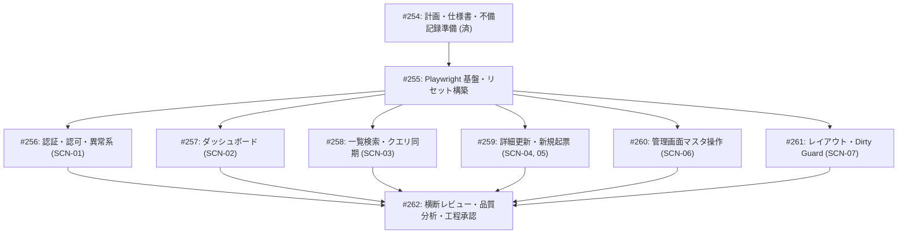

# Step 3 結合テスト仕様書（テスト計画・シナリオ仕様書）

| 項目                | 内容                                                                                                                                                                                                                                                                                                                                                                                                                                                                                                                                                                                                                                                                                                                                                                                              |
| ------------------- | ------------------------------------------------------------------------------------------------------------------------------------------------------------------------------------------------------------------------------------------------------------------------------------------------------------------------------------------------------------------------------------------------------------------------------------------------------------------------------------------------------------------------------------------------------------------------------------------------------------------------------------------------------------------------------------------------------------------------------------------------------------------------------------------------- |
| 状態                | `Review (Step 3)`                                                                                                                                                                                                                                                                                                                                                                                                                                                                                                                                                                                                                                                                                                                                                                                 |
| 更新日              | `2026-10-24`                                                                                                                                                                                                                                                                                                                                                                                                                                                                                                                                                                                                                                                                                                                                                                                      |
| 関連する ED/ID 項目 | `docs/rd/step3.md#33-it結合テストの実施トレース記録ルール`<br>`docs/ed/01-system-overview.md`<br>`docs/ed/02-screen-list.md`<br>`docs/ed/03-screen-transition.md`<br>`docs/ed/screens/`<br>`docs/id/01-frontend-architecture.md`<br>`docs/id/state-management.md`<br>`docs/id/api-client.md`<br>`docs/id/test-design.md#7-単体テストutと結合テストitの責務境界とplaywright実ブラウザit設計`<br>`docs/id/tech-verification.md#5-検証テーマ-4-playwright-実ブラウザ-ittrace-onにおけるシードデータ初期化同期方式の検証`<br>`docs/c-ut/quality/step3.md#5-残存課題および後続-it結合テスト工程への重点検証申し送り事項`<br>`docs/it/quality/step2.md#5-今後の標準化次期-step-への提言`<br>`src/mocks/db/seed.ts`<br>`docs/it/README.md`<br>`.github/skills/waterfall-github-task-management/SKILL.md` |

このドキュメントでは、社内問い合わせ・チケット管理システム（Step 3: Next.js App Router 構成）の結合テスト（IT）工程における全体テスト計画、テスト実行環境・ツール構成、重要検証観点、結合テストシナリオ群（`SCN-01`〜`SCN-07`）の詳細仕様、トレーサビリティ・マトリクス、テストデータ管理ルール、および後続実装タスク（Issue #255〜#261）への割り当てを定義します。

---

## 1. 結合テスト（IT）の目的と基本方針

### 1.1 目的

単体テスト（UT）で検証済みの各画面コンポーネント（Storybook CSFv3 + `composeStories`）、カスタムフック、API クライアント、認証・認可ガード、レイアウト（`AppLayout`）、および MSW リレーショナルデータストアを Next.js App Router アーキテクチャ配下で統合し、アプリケーション全体として実ブラウザ上での画面間遷移、URL 状態・クエリ同期、ロール別アクセス制御、画面間データ更新連携、異常系・フォールバック、およびブラウザ実環境依存動作が外部設計（ED）および内部設計（ID）の仕様どおりに動作することを検証します。

### 1.2 基本方針

1. **実ブラウザ（Chromium）駆動による通しシナリオ検証**:
   - 仮想 DOM（JSDOM）ではなく、Playwright Test（Chromium 実ブラウザ駆動）を用いて Next.js App Router ネイティブのルーティング解決（`/login`, `/dashboard`, `/tickets`, `/tickets/new`, `/tickets/[id]`, `/admin/management`, `not-found.tsx`）、認証コンテキスト、画面レイアウト、および画面遷移を結合レベルで検証します。
2. **OpenAPI 契約準拠のリレーショナル MSW モック活用**:
   - `src/mocks/handlers/` および `src/mocks/db/`（ユーザー・プロジェクト・チケット・コメント）を利用し、フロントエンドとモック API 間の OpenAPI 契約（SSOT: `docs/ed/api/openapi.yaml`）に基づいた通信・リレーショナルデータ連動を検証します。
3. **UT との明確な責務境界の遵守 (`docs/id/test-design.md` §7)**:
   - 単一コンポーネントの表示バリエーションや分岐条件は UT で網羅済み（全 1,566 テスト PASS、カバレッジ C0/C1 100%、Storybook VRT 419 件 PASS）であるため、IT では「画面間をまたぐ業務フロー」「複数画面・コンポーネント間の状態伝播」「ブラウザ履歴（戻る/進む）との同期」「ロール権限ガードによる保護」「異常系フォールバック」「Dirty State 離脱防止」に集中して検証します。
4. **決定論的シードデータ初期化（`POST /api/test/reset`）**:
   - 各テストケース開始前（`test.beforeEach`）に `POST /api/test/reset` を発行し、インメモリストアを正本データ（`src/mocks/db/seed.ts`）の状態へ巻き戻すことで、テスト間の状態汚染・順序依存・フレーキーテストを完全に排除します。
5. **トレース常時記録（`trace: "on"`）と日本語構造化**:
   - 全テストケースで Playwright トレースを常時記録し、DOM、Action、Network API 通信、Console ログを Trace Viewer で 1 ステップずつ追跡・監査可能とします。

### 1.3 前 Step 開発範囲の包含・進化とシステム全体結合保証方針（IT 標準）

本プロジェクトにおける結合テスト（IT）は、Step 3 で新規追加・変更された機能のみを孤立して検証するのではなく、**前 Step までの過去開発範囲を含めた現時点のシステム全体が一貫して仕様通りに動作することを保証する統合テストスイート（全体結合・回帰保護）** として策定・再構築します。

Step 1 および Step 2 で実装された機能（認証、レイアウト、一覧表示、検索・絞り込み、詳細閲覧、ステータス/担当者更新、コメント投稿、クエリ復元、新規起票、管理画面 CRUD、404/500/401 フォールバック）は、Step 3 の Next.js App Router 基底アーキテクチャに合わせて包含・進化させ、新機能と統合した `SCN-01` 〜 `SCN-07` の単一シナリオ体系として一本化して管理します。

#### システム全体結合シナリオの体系と包含・進化関係

| シナリオ ID  | シナリオ群名称                                                                                    | 位置づけ（過去 Step からの包含・進化および Step 3 拡張内容）                                                                                                                                                                                                                               | 担当 Issue |
| :----------- | :------------------------------------------------------------------------------------------------ | :----------------------------------------------------------------------------------------------------------------------------------------------------------------------------------------------------------------------------------------------------------------------------------------- | :--------: |
| **`SCN-01`** | **認証・認可ガード・セッション管理および異常系フォールバック結合シナリオ**                        | **【Step 2 包含 ＋ Step 3 進化】**<br>・未認証ガード（`/login?redirect=...`）、元 URL 復帰、オープンリダイレクト遮断<br>・一般の `/admin` 遮断（TR-16）、管理者の `/tickets/new` 遮断（TR-17）<br>・共通 404（`not-found.tsx`）、詳細 404、API 500 再試行復帰                              |    #256    |
| **`SCN-02`** | **ロール別ダッシュボード集計および一覧ドリルダウン連携シナリオ**                                  | **【Step 2 包含 ＋ Step 3 進化】**<br>・一般ユーザー（単一所属 `user1` / 複数所属 `user2`）の所属別集計<br>・自身担当未完了チケット直接遷移（TR-10）<br>・サマリーカード押下時のフィルタ付き一覧ドリルダウン（TR-11、**C・UT 申し送り 4**）                                                |    #257    |
| **`SCN-03`** | **問い合わせ一覧検索・URL クエリ双方向同期・履歴復元および詳細遷移シナリオ**                      | **【Step 1/2 包含 ＋ Step 3 進化】**<br>・複合 AND 検索・ソート・ページング・URL クエリ双方向同期<br>・詳細遷移と「一覧へ戻る」押下時の検索条件完全復元（TR-13）<br>・プロジェクト変更時担当者連動リセット（**C・UT 申し送り 4**）<br>・OpenAPI 400 バリデーション（**C・UT 申し送り 1**） |    #258    |
| **`SCN-04`** | **問い合わせ詳細更新・コメント追加・管理者 Read-only 制御シナリオ**                               | **【Step 1/2 包含 ＋ Step 3 進化】**<br>・ステータス/担当者更新と一覧・ダッシュボードへの即時反映（Fresh Fetch: `cache: "no-store"`）<br>・コメント投稿（絵文字サロゲートペア対応）<br>・管理者閲覧専用（Read-only）制御<br>・更新競合検知（409 Conflict）                                 |    #259    |
| **`SCN-05`** | **問い合わせ新規起票フロー・入力バリデーションおよび詳細・一覧即時反映シナリオ**                  | **【Step 2 包含 ＋ Step 3 進化】**<br>・プロジェクト選択に応じた担当者候補の動的連動<br>・フォームバリデーション（タイトル・本文制約）<br>・起票成功時の詳細自動遷移（TR-14）および一覧・ダッシュボード即時反映                                                                            |    #259    |
| **`SCN-06`** | **ユーザー・プロジェクト管理画面（SCR-04）のマスタ操作・参照整合性保護および他画面連動シナリオ**  | **【Step 2 包含 ＋ Step 3 進化】**<br>・プロジェクト作成・参照整合性保護付き削除（チケット保有時削除禁止）<br>・ユーザー作成・自己削除防止・所属編集モーダル<br>・マスタ更新結果の他画面（一覧・起票担当者候補）への即時連動                                                               |    #260    |
| **`SCN-07`** | **開閉式サイドバー・375px モバイルドロワー実操作性および 3層 Dirty State ガード複合結合シナリオ** | **【Step 2 包含 ＋ Step 3 進化】**<br>・サイドバー開閉永続化（`sidebar_collapsed`）<br>・375px モバイルドロワー開閉・スクロールロック・フォーカストラップ（**C・UT 申し送り 2**）<br>・3層 Dirty State ガード（起票・コメント・所属編集）と 401 失効複合挙動（**C・UT 申し送り 3**）       |    #261    |

---

## 2. テスト実行環境・ツール構成および実装方針

### 2.1 採用ツール構成

- **テストランナー**: `@playwright/test` (Chromium ヘッドレス駆動)
- **テスト設定ファイル**: `playwright.it.config.ts`
  - `testDir: "./test/it"`
  - `fullyParallel: false`, `workers: 1`（決定論的実行を保証）
  - `use: { baseURL: "http://localhost:3000", trace: "on", screenshot: "on", video: "off" }`
  - `reporter: [["html", { open: "never", outputFolder: "playwright-report/it" }], ["json", { outputFile: "playwright-report/it-results.json" }], ["list"]]`
- **対象アプリケーション**: Next.js App Router サーバー（ポート 3000）
- **モックバックエンド**: MSW（Mock Service Worker）ブラウザ Worker / Node サーバー
- **シードデータ初期化**: `POST /api/test/reset` HTTP エンドポイント

### 2.2 テストファイル配置とディレクトリ構成

```
test/it/
├── helpers/                                      # IT 共通フィクスチャ・ヘルパー
│   ├── index.ts                                  # 共通ヘルパー集約エクスポート
│   ├── auth.ts                                   # ログイン操作・認証状態セットアップ
│   ├── reset.ts                                  # POST /api/test/reset 呼び出し
│   └── test-step.ts                              # 日本語ステップ構造化支援
├── scenarios/                                    # 結合テストシナリオ仕様実装
│   ├── scn01-auth-and-fallback.spec.ts           # SCN-01: 認証・認可・異常系 (#256)
│   ├── scn02-dashboard.spec.ts                   # SCN-02: ダッシュボード (#257)
│   ├── scn03-ticket-list.spec.ts                 # SCN-03: 一覧検索・クエリ同期 (#258)
│   ├── scn04-ticket-detail.spec.ts               # SCN-04: 詳細更新・コメント (#259)
│   ├── scn05-ticket-create.spec.ts               # SCN-05: 新規起票フロー (#259)
│   ├── scn06-admin-management.spec.ts            # SCN-06: ユーザー・PJ管理 (#260)
│   └── scn07-layout-and-dirty-guard.spec.ts      # SCN-07: レイアウト・Dirty Guard (#261)
playwright.it.config.ts                           # Playwright IT 専用設定ファイル
```

### 2.3 実行スクリプト

- **全結合テスト実行**:
  ```bash
  npm run test:it
  ```
- **個別シナリオ実行**:
  ```bash
  npx playwright test test/it/scenarios/scn01-auth-and-fallback.spec.ts --config=playwright.it.config.ts
  ```

### 2.4 `test.step` による日本語構造化と `trace: "on"` 常時記録

テストコード内では、外部設計の業務フロー・受入基準に対応する日本語ステップ名を定義します。

```typescript
test("SCN-03-05: 問い合わせ詳細遷移と「一覧へ戻る」による検索条件完全復元", async ({
  page,
}) => {
  await test.step("1. 一般ユーザー（user1）でログインして一覧画面を表示する", async () => {
    // 操作およびアサーション
  });
  await test.step("2. ステータス『未対応』、担当者『未割り当て』で検索を実行する", async () => {
    // 操作およびアサーション
  });
  await test.step("3. 検索結果1件目の行リンクを押下して詳細画面へ遷移する", async () => {
    // 操作およびアサーション
  });
  await test.step("4. 詳細画面の『一覧へ戻る』ボタンを押下する", async () => {
    // 操作およびアサーション
  });
  await test.step("5. 遷移前の一覧検索条件（ステータス・担当者・URLクエリ）が完全に復元されていることを確認する", async () => {
    // 操作およびアサーション
  });
});
```

---

## 3. Step 3 における重要検証観点と申し送り対応方針

### 3.1 認証・認可ガードとロールアクセス制御方針（SCN-01 連携）

- **未認証リダイレクトと元 URL 復帰**:
  未認証状態で保護ルート（例: `/tickets?status=open`）にアクセスした際、`/login?redirect=%2Ftickets%3Fstatus%3Dopen` へリダイレクトされ、ログイン成功後に元画面へ復帰することを検証します。
- **オープンリダイレクト遮断**:
  `?redirect=https://evil.com` や `?redirect=//evil.com` 等の外部 URL が指定された場合、オープンリダイレクトを遮断し、安全に `/dashboard` へフォールバックすることを検証します。
- **ロール別認可ガード（403 Forbidden）**:
  - 一般ユーザーが `/admin` または `/admin/management` へアクセスした際、TR-16 文言 **`管理者権限が必要です（403 Forbidden）`** が表示され、ダッシュボードへの復帰リンクが提供されることを検証します。
  - 管理者ユーザーが `/tickets/new` へアクセスした際、TR-17 文言 **`管理者ロールでは新規起票機能は利用できません（403 Forbidden）`** が表示され、ダッシュボードへの復帰リンクが提供されることを検証します。

### 3.2 ロール別ダッシュボードおよびドリルダウン連携方針（SCN-02 連携）

- **所属別集計正確性**:
  - `user1`（PRJ-01 のみ所属）ログイン時、PRJ-01 スコープ内（15件）のステータス集計が表示されること。
  - `user2`（PRJ-01, PRJ-02 所属）ログイン時、所属 2 プロジェクト合算（25件）のステータス集計が表示されること。
  - `admin`（全プロジェクトアクセス）ログイン時、全社（PRJ-01〜03、25件）の集計が表示されること。
- **サマリーカードドリルダウン連携**:
  サマリーカード（未対応・対応中・完了）押下時、自プロジェクト条件および該当ステータスで絞り込まれた問い合わせ一覧画面（`/tickets?status=...&projectId=...`）へ遷移し、一覧画面側のフォーム UI と同期することを検証します（**C・UT 申し送り 4**）。

### 3.3 問い合わせ一覧検索・URL クエリ双方向同期・履歴復元方針（SCN-03 連携）

- **複合 AND 検索と URL 同期**:
  プロジェクト、ステータス、担当者、タイトルキーワード、作成日範囲（`from`〜`to`）、長期滞留（`stale=true`）の全条件が URL クエリパラメータと双方向同期し、リロード後も検索結果が復元されること。
- **プロジェクト変更時担当者連動リセット**:
  プロジェクトフィルタを変更した際、変更後プロジェクトに所属しない選択中担当者フィルタが自動的にリセットされること（**C・UT 申し送り 4 / R1-14**）。
- **詳細往復・ブラウザ履歴復元**:
  一覧（検索条件適用中・2ページ目）から詳細画面へ遷移し、「一覧へ戻る」ボタン押下、またはブラウザ「戻る」（`popstate`）を押下した際、遷移前の検索フィルタ・ソート・ページ番号が 100% 復元されること。
- **OpenAPI 400 バリデーション**:
  不正な日付形式や範囲逆転（`from > to`）クエリを指定した際、MSW / Mock API から HTTP 400 `VALIDATION_ERROR` が返却され、画面上で Toast 通知が表示されること（**C・UT 申し送り 1**）。

### 3.4 問い合わせ詳細更新・コメント追加・管理者 Read-only 制御方針（SCN-04 連携）

- **ステータス・担当者更新の即時反映**:
  一般ユーザーによる更新後、成功 Toast が表示され、一覧画面やダッシュボード画面へ戻った際（Fresh Fetch: `cache: "no-store"`）に最新状態が即時反映されていること。
- **コメント投稿**:
  時系列昇順表示、絵文字サロゲートペアを含む文字数カウント、投稿後の即時反映。
- **管理者 Read-only 制御**:
  管理者（`admin`）での閲覧時、ステータス更新・担当者更新セレクターおよびコメント投稿フォームが非表示（閲覧専用）となること（TR-12M）。
- **更新競合検知**:
  先行して他者により更新された場合（409 Conflict）、警告ダイアログ・Toast が表示され、リフレッシュ案内が行われること。

### 3.5 問い合わせ新規起票フロー・入力バリデーション方針（SCN-05 連携）

- **プロジェクト・担当者連動**:
  起票フォームにおいて選択したプロジェクトに応じて、所属メンバーのみが担当者ドロップダウンの選択肢に動的表示されること。
- **バリデーションと起票完了遷移**:
  タイトル（1〜100文字）・本文（1〜2000文字）制約、起票成功時の Toast 表示、自動採番された詳細画面（`/tickets/[newId]`）への自動遷移（TR-14）、一覧およびダッシュボードへの即時追加確認。

### 3.6 ユーザー・プロジェクト管理画面と参照整合性保護方針（SCN-06 連携）

- **参照整合性保護付き削除ガード**:
  チケットを1件以上保有するプロジェクト（`PRJ-01`, `PRJ-02`）および単独所属ユーザーが存在するプロジェクトの削除ボタンが非活性（Disabled）であること。0件の `PRJ-03` は正常削除可能であること。
- **ユーザー管理ガード**:
  ログイン中の管理者自身（`admin`）および最後の管理者の削除ボタン非活性（自己削除・管理者不在防止ガード）。
- **所属編集モーダル**:
  一般ユーザーの所属プロジェクトは 1 件以上必須（全解除チェック時のバリデーションエラー）。
- **他画面連動**:
  新規作成したユーザー・プロジェクトが、問い合わせ一覧のフィルタ選択肢および新規起票の候補へ即座に反映されること。

### 3.7 開閉式サイドバー・375px モバイル操作性および 3層 Dirty State ガード方針（SCN-07 連携）

- **サイドバー開閉永続化**:
  展開（240px）⇔ 折りたたみ（60px）のトグルと `localStorage`（`sidebar_collapsed`）への永続化・復元。
- **375px モバイルビューポート実操作性（C・UT 申し送り 2）**:
  ハンバーガーメニュー開閉、ドロワー内リンク遷移と自動クローズ、背景スクロールロック（`overflow: hidden`）、Tab フォーカストラップ、Escape キー押下によるクローズとバブリング抑止（R1-02）。
- **3層 Dirty State ガード（C・UT 申し送り 3）**:
  起票フォーム、コメント入力欄、所属編集モーダルにおいて入力中（未保存変更あり）の際、アプリ内遷移横取り、ブラウザ「戻る」（`popstate`）の Revert & Replay、離脱ダイアログ（「このページを離れますか？」）の「留まる」「破棄して移動」動作。
- **401 失効時の複合挙動（C・UT 申し送り 3）**:
  入力中の 401 失効時において、Dirty Guard ダイアログが表示され、破棄確認後に `/login?redirect=...` へ安全にリダイレクトされること。

---

## 4. 結合テストシナリオ群一覧

| シナリオ ID  | シナリオ名                                                                                        | 対象画面                                         | 検証観点                                                                                          | 想定ケース数  | 担当 Issue |
| :----------- | :------------------------------------------------------------------------------------------------ | :----------------------------------------------- | :------------------------------------------------------------------------------------------------ | :-----------: | :--------: |
| **`SCN-01`** | **認証・認可ガード・セッション管理および異常系フォールバック結合シナリオ**                        | `/login`, `/dashboard`, `/admin`, 共通 404, 詳細 | 未認証リダイレクト、オープンリダイレクト遮断、セッション復元、403 ガード、404/500/操作中 401 失効 |   9 ケース    |    #256    |
| **`SCN-02`** | **ロール別ダッシュボード集計および一覧ドリルダウン連携シナリオ**                                  | `/dashboard`, `/tickets`, `/tickets/[id]`        | 所属別集計正確性、自身担当案件直接遷移、サマリーカードドリルダウン、未割当・滞留警告              |   6 ケース    |    #257    |
| **`SCN-03`** | **問い合わせ一覧検索・URL クエリ双方向同期・履歴復元および詳細遷移シナリオ**                      | `/tickets`, `/tickets/[id]`                      | 複合検索・ソート・ページング、URL クエリ同期、戻る復元、担当者連動リセット、OpenAPI 400           |   8 ケース    |    #258    |
| **`SCN-04`** | **問い合わせ詳細更新・コメント追加・管理者 Read-only 制御シナリオ**                               | `/tickets/[id]`, `/tickets`, `/dashboard`        | ステータス/担当者更新と即時反映、コメント投稿（絵文字）、管理者 Read-only、競合検知               |   6 ケース    |    #259    |
| **`SCN-05`** | **問い合わせ新規起票フロー・入力バリデーションおよび詳細・一覧即時反映シナリオ**                  | `/tickets/new`, `/tickets/[id]`, `/tickets`      | プロジェクト担当者連動、バリデーション、起票完了自動遷移、一覧・ダッシュボード反映                |   5 ケース    |    #259    |
| **`SCN-06`** | **ユーザー・プロジェクト管理画面（SCR-04）のマスタ操作・参照整合性保護および他画面連動シナリオ**  | `/admin/management`, `/tickets`, `/tickets/new`  | プロジェクト・ユーザー CRUD、参照整合性保護削除ガード、自己削除防止、所属編集、他画面連動         |   8 ケース    |    #260    |
| **`SCN-07`** | **開閉式サイドバー・375px モバイルドロワー実操作性および 3層 Dirty State ガード複合結合シナリオ** | 全画面（共通レイアウト・モーダル）               | サイドバー開閉永続化、375px モバイル操作性・スクロールロック、3層 Dirty Guard、401 複合           |   7 ケース    |    #261    |
| **合計**     | -                                                                                                 | -                                                | -                                                                                                 | **49 ケース** |     -      |

---

## 5. シナリオケース詳細仕様

> [!IMPORTANT] シードデータ正本（`src/mocks/db/seed.ts`）完全同期ルール
> プレースホルダーや架空の ID・名称を一切排除し、`src/mocks/db/seed.ts` に定義された正本データ（`PRJ-01`〜`PRJ-03`、`user-admin`、`user-1`〜`user-3`、チケット `#1`〜`#34`）を直接指定して記述します。

### 5.1 SCN-01: 認証・認可ガード・セッション管理および異常系フォールバック結合シナリオ（担当: Issue #256）

#### SCN-01-01: 未認証状態での保護ルートアクセス検知とログイン画面へのリダイレクト（元 URL 保持）

- **関連要件**: SYS-AC-08, SYS-AC-09, TR-01, TR-06, SCR-AUTH AC-01, AC-03, AC-04
- **事前条件**: 未ログイン状態（ストレージ空）
- **操作手順**:
  1. ブラウザで `/tickets?status=open&projectId=PRJ-01` へ直接アクセス。
- **期待結果**:
  - `/login?redirect=%2Ftickets%3Fstatus%3Dopen%26projectId%3DPRJ-01` へ自動リダイレクトされること（SCR-AUTH AC-04）。
  - ログイン画面（ユーザー名・パスワード入力フォーム）が正常に描画されること（SCR-AUTH AC-01）。

#### SCN-01-02: ログインフォームのクライアント入力検証および送信処理中の二重送信防止

- **関連要件**: SYS-AC-08, TR-03, SCR-AUTH AC-02, AC-06
- **事前条件**: 未ログイン状態、`/login` を表示中
- **操作手順**:
  1. ユーザー名・パスワードを未入力のまま「ログイン」ボタンを押下。
  2. バリデーションエラーメッセージを確認。
  3. ユーザー名「user1」、パスワード「password123」を入力し「ログイン」ボタンを押下（送信処理中のボタン非活性・二重送信防止を確認）。
- **期待結果**:
  - 空白送信時に「ユーザー名を入力してください」「パスワードを入力してください」のクライアントエラーが表示され送信がブロックされること（SCR-AUTH AC-02）。
  - 送信中はボタンが disabled（ローディング表示）となり二重送信が抑止されること（SCR-AUTH AC-06）。

#### SCN-01-03: 認証失敗時のエラーハンドリングおよびオープンリダイレクト遮断

- **関連要件**: SYS-AC-08, TR-03, SCR-AUTH AC-04, AC-05
- **事前条件**: 未ログイン状態
- **操作手順**:
  1. `/login` でユーザー名「user1」、誤ったパスワード「wrongpassword」を入力してログイン。
  2. `/login?redirect=https://evil.com` および `/login?redirect=//evil.com` へ直接アクセスし、正しい認証情報でログイン。
- **期待結果**:
  - パスワード不一致時に「ユーザー名またはパスワードが正しくありません」という認証エラーが表示され画面に留まること（SCR-AUTH AC-05）。
  - 悪意ある外部 URL へのオープンリダイレクトは遮断され、安全な既定画面 `/dashboard` へリダイレクトされること（SCR-AUTH AC-04）。

#### SCN-01-04: 一般ユーザー（user1）の正常ログイン・セッション永続化・認証済みスキップ・ログアウト

- **関連要件**: SYS-AC-08, TR-02, TR-04, TR-05, TR-07, SCR-AUTH AC-01, AC-03, AC-07
- **事前条件**: 未ログイン状態
- **操作手順**:
  1. `/login` へアクセスし、`user1` / `password123` でログイン（元リクエストなしの場合は既定ダッシュボードへ遷移）。
  2. `/dashboard` 表示後、ブラウザをリロード（`page.reload()`）。
  3. ログイン済みの状態で `/login` へ直接アクセス。
  4. サイドバーの「ログアウト」ボタンを押下。
- **期待結果**:
  - ログイン成功時に `/dashboard` へ遷移し、ヘッダーに「山田 太郎」と表示されること（SCR-AUTH AC-03）。
  - リロード後もログイン状態が維持され、`/login` へ戻されないこと。
  - 認証済み状態で `/login` へアクセスした際、自動的に `/dashboard` へリダイレクト（スキップ）されること（SCR-AUTH AC-07）。
  - ログアウト後、`localStorage` の認証トークンがクリアされ、`/login` へ遷移すること（`redirect` クエリが付与されないこと: R1-13）。

#### SCN-01-05: 認可ガード: 一般ユーザーによる管理者画面アクセス時の 403 ガード表示

- **関連要件**: SYS-AC-09, SYS-AC-13, TR-16, SCR-04 AC-01
- **事前条件**: 一般ユーザー（`user1`）でログイン中
- **操作手順**:
  1. ブラウザで `/admin/management`（または `/admin`）へ直接アクセス。
- **期待結果**:
  - 管理画面のコンテンツは表示されないこと。
  - 403 Forbidden 警告文言 **`管理者権限が必要です（403 Forbidden）`** のトースト通知が表示され、`/dashboard` へ安全に自動フォールバックすること（SCR-04 AC-01, TR-16）。

#### SCN-01-06: 認可ガード: 管理者ユーザーによる新規起票画面アクセス時の 403 ガード表示

- **関連要件**: SYS-AC-09, SYS-AC-12, TR-17, SCR-03 AC-09
- **事前条件**: 管理者ユーザー（`admin`）でログイン中
- **操作手順**:
  1. ブラウザで `/tickets/new` へ直接アクセス。
- **期待結果**:
  - 起票フォームは表示されないこと。
  - 403 Forbidden 警告文言 **`管理者ロールでは新規起票機能は利用できません（403 Forbidden）`** のトースト通知が表示され、`/dashboard` へ安全に自動フォールバックすること（SCR-03 AC-09, TR-17）。

#### SCN-01-07: 存在しないパス直接アクセス時の共通 404 画面表示（not-found.tsx）

- **関連要件**: SYS-AC-06, TR-19, TR-20
- **事前条件**: 一般ユーザー（`user1`）でログイン中
- **操作手順**:
  1. ブラウザで `/unknown-route-path` へ直接アクセス。
- **期待結果**:
  - Next.js 共通の 404 画面（`not-found.tsx`）が表示されること（「ページが見つかりません」）。
  - ポータル復帰リンク（「ダッシュボードへ」）が存在し、押下すると `/dashboard` へ遷移すること。

#### SCN-01-08: 存在しないチケット ID アクセス時の詳細画面内 404 表示と一覧復帰

- **関連要件**: SYS-AC-06, TR-19, SCR-02 AC-09, AC-14
- **事前条件**: 一般ユーザー（`user1`）でログイン中
- **操作手順**:
  1. ブラウザで存在しないチケット ID `/tickets/999` または不正形式 `/tickets/abc` へ直接アクセス。
- **期待結果**:
  - 「指定された問い合わせが見つかりませんでした」という 404 案内メッセージが表示されること（SCR-02 AC-09, AC-14）。
  - 「問い合わせ一覧へ戻る」ボタンが存在し、押下すると `/tickets` へ安全に戻ること。

#### SCN-01-09: API 500 エラー発生時の画面内エラー表示と再試行復帰および操作中 API 401 セッション失効

- **関連要件**: SYS-AC-05, SYS-AC-08, TR-06, SCR-00 AC-07, SCR-01 AC-12, SCR-02 AC-10, SCR-04 AC-09
- **事前条件**: 一般ユーザー（`user1`）でログイン中
- **操作手順**:
  1. 一覧取得 API（`GET /api/tickets`）で意図的に 500 エラーを返すよう一時的に設定し、`/tickets` を表示。
  2. 画面内にエラーバナーが表示されたことを確認。
  3. API エラー設定を解除し、画面内の「再試行」ボタンを押下して一覧データが復帰することを確認。
  4. 画面操作中に API（`GET /api/tickets`）から 401 応答を返すよう一時的に設定し、タイトル検索を実行。
- **期待結果**:
  - 500 発生時、エラーバナーに「問い合わせ一覧の取得に失敗しました」と表示されること（SCR-01 AC-12）。
  - 再試行ボタン押下により正常にデータが再取得され、問い合わせ一覧テーブルが表示されること（SYS-AC-05）。
  - 操作中 401 発生時、セッション（`auth_token`）が破棄され、`/login?redirect=%2Ftickets...&reason=expired` へ強制遷移して「セッションの有効期限が切れました。再度ログインしてください。」という失効アラートが表示されること（SYS-AC-08, TR-06）。

---

### 5.2 SCN-02: ロール別ダッシュボード集計および一覧ドリルダウン連携シナリオ（担当: Issue #257）

#### SCN-02-01: 単一プロジェクト所属一般ユーザー（user1）のダッシュボード集計表示

- **関連要件**: SYS-AC-11, SCR-00 AC-01, AC-06
- **事前条件**: `user1`（PRJ-01 のみ所属）でログイン
- **操作手順**:
  1. `/dashboard` を表示。
- **期待結果**:
  - プロジェクトA（PRJ-01）のスコープ内のみのチケット（計15件）が集計されていること（SCR-00 AC-01）。
  - ステータス別集計カードに、未対応（open: 8件）、対応中（in_progress: 3件）、完了（closed: 4件）、総件数（15件）が表示されること。

#### SCN-02-02: 複数プロジェクト所属一般ユーザー（user2）の合算集計表示

- **関連要件**: SYS-AC-11, SCR-00 AC-01, AC-06
- **事前条件**: `user2`（PRJ-01, PRJ-02 所属）でログイン
- **操作手順**:
  1. `/dashboard` を表示。
- **期待結果**:
  - PRJ-01（15件）＋ PRJ-02（10件）の合算（計25件）が集計されていること（SCR-00 AC-01）。
  - ステータス別集計カードに、未対応（open: 13件）、対応中（in_progress: 7件）、完了（closed: 5件）、総件数（25件）が表示されること。

#### SCN-02-03: 自身担当の未完了チケット表示と詳細画面への直接遷移

- **関連要件**: SYS-AC-11, TR-10, SCR-00 AC-02, AC-07
- **事前条件**: `user1`（山田 太郎）でログイン中
- **操作手順**:
  1. ダッシュボードの「担当中の問い合わせ」リストを確認。
  2. `user1` が担当する未完了チケット #11「請求書発行システムの表示崩れ」（in_progress）の行をクリック。
- **期待結果**:
  - 担当中チケットリストに `user1` 担当の未完了チケット（#3, #11, #13, #24）が表示されていること（SCR-00 AC-02）。
  - クリック後、問い合わせ詳細画面 `/tickets/11` へ遷移すること。

#### SCN-02-04: ステータス集計カード押下によるフィルタ付き一覧ドリルダウン遷移（C・UT 申し送り 4）

- **関連要件**: SYS-AC-11, SYS-AC-15, TR-11, SCR-00 AC-01, AC-06
- **事前条件**: `user1` でログイン中
- **操作手順**:
  1. ダッシュボードの「未対応」集計カード（または詳細リンク）を押下。
- **期待結果**:
  - `/tickets?status=open&projectId=PRJ-01` へ遷移すること（SCR-00 AC-06）。
  - 一覧画面のステータスセレクターが「未対応」、プロジェクトが「プロジェクトA」に同期され、該当チケット（8件）のみが表示されていること。

#### SCN-02-05: 管理者ユーザー（admin）の全社プロジェクト集計およびアクティビティ表示

- **関連要件**: SYS-AC-11, SCR-00 AC-03, AC-04
- **事前条件**: `admin`（管理者）でログイン中
- **操作手順**:
  1. `/dashboard` を表示。
- **期待結果**:
  - 全社（PRJ-01, PRJ-02, PRJ-03）の総チケット数（25件: open: 13件、in_progress: 7件、closed: 5件）が表示されること（SCR-00 AC-03）。
  - 「未割り当ての問い合わせ」および「プロジェクト別アクティビティ」セクションが表示されていること（SCR-00 AC-04）。

#### SCN-02-06: 未割当・滞留アラートからのドリルダウン遷移

- **関連要件**: SYS-AC-11, TR-11M, SCR-00 AC-05, AC-06, SCR-01 AC-07
- **事前条件**: `admin` でログイン中
- **操作手順**:
  1. ダッシュボードの「未割り当ての問い合わせ」一覧からチケット #1「ログインができない」をクリック。
  2. 再度 `/dashboard` へ戻り、長期滞留アラートの「一覧を見る」リンクを押下。
- **期待結果**:
  - チケット #1 クリック時は `/tickets/1` へ直接遷移すること（SCR-00 AC-06）。
  - 長期滞留リンク押下時は `/tickets?stale=true` へ遷移し、一覧画面で長期滞留フィルタが適用されていること（SCR-00 AC-05, SCR-01 AC-07）。

---

### 5.3 SCN-03: 問い合わせ一覧検索・URL クエリ双方向同期・履歴復元および詳細遷移シナリオ（担当: Issue #258）

#### SCN-03-01: ロール別スコープ制御とプロジェクトフィルタの連動

- **関連要件**: SYS-AC-01, SCR-01 AC-01, AC-13
- **事前条件**: 各ロールでログイン
- **操作手順**:
  1. `user1`（PRJ-01 のみ所属）で `/tickets` を表示。
  2. `admin`（管理者）で `/tickets` を表示。
- **期待結果**:
  - `user1`: プロジェクトAの15件のみ表示され、プロジェクトセレクターは固定（選択肢1件）、新規起票ボタンが表示されること。
  - `admin`: 全社25件が表示され、プロジェクトセレクターで「全プロジェクト」「プロジェクトA」「プロジェクトB」「プロジェクトC」を選択可能であり、新規起票ボタンは非表示であること。

#### SCN-03-02: 複合 AND 検索フィルタと URL クエリ双方向同期

- **関連要件**: SYS-AC-01, SYS-AC-07, SYS-AC-15, SCR-01 AC-02, AC-03, AC-04, AC-05, AC-06, AC-07, AC-14
- **事前条件**: `admin` でログイン中、`/tickets` を表示
- **操作手順**:
  1. プロジェクト: `PRJ-01`、ステータス: `open`、担当者: `未割り当て`、キーワード: `ログイン` を入力し「検索」を押下。
  2. ブラウザのアドレスバー URL を確認。
  3. ブラウザをリロード（`page.reload()`）。
- **期待結果**:
  - アドレスバーの URL が `/tickets?projectId=PRJ-01&status=open&assigneeId=unassigned&keyword=%E3%83%AD%E3%82%B0%E3%82%A4%E3%83%B3` に同期すること（SCR-01 AC-14）。
  - 検索結果にチケット #1「ログインができない」が表示されること（SCR-01 AC-02, AC-03, AC-04, AC-07）。
  - リロード後もフォーム入力値および検索結果が完全再現されること。

#### SCN-03-03: プロジェクト変更時の非所属担当者連動リセット（C・UT 申し送り 4 / R1-14）

- **関連要件**: SYS-AC-01, SCR-01 AC-03
- **事前条件**: `admin` でログイン中、`/tickets` を表示
- **操作手順**:
  1. プロジェクトセレクターで「プロジェクトA（PRJ-01）」を選択。
  2. 担当者セレクターで「山田 太郎（user-1）」（PRJ-01所属）を選択して検索。
  3. プロジェクトセレクターを「プロジェクトB（PRJ-02）」に変更。
- **期待結果**:
  - プロジェクト変更に伴い、PRJ-02 に所属しない「山田 太郎」の選択が自動解除され、担当者セレクターが「担当者（すべて）」にリセットされること（SCR-01 AC-03）。

#### SCN-03-04: ソート順切り替えとページネーション動作

- **関連要件**: SYS-AC-01, SYS-AC-15, SCR-01 AC-08, AC-09, AC-10, AC-14
- **事前条件**: `admin` でログイン中、`/tickets` を表示（全25件）
- **操作手順**:
  1. ソート項目を「更新日時」「昇順」に変更して検索。
  2. ページネーションで「2ページ目」を押下。
- **期待結果**:
  - URL クエリに `sortBy=updated_at&sortOrder=asc&page=2` が反映されること（SCR-01 AC-10, AC-14）。
  - 2 ページ目のチケット（11〜20件目）が表示されること（SCR-01 AC-09）。

#### SCN-03-05: 詳細画面への遷移と「一覧へ戻る」押下による検索条件完全復元

- **関連要件**: SYS-AC-01, SYS-AC-15, TR-12, TR-13, SCR-01 AC-11, AC-14, SCR-02 AC-08
- **事前条件**: SCN-03-04 の状態（2ページ目、ソート適用中）
- **操作手順**:
  1. 表示されているチケットの行リンクを押下して詳細画面 `/tickets/[id]` へ遷移。
  2. 詳細画面のヘッダーにある「一覧へ戻る」ボタンを押下。
- **期待結果**:
  - 一覧画面へ戻った際、URL が元の `/tickets?sortBy=updated_at&sortOrder=asc&page=2` であること（SCR-01 AC-14, SCR-02 AC-08）。
  - 2 ページ目の表示およびソート状態が完全復元されていること。

#### SCN-03-06: ブラウザ「戻る」「進む」履歴操作における URL クエリと検索結果の同期

- **関連要件**: SYS-AC-01, SYS-AC-15, TR-18, SCR-01 AC-14
- **事前条件**: 一覧画面で検索条件 A（ステータス: open）→ 検索条件 B（ステータス: closed）と連続実行
- **操作手順**:
  1. ブラウザの「戻る」ボタンを押下（`page.goBack()`）。
  2. ブラウザの「進む」ボタンを押下（`page.goForward()`）。
- **期待結果**:
  - 「戻る」押下時、URL が `status=open` に戻り、一覧テーブルも open のチケットのみが表示されること。
  - 「進む」押下時、URL が `status=closed` に戻り、一覧テーブルも closed のチケットのみが表示されること。

#### SCN-03-07: OpenAPI クエリバリデーションエラー時のハンドリング（C・UT 申し送り 1）

- **関連要件**: SYS-AC-07, SCR-01 AC-12
- **事前条件**: ログイン状態
- **操作手順**:
  1. 不正な日付形式 `/tickets?createdFrom=invalid-date` や、日付範囲逆転 `/tickets?createdFrom=2026-10-20&createdTo=2026-10-01` でアクセス。
- **期待結果**:
  - API から HTTP 400 `VALIDATION_ERROR` が返却されること。
  - クライアント側で適切な Toast エラーメッセージ（「検索条件の日付形式が不正です」等）が表示され、画面クラッシュが発生しないこと（SCR-01 AC-12）。

#### SCN-03-08: 検索結果 0 件時の Empty State 表示と条件クリア

- **関連要件**: SYS-AC-01, SYS-AC-05, SCR-01 AC-01, AC-12
- **事前条件**: ログイン状態
- **操作手順**:
  1. ヒットしないキーワード「存在しない検索文字列xyz123」で検索。
  2. 表示された Empty State 内の「検索条件をクリア」ボタンを押下。
- **期待結果**:
  - 「一致する問い合わせは見つかりませんでした」という Empty メッセージが表示されること（SCR-01 AC-12）。
  - 条件クリアボタン押下により検索フォームが初期化され、全件一覧へ復帰すること（SCR-01 AC-01）。

---

### 5.4 SCN-04: 問い合わせ詳細更新・コメント追加・管理者 Read-only 制御シナリオ（担当: Issue #259）

#### SCN-04-01: チケット基本情報および時系列コメント一覧の表示

- **関連要件**: SYS-AC-02, SCR-02 AC-01, AC-02
- **事前条件**: `user1` でログイン中
- **操作手順**:
  1. `/tickets/1`（チケット #1「ログインができない」）を表示。
- **期待結果**:
  - プロジェクト名「プロジェクトA」、タイトル、本文、起票者「佐藤 次郎」、ステータス「未対応」、担当者「未割り当て」が表示されること。
  - コメント一覧に 2 件のコメント（山田 太郎による2件の履歴）が時系列昇順で表示されること。

#### SCN-04-02: 一般ユーザーによるステータス／担当者更新

- **関連要件**: SYS-AC-03, SCR-02 AC-03, AC-04, AC-07
- **事前条件**: `user1` でログイン中、`/tickets/1` を表示
- **操作手順**:
  1. ステータスセレクターを「対応中（in_progress）」に変更。
  2. 担当者セレクターを「山田 太郎（user-1）」に変更。
  3. 「更新」ボタンを押下。
- **期待結果**:
  - 送信中はボタンにローディングスピナーが表示され、二重送信が防止されること（SCR-02 AC-07）。
  - 成功 Toast「問い合わせ情報を更新しました」が表示されること。
  - 画面内のステータスバッジが「対応中」、担当者が「山田 太郎」に更新されること（SCR-02 AC-03, AC-04）。

#### SCN-04-03: 更新成功後の一覧・ダッシュボードへの即時反映（Fresh Fetch）

- **関連要件**: SYS-AC-02, TR-13, SCR-02 AC-08, AC-11
- **事前条件**: SCN-04-02 完了直後
- **操作手順**:
  1. 「一覧へ戻る」ボタンを押下して `/tickets` へ戻る。
  2. サイドバーから `/dashboard` へ遷移。
- **期待結果**:
  - `/tickets` 一覧テーブルのチケット #1 のステータスが「対応中」、担当者が「山田 太郎」に即時反映されていること（SCR-02 AC-08）。
  - `/dashboard` の集計カード（対応中件数）および担当中チケット一覧にチケット #1 が即時反映されていること。

#### SCN-04-04: コメント追加（絵文字サロゲートペア対応文字数カウント）

- **関連要件**: SYS-AC-04, SCR-02 AC-05, AC-06, AC-07
- **事前条件**: `user1` でログイン中、`/tickets/1` を表示
- **操作手順**:
  1. コメント入力欄に「対応を開始します。よろしくお願いいたします 🚀✨」と入力。
  2. 文字数カウンタが正確にコードポイント数をカウントしていることを確認（SCR-02 AC-06）。
  3. 「コメントを投稿」ボタンを押下。
- **期待結果**:
  - 送信中は二重送信が抑止されること（SCR-02 AC-07）。
  - 送信完了後、入力欄がクリアされること。
  - コメント一覧の最下部に投稿したコメントが即時追加表示され、投稿者名が「山田 太郎」となっていること（SCR-02 AC-05）。

#### SCN-04-05: 管理者ユーザー（admin）での詳細閲覧時における Read-only 制御

- **関連要件**: SYS-AC-02, SYS-AC-04, TR-12M, SCR-02 AC-13
- **事前条件**: `admin` でログイン中
- **操作手順**:
  1. `/tickets/1` を表示。
- **期待結果**:
  - チケット情報およびコメント履歴はすべて閲覧可能であること。
  - ステータス更新セレクター、担当者セレクター、更新保存ボタン、および新規コメント投稿フォームが非表示（または閲覧専用ラベル表示）となり、管理者からの編集操作が抑止されていること（SCR-02 AC-13）。

#### SCN-04-06: 同時更新・競合検知（409 Conflict）発生時の警告表示

- **関連要件**: SYS-AC-03, SYS-AC-07, SCR-02 AC-10
- **事前条件**: `user1` でログイン中、`/tickets/1` を表示
- **操作手順**:
  1. 他セッションでチケット #1 が更新された状態を模擬（409 エラーレスポンス）。
  2. 更新ボタンを押下。
- **期待結果**:
  - エラートースト「他のユーザーによって問い合わせが更新されました。画面を再読み込みしてください」が表示されること（SCR-02 AC-10）。
  - 画面がクラッシュせず、再読み込み案内が提供されること。

---

### 5.5 SCN-05: 問い合わせ新規起票フロー・入力バリデーションおよび詳細・一覧即時反映シナリオ（担当: Issue #259）

#### SCN-05-01: 新規起票画面（/tickets/new）の初期表示とプロジェクト所属連動

- **関連要件**: SYS-AC-12, SCR-03 AC-01, AC-07
- **事前条件**: `user1`（PRJ-01 所属）でログイン中
- **操作手順**:
  1. サイドバーの「新規起票」リンクを押下して `/tickets/new` を表示。
  2. 起票をキャンセルして「問い合わせ一覧へ戻る」ボタンを押下。
- **期待結果**:
  - 起票フォームが表示され、プロジェクト選択肢に「プロジェクトA」が初期選択されていること（SCR-03 AC-01）。
  - 担当者ドロップダウンの選択肢に「未割り当て」および PRJ-01 所属の「山田 太郎」「佐藤 次郎」が表示されること（PRJ-02 のみの鈴木花子は含まれないこと）。
  - キャンセル操作により一覧画面 `/tickets` へ安全に戻ること（SCR-03 AC-07）。

#### SCN-05-02: 複数所属ユーザーにおけるプロジェクト変更と担当者選択肢の動的更新

- **関連要件**: SYS-AC-12, SCR-03 AC-02, AC-03
- **事前条件**: `user2`（PRJ-01, PRJ-02 所属）でログイン中、`/tickets/new` を表示
- **操作手順**:
  1. プロジェクトセレクターを「プロジェクトB」に変更。
  2. 担当者を「鈴木 花子」に任意選択。
- **期待結果**:
  - 担当者ドロップダウンの選択肢が PRJ-02 所属の「佐藤 次郎」「鈴木 花子」に動的更新されること（SCR-03 AC-02）。
  - 任意の担当者を正しく選択可能であること（SCR-03 AC-03）。

#### SCN-05-03: フォーム入力バリデーション（必須制約・文字数超過制約）

- **関連要件**: SYS-AC-12, SYS-AC-07, SCR-03 AC-04, AC-10
- **事前条件**: `user1` でログイン中、`/tickets/new` を表示
- **操作手順**:
  1. タイトルおよび本文を空のまま「起票する」ボタンを押下。
  2. タイトルに 101 文字以上、本文に 2001 文字以上を入力。
- **期待結果**:
  - タイトル・本文の入力欄直下に「タイトルは必須です」「本文は必須です」のエラーメッセージが表示されること（SCR-03 AC-04）。
  - 文字数超過時にもバリデーションエラーが表示され、API 送信が遮断されること。

#### SCN-05-04: 新規起票送信と詳細画面（/tickets/[newId]）への自動遷移

- **関連要件**: SYS-AC-12, TR-14, SCR-03 AC-05, AC-06
- **事前条件**: `user1` でログイン中、`/tickets/new` を表示
- **操作手順**:
  1. プロジェクト: `PRJ-01`、タイトル: `【ITテスト】結合検証用起票チケット`、本文: `実ブラウザITでの新規起票テスト本文です。`、担当者: `未割り当て` を入力。
  2. 「起票する」ボタンを押下。
- **期待結果**:
  - 送信中はボタンが非活性化しスピナーが表示されること（SCR-03 AC-05）。
  - 成功 Toast「問い合わせを起票しました」が表示されること（SCR-03 AC-06）。
  - 自動採番された新規詳細画面（`/tickets/35` 等）へ自動遷移すること。
  - 詳細画面に入力したタイトル・本文・プロジェクト名が正確に表示されていること。

#### SCN-05-05: 起票後の問い合わせ一覧およびダッシュボードへの即時反映確認

- **関連要件**: SYS-AC-12, TR-13, SCR-03 AC-06
- **事前条件**: SCN-05-04 完了直後
- **操作手順**:
  1. サイドバーから `/tickets` を表示。
  2. サイドバーから `/dashboard` を表示。
- **期待結果**:
  - `/tickets` 一覧の最上部に起票したチケットが表示され、総件数が 1 件増加していること（SCR-03 AC-06）。
  - `/dashboard` の総件数および未対応件数が 1 件増加して表示されること。

---

### 5.6 SCN-06: ユーザー・プロジェクト管理画面（SCR-04）のマスタ操作・参照整合性保護および他画面連動シナリオ（担当: Issue #260）

#### SCN-06-01: プロジェクト一覧表示、ソート、新規プロジェクト作成

- **関連要件**: SYS-AC-13, SCR-04 AC-02, AC-03, AC-09
- **事前条件**: `admin` でログイン中
- **操作手順**:
  1. `/admin/management` を表示。
  2. プロジェクト一覧テーブルのヘッダーをクリックしてカラムソートを実行。
  3. 「プロジェクト追加」ボタンを押下し、モーダルでプロジェクト名「プロジェクトD」、説明「新規事業検討」を入力して保存。
- **期待結果**:
  - 初期状態で PRJ-01〜PRJ-03 が表示され、ソートが機能すること（SCR-04 AC-02）。
  - 保存成功後、一覧に PRJ-04（プロジェクトD）が即時追加表示され、所属メンバー数 0名、チケット数 0件と表示されること（SCR-04 AC-03）。

#### SCN-06-02: 参照整合性保護: チケット保有プロジェクトの削除禁止ガード

- **関連要件**: SYS-AC-13, SCR-04 AC-04
- **事前条件**: `admin` でログイン中、`/admin/management` を表示
- **操作手順**:
  1. プロジェクト一覧テーブルで、チケットを保有する「プロジェクトA（15件）」および「プロジェクトB（10件）」の行を確認。
- **期待結果**:
  - プロジェクトAおよびプロジェクトBの削除ボタンが非活性（Disabled、ツールチップ等で削除不可を通知）となっており、誤削除が防止されていること（SCR-04 AC-04）。

#### SCN-06-03: チケット0件・単独所属ユーザーなしプロジェクトの正常削除

- **関連要件**: SYS-AC-13, SCR-04 AC-04
- **事前条件**: `admin` でログイン中、`/admin/management` を表示
- **操作手順**:
  1. チケット 0 件の「プロジェクトC（PRJ-03）」の削除ボタンを押下。
  2. 削除確認ダイアログで「削除する」を押下。
- **期待結果**:
  - 成功 Toast が表示され、プロジェクト一覧から「プロジェクトC」が削除されること（SCR-04 AC-04）。

#### SCN-06-04: OpenAPI 400（PROJECT_HAS_TICKETS）サーバー側バリデーションハンドリング（C・UT 申し送り 1）

- **関連要件**: SYS-AC-07, SYS-AC-13, SCR-04 AC-04
- **事前条件**: `admin` でログイン中
- **操作手順**:
  1. チケット保有プロジェクトに対する直接 DELETE リクエストをシミュレーション。
- **期待結果**:
  - API から HTTP 400 `{ "code": "PROJECT_HAS_TICKETS", "message": "チケットが存在するプロジェクトは削除できません" }` が返却されること。
  - クライアント側でエラートーストが表示され、UI 状態が破綻しないこと（SCR-04 AC-04）。

#### SCN-06-05: ユーザー一覧表示と新規一般ユーザー作成

- **関連要件**: SYS-AC-13, SCR-04 AC-05, AC-06
- **事前条件**: `admin` でログイン中、`/admin/management` を表示
- **操作手順**:
  1. 「ユーザー追加」ボタンを押下。
  2. ユーザー名: `testuser`, 表示名: `テスト太郎`, パスワード: `password123`, ロール: `一般ユーザー`, 所属: `PRJ-01` を選択して作成。
- **期待結果**:
  - ユーザー一覧テーブルおよびソートが機能すること（SCR-04 AC-05）。
  - 保存成功 Toast が表示され、ユーザー一覧テーブルに `testuser` が即時追加されること（SCR-04 AC-06）。

#### SCN-06-06: 新規作成ユーザーでの即時ログイン検証

- **関連要件**: SYS-AC-08, SYS-AC-13, SCR-04 AC-06
- **事前条件**: SCN-06-05 で `testuser` 作成直後
- **操作手順**:
  1. ログアウトして `/login` へ移動。
  2. ユーザー名 `testuser` / パスワード `password123` でログイン。
- **期待結果**:
  - 正常にログインでき、`/dashboard` が表示されること。
  - 所属プロジェクト「プロジェクトA」のスコープが適用されていること。

#### SCN-06-07: 管理者自己削除防止および最後の管理者削除防止ガード

- **関連要件**: SYS-AC-13, SCR-04 AC-07
- **事前条件**: `admin` でログイン中、`/admin/management` を表示
- **操作手順**:
  1. ユーザー一覧テーブルで `admin` ユーザーの行を確認。
- **期待結果**:
  - ログイン中の自身（`admin`）の削除ボタンが非活性（Disabled）となっており、自己削除が防止されていること（SCR-04 AC-07）。

#### SCN-06-08: ユーザー×プロジェクト所属編集モーダルと他画面即時連動

- **関連要件**: SYS-AC-13, SCR-04 AC-08
- **事前条件**: `admin` でログイン中、`/admin/management` を表示
- **操作手順**:
  1. `user1`（山田 太郎）の「所属編集」ボタンを押下。
  2. 全チェックを外して保存を試行（1件以上必須ガードの確認）。
  3. 「プロジェクトB（PRJ-02）」にチェックを追加して保存。
  4. `/tickets` 一覧画面および `/tickets/new` 起票画面を確認。
- **期待結果**:
  - 全チェック解除時は「所属プロジェクトは1件以上選択してください」とエラーが表示され保存できないこと。
  - 保存成功後、一覧画面のプロジェクトBの担当者選択肢、および起票画面のプロジェクトB選択時の担当者候補に「山田 太郎」が即時追加されていること（SCR-04 AC-08）。

---

### 5.7 SCN-07: 開閉式サイドバー・375px モバイルドロワー実操作性および 3層 Dirty State ガード複合結合シナリオ（担当: Issue #261）

#### SCN-07-01: デスクトップ表示でのサイドバー開閉トグルと localStorage 永続化

- **関連要件**: SYS-AC-10, TR-21
- **事前条件**: `user1` でログイン中、デスクトップ表示（幅 1280px）
- **操作手順**:
  1. 初期状態でサイドバーが展開表示（幅 240px、テキストラベル表示）されていることを確認。
  2. サイドバー開閉トグルボタンを押下。
  3. `page.reload()` で画面を再読み込み。
- **期待結果**:
  - サイドバーが折りたたみ状態（幅 60px、アイコンのみ表示）に切り替わること。
  - `localStorage`（キー: `sidebar_collapsed`）に `"true"` が保存されていること。
  - リロード後も折りたたみ状態が維持されること。

#### SCN-07-02: 375px モバイル表示でのハンバーガーメニュー開閉とドロワー内リンク遷移（C・UT 申し送り 2）

- **関連要件**: SYS-AC-10, TR-22
- **事前条件**: `user1` でログイン中、ビューポートを 375×812 に設定
- **操作手順**:
  1. モバイルヘッダーのハンバーガーボタンを押下。
  2. ドロワーメニューが表示されたことを確認。
  3. ドロワー内の「問い合わせ一覧」リンクを押下。
- **期待結果**:
  - ハンバーガーボタン押下でオーバーレイドロワーがスムーズに展開されること。
  - ドロワー内リンク押下で `/tickets` へ遷移すると同時に、ドロワーが自動的にクローズすること。

#### SCN-07-03: モバイルドロワー・モーダル表示時のスクロールロックとキーボードアクセシビリティ（C・UT 申し送り 2）

- **関連要件**: SYS-AC-10, TR-22, R1-02
- **事前条件**: ビューポート 375×812
- **操作手順**:
  1. ハンバーガーボタンを押下してドロワーを展開。
  2. `document.body` のスタイルを確認。
  3. `Tab` キーおよび `Shift+Tab` キーを押下。
  4. `Escape` キーを押下。
- **期待結果**:
  - ドロワー表示中、`body` に `overflow: hidden` が適用され背景スクロールが抑止されること。
  - フォーカスがドロワー内の操作可能要素内のみを循環（フォーカストラップ）すること。
  - `Escape` キー押下でドロワーが閉じ、親要素への不要なイベントバブリングが抑止されること（R1-02）。

#### SCN-07-04: 新規起票画面での入力中（Dirty状態）のサイドバー遷移および離脱防止ダイアログ

- **関連要件**: SYS-AC-14, SCR-03 AC-08
- **事前条件**: `user1` でログイン中、`/tickets/new` を表示
- **操作手順**:
  1. タイトルに「未保存のタイトル入力」と入力。
  2. サイドバーの「ダッシュボード」リンクを押下。
  3. 表示された離脱防止モーダルで「このページに留まる」を押下。
  4. 再度「ダッシュボード」リンクを押し、今度は「変更を破棄して移動」を押下。
- **期待結果**:
  - リンク押下時に画面遷移が横取りされ、Dirty State 離脱防止モーダルが表示されること。
  - 「留まる」押下時は `/tickets/new` に留まり、入力内容が保持されること。
  - 「破棄して移動」押下時は `/dashboard` へ正常に遷移すること。

#### SCN-07-05: 問い合わせ詳細でのコメント入力中 Dirty Guard とブラウザ戻る（popstate）の Revert & Replay

- **関連要件**: SYS-AC-14, SCR-02 AC-12, TR-18
- **事前条件**: `user1` でログイン中、一覧から詳細 `/tickets/1` へ遷移
- **操作手順**:
  1. コメント入力欄に「書きかけのコメント」を入力。
  2. ブラウザの「戻る」ボタンを押下（`page.goBack()`）。
  3. 離脱防止ダイアログで「変更を破棄して移動」を押下。
- **期待結果**:
  - ブラウザバック時に即座に戻らず、URL がリバートされて離脱防止ダイアログが表示されること。
  - 破棄承認後に元の `/tickets` へ正常に戻ること。

#### SCN-07-06: 管理画面での所属編集モーダル入力中 Dirty State ガード

- **関連要件**: SYS-AC-14, SCR-04 AC-10
- **事前条件**: `admin` でログイン中、`/admin/management` で所属編集モーダルを開きチェックを変更
- **操作手順**:
  1. モーダル外のサイドバーリンクを押下、またはモーダルの「キャンセル」ボタンを押下。
- **期待結果**:
  - 未保存変更の破棄確認ダイアログが表示され、誤破棄が防止されること。

#### SCN-07-07: 401 セッション失効時と Dirty Guard の複合挙動検証（C・UT 申し送り 3）

- **関連要件**: SYS-AC-08, SYS-AC-14, SCR-03 AC-08
- **事前条件**: `/tickets/new` で起票フォーム入力中
- **操作手順**:
  1. バックグラウンドでセッション失効（API 401 Unauthorized）をシミュレーション。
  2. 画面内操作または遷移を実行。
- **期待結果**:
  - 突然の画面遷移で入力が消滅するのを防ぐため、離脱確認ダイアログが表示されること。
  - 破棄確認後、ログイン画面 `/login?redirect=%2Ftickets%2Fnew` へリダイレクトされ、再ログイン後に元画面へ復帰可能な状態が維持されること。

---

## 6. トレーサビリティ・マトリクス

### 6.1 システム受け入れ条件（`SYS-AC-01`〜`SYS-AC-15`）トレーサビリティ

| 受入条件 ID   | 業務要件・仕様                                                               | 対象シナリオ                                     | 検証ケース詳細                                                                                               |
| :------------ | :--------------------------------------------------------------------------- | :----------------------------------------------- | :----------------------------------------------------------------------------------------------------------- |
| **SYS-AC-01** | 問い合わせ一覧の検索・絞り込み・表示制御                                     | `SCN-03`                                         | SCN-03-01, SCN-03-02, SCN-03-03, SCN-03-04, SCN-03-05, SCN-03-08                                             |
| **SYS-AC-02** | 問い合わせ詳細およびコメント履歴の閲覧                                       | `SCN-04`                                         | SCN-04-01                                                                                                    |
| **SYS-AC-03** | 問い合わせのステータス・担当者更新（一般専用・管理者 Read-only）             | `SCN-04`                                         | SCN-04-02, SCN-04-03, SCN-04-05, SCN-04-06                                                                   |
| **SYS-AC-04** | コメント追加機能（一般専用・管理者 Read-only）                               | `SCN-04`                                         | SCN-04-04, SCN-04-05                                                                                         |
| **SYS-AC-05** | 共通画面状態表示（ローディング・Empty・エラー・再試行）                      | `SCN-01`, `SCN-03`, `SCN-04`, `SCN-05`, `SCN-06` | SCN-01-09, SCN-03-08, SCN-04-02, SCN-05-04, SCN-06-01                                                        |
| **SYS-AC-06** | 未存在チケット・未定義パスへのアクセス制御（404 Not Found）                  | `SCN-01`                                         | SCN-01-07, SCN-01-08                                                                                         |
| **SYS-AC-07** | モック API 連携（OpenAPI 完全準拠）                                          | 全シナリオ (`SCN-01`〜`SCN-07`)                  | SCN-03-02, SCN-03-07, SCN-06-04 を含む全テストケースでの通信検証                                             |
| **SYS-AC-08** | 認証（ログイン・ログアウト・セッション維持・永続化）                         | `SCN-01`, `SCN-06`, `SCN-07`                     | SCN-01-01, SCN-01-02, SCN-01-03, SCN-01-04, SCN-01-09, SCN-06-06, SCN-07-07                                  |
| **SYS-AC-09** | 未認証ガード & ロールアクセス制御（401 / 403 Forbidden）                     | `SCN-01`, `SCN-02`, `SCN-03`, `SCN-04`           | SCN-01-01, SCN-01-05, SCN-01-06, SCN-02-05, SCN-03-01, SCN-04-05                                             |
| **SYS-AC-10** | 共通レイアウト & 開閉式サイドバー（状態永続化・レスポンシブ）                | `SCN-07`                                         | SCN-07-01, SCN-07-02, SCN-07-03                                                                              |
| **SYS-AC-11** | ダッシュボード機能（ロール別集計・クイックアクセス・アラート）               | `SCN-02`                                         | SCN-02-01, SCN-02-02, SCN-02-03, SCN-02-04, SCN-02-05, SCN-02-06                                             |
| **SYS-AC-12** | 問い合わせ新規起票機能（一般ユーザー専用・バリデーション）                   | `SCN-05`                                         | SCN-05-01, SCN-05-02, SCN-05-03, SCN-05-04, SCN-05-05                                                        |
| **SYS-AC-13** | ユーザー・プロジェクト管理機能（管理者専用・整合性保護）                     | `SCN-06`                                         | SCN-06-01, SCN-06-02, SCN-06-03, SCN-06-05, SCN-06-07, SCN-06-08                                             |
| **SYS-AC-14** | 画面離脱防止（3層 Dirty State ガード）                                       | `SCN-07`                                         | SCN-07-04, SCN-07-05, SCN-07-06, SCN-07-07                                                                   |
| **SYS-AC-15** | Next.js (App Router) 移行基盤・クライアント画面遷移・URLクエリ同期・履歴復元 | `SCN-01`, `SCN-03`, `SCN-05`, `SCN-07`           | SCN-01-01, SCN-01-02, SCN-01-07, SCN-02-04, SCN-03-02, SCN-03-04, SCN-03-05, SCN-03-06, SCN-05-04, SCN-07-05 |

> ※ `SYS-AC-16`（別コンテナ Mock API 接続）および `SYS-AC-17`（非機能要件・品質特性）は、本番ビルドコンテナ環境を対象とする次工程（PT: 総合テスト）にて検証します。

### 6.2 画面別受け入れ条件トレーサビリティ

- **SCR-AUTH（ログイン画面 - `docs/ed/screens/login.md`）**:
  - `AC-01` (初期表示と入力欄・案内表示): SCN-01-01, SCN-01-04
  - `AC-02` (クライアント側入力検証): SCN-01-02
  - `AC-03` (ログイン成功と初期画面遷移): SCN-01-01, SCN-01-04
  - `AC-04` (元 URL 復帰リダイレクト): SCN-01-01, SCN-01-03
  - `AC-05` (認証失敗時のエラーハンドリング): SCN-01-03
  - `AC-06` (認証処理中の二重送信防止): SCN-01-02
  - `AC-07` (認証済みアクセスの自動スキップ): SCN-01-04
- **SCR-00（ダッシュボード画面 - `docs/ed/screens/dashboard.md`）**:
  - `AC-01` (一般: 自プロジェクトステータス別サマリー表示): SCN-02-01, SCN-02-02
  - `AC-02` (一般: 自分宛て担当チケット一覧表示と詳細遷移): SCN-02-03
  - `AC-03` (管理者: 全社横断チケット集計サマリー表示): SCN-02-05
  - `AC-04` (管理者: プロジェクト別チケット稼働サマリー表示): SCN-02-05
  - `AC-05` (管理者: 未割り当て・長期滞留案件アラート表示): SCN-02-06
  - `AC-06` (一覧画面へのドリルダウン遷移連携): SCN-02-01, SCN-02-04, SCN-02-06
  - `AC-07` (画面状態の適切な提示（読込中・空状態・エラー）): SCN-01-09, SCN-02-03
- **SCR-01（問い合わせ一覧画面 - `docs/ed/screens/ticket-list.md`）**:
  - `AC-01` (一覧表示と既定状態): SCN-03-01, SCN-03-08
  - `AC-02` (ステータス絞り込み): SCN-03-02
  - `AC-03` (担当者絞り込み): SCN-03-02, SCN-03-03
  - `AC-04` (タイトルキーワード検索): SCN-03-02
  - `AC-05` (起票日フィルタリング): SCN-03-02
  - `AC-06` (日付入力バリデーション): SCN-03-02
  - `AC-07` (複合絞り込み・滞留案件絞り込み): SCN-02-06, SCN-03-02
  - `AC-08` (1ページ上限切り替え): SCN-03-04
  - `AC-09` (ページネーション操作): SCN-03-04
  - `AC-10` (ソート機能): SCN-03-04
  - `AC-11` (詳細画面遷移): SCN-03-05
  - `AC-12` (画面状態表示): SCN-01-09, SCN-03-07, SCN-03-08
  - `AC-13` (ロール別プロジェクト表示・制御): SCN-03-01
  - `AC-14` (URL クエリ同期とブラウザ履歴復元): SCN-03-02, SCN-03-04, SCN-03-05, SCN-03-06
- **SCR-02（問い合わせ詳細画面 - `docs/ed/screens/ticket-detail.md`）**:
  - `AC-01` (詳細情報表示): SCN-04-01
  - `AC-02` (コメント一覧表示): SCN-04-01
  - `AC-03` (ステータス更新): SCN-04-02
  - `AC-04` (担当者更新): SCN-04-02
  - `AC-05` (コメント追加): SCN-04-04
  - `AC-06` (入力バリデーション): SCN-04-04
  - `AC-07` (二重送信抑止): SCN-04-02, SCN-04-04
  - `AC-08` (一覧へ戻る操作): SCN-03-05, SCN-04-03
  - `AC-09` (チケット未存在時の振る舞い): SCN-01-08
  - `AC-10` (API エラーハンドリング): SCN-01-09, SCN-04-06
  - `AC-11` (初期読み込み中表示): SCN-04-03
  - `AC-12` (画面離脱防止（Dirty State ガード）): SCN-07-05
  - `AC-13` (管理者ロール閲覧専用（Read-only）制御): SCN-04-05
  - `AC-14` (不正形式 ID アクセス時の共通 404 表示): SCN-01-08
- **SCR-03（新規起票画面 - `docs/ed/screens/ticket-create.md`）**:
  - `AC-01` (初期表示およびセッション・所属自動バインド): SCN-05-01
  - `AC-02` (複数プロジェクト所属時の選択機能): SCN-05-02
  - `AC-03` (担当者任意選択機能): SCN-05-02
  - `AC-04` (入力バリデーション): SCN-05-03
  - `AC-05` (起票登録実行および二重送信防止): SCN-05-04
  - `AC-06` (起票完了後の自動遷移および完了通知): SCN-05-04, SCN-05-05
  - `AC-07` (キャンセル操作による一覧復帰): SCN-05-01
  - `AC-08` (画面離脱防止（Dirty State ガード）): SCN-07-04, SCN-07-07
  - `AC-09` (管理者ロールアクセスガード（403）): SCN-01-06
  - `AC-10` (API エラーハンドリング): SCN-05-03
- **SCR-04（ユーザー・プロジェクト管理画面 - `docs/ed/screens/admin-management.md`）**:
  - `AC-01` (管理者専用アクセス制御（Role Guard）): SCN-01-05
  - `AC-02` (プロジェクト一覧の表示とソート): SCN-06-01
  - `AC-03` (新規プロジェクトの登録): SCN-06-01
  - `AC-04` (プロジェクトの削除制御（整合性保護）): SCN-06-02, SCN-06-03, SCN-06-04
  - `AC-05` (ユーザー一覧の表示とソート): SCN-06-05
  - `AC-06` (新規ユーザーの登録): SCN-06-05, SCN-06-06
  - `AC-07` (ユーザーの削除制御（自己削除防止）): SCN-06-07
  - `AC-08` (ユーザー所属プロジェクト紐づけ更新): SCN-06-08
  - `AC-09` (画面状態の適切な提示（読込中・空・エラー）): SCN-01-09, SCN-06-01
  - `AC-10` (所属紐づけ管理における画面離脱防止（Dirty State ガード）): SCN-07-06

### 6.3 画面遷移（`TR-01`〜`TR-22`）トレーサビリティ

| 遷移 ID                | 遷移内容                                                                | 対象シナリオケース              |
| :--------------------- | :---------------------------------------------------------------------- | :------------------------------ |
| **TR-01**              | `/`（未認証） → `/login`                                                | SCN-01-01                       |
| **TR-02**              | `/`（認証済み） → `/dashboard`                                          | SCN-01-04                       |
| **TR-03**              | `/login` 認証成功 → `/dashboard` または `?redirect=` パス               | SCN-01-02, SCN-01-03, SCN-01-04 |
| **TR-04**              | `/login` 認証失敗 → 同一画面エラー表示                                  | SCN-01-04                       |
| **TR-05**              | ログアウト → `/login`                                                   | SCN-01-04                       |
| **TR-06**              | 保護ルート直接アクセス（未認証） → `/login?redirect=...`                | SCN-01-01                       |
| **TR-07**              | `/login` 直接アクセス（認証済み） → `/dashboard`                        | SCN-01-04                       |
| **TR-08**              | サイドバーメニュー遷移（一般: ダッシュボード・一覧・起票）              | SCN-01-04, SCN-05-01, SCN-07-01 |
| **TR-09**              | サイドバーメニュー遷移（管理者: ダッシュボード・一覧・管理）            | SCN-01-05, SCN-06-01            |
| **TR-10**              | ダッシュボード担当案件押下 → `/tickets/[id]`                            | SCN-02-03                       |
| **TR-11** / **TR-11M** | サマリーカード / 滞留アラート押下 → `/tickets?status=...`               | SCN-02-04, SCN-02-06            |
| **TR-12** / **TR-12M** | 問い合わせ一覧行押下 → `/tickets/[id]`                                  | SCN-03-05, SCN-04-05            |
| **TR-13** / **TR-13M** | 問い合わせ詳細「一覧へ戻る」押下 → クエリ保持 `/tickets?...`            | SCN-03-05, SCN-04-03            |
| **TR-14**              | 新規起票完了 → `/tickets/[newId]`                                       | SCN-05-04                       |
| **TR-15**              | 新規起票キャンセル → `/tickets`                                         | SCN-05-01, SCN-07-04            |
| **TR-16**              | 一般の `/admin` または `/admin/management` アクセス遮断 → 403 Forbidden | SCN-01-05                       |
| **TR-17**              | 管理者の `/tickets/new` アクセス遮断 → 403 Forbidden                    | SCN-01-06                       |
| **TR-18**              | ブラウザ「戻る」「進む」履歴操作とクエリ同期                            | SCN-03-06, SCN-07-05            |
| **TR-19**              | チケット詳細内 404 からの「一覧へ戻る」                                 | SCN-01-08                       |
| **TR-20**              | 未定義パスアクセス → 共通 404（`not-found.tsx`）                        | SCN-01-07                       |
| **TR-21**              | サイドバー開閉トグル（展開 ↔ 折りたたみ）と `localStorage` 永続化       | SCN-07-01                       |
| **TR-22**              | モバイル（375px）ハンバーガーメニュー・ドロワー開閉と自動クローズ       | SCN-07-02, SCN-07-03            |

---

## 7. テストデータ管理とテスト実行前処理

### 7.1 シードデータ正本仕様（`src/mocks/db/seed.ts`）

全シナリオにおいて、以下の正本データを基準として事前条件・期待値を検証します。

1. **プロジェクトマスタ (3 件)**:
   - `PRJ-01`: プロジェクトA (チケット15件, 説明: ECサイト刷新プロジェクト)
   - `PRJ-02`: プロジェクトB (チケット10件, 説明: 社内基盤刷新プロジェクト)
   - `PRJ-03`: プロジェクトC (チケット0件, 説明: CRM導入検討プロジェクト)
2. **ユーザーマスタ (4 名)**:
   - `user-admin`: admin / システム管理者 (admin, 全プロジェクトアクセス)
   - `user-1`: user1 / 山田 太郎 (general, 所属: PRJ-01)
   - `user-2`: user2 / 佐藤 次郎 (general, 所属: PRJ-01, PRJ-02)
   - `user-3`: user3 / 鈴木 花子 (general, 所属: PRJ-02)
3. **担当者マスタ (3 名)**:
   - `user-1`: 山田 太郎 (`yamada@example.com`)
   - `user-2`: 佐藤 次郎 (`sato@example.com`)
   - `user-3`: 鈴木 花子 (`suzuki@example.com`)
4. **チケットデータ (計 25 件)**:
   - PRJ-01 配下: 15 件（ID: 1, 2, 3, 4, 5, 6, 11, 12, 13, 24, 32, 18, 19, 20, 21）
   - PRJ-02 配下: 10 件（ID: 7, 8, 9, 10, 14, 15, 16, 17, 34, 22）
   - PRJ-03 配下: 0 件

### 7.2 決定論的シードデータ初期化方式（`POST /api/test/reset`）

テスト間の独立性を保証するため、すべてのテストケースで以下の前処理を義務化します。

```typescript
test.beforeEach(async ({ request, page }) => {
  // 1. モック DB を初期シードデータ（seed.ts 正本）へ決定論的にリセット
  const res = await request.post("/api/test/reset");
  expect(res.ok()).toBeTruthy();

  // 2. ブラウザストレージの初期化
  await page.goto("/login");
  await page.evaluate(() => {
    localStorage.clear();
    sessionStorage.clear();
  });
});
```

---

## 8. 後続タスク割り当てとマイルストーン計画

Step 3 結合テスト（IT）工程の各個別 Issue へのシナリオ割り当ては以下の通りです。



---

## 9. PT（受入・総合テスト）工程への申し送り事項

結合テスト（IT）で実ブラウザにおける機能・画面遷移・データ連携を網羅したうえで、本番ビルドコンテナ環境（Next.js + 別コンテナ Mock API サーバー）および非機能要件を検証する次期 PT（総合テスト）工程に向けて、以下の 5 項目を申し送ります。

| 申し送り ID  | 項目名称                                     | 検証観点・内容                                                                                                                                           | 関連受入条件 |
| :----------- | :------------------------------------------- | :------------------------------------------------------------------------------------------------------------------------------------------------------- | :----------: |
| **PT-HO-01** | **コンテナ間通信（Rewrites プロキシ）検証**  | Next.js コンテナから別コンテナ Mock API サーバーへの `/api` リクエスト中継が正常に行われ、ヘッダー・CORS・Cookie が透過すること                          | `SYS-AC-16`  |
| **PT-HO-02** | **Mock API サーバー通信ログ観測**            | 別コンテナ Mock API サーバー（Node.js / Express）において、全リクエストが OpenAPI 契約通りのパス・ヘッダー・ボディで到達していることをサーバーログで観測 | `SYS-AC-16`  |
| **PT-HO-03** | **初期ロード JS バンドルサイズ実測**         | 本番ビルド成果物において、画面固有 JS が 100.0 kB 未満、ルート別合計 First Load JS Gzip が 130.0 kB 未満であることを `scripts/analyze-bundle.mjs` で検証 | `SYS-AC-17`  |
| **PT-HO-04** | **Lighthouse 監査（a11y / Best Practices）** | 本番ビルドコンテナ環境に対し、全画面で Accessibility 90点以上、Best Practices 90点以上を達成すること                                                     | `SYS-AC-17`  |
| **PT-HO-05** | **1280px / 375px レスポンシブ実機目視証跡**  | 全 6 画面のデスクトップ（1280px）およびモバイル（375px）実ブラウザキャプチャを取得し、レイアウト崩れ・重なりがないことを目視確認・記録                   | `SYS-AC-17`  |
