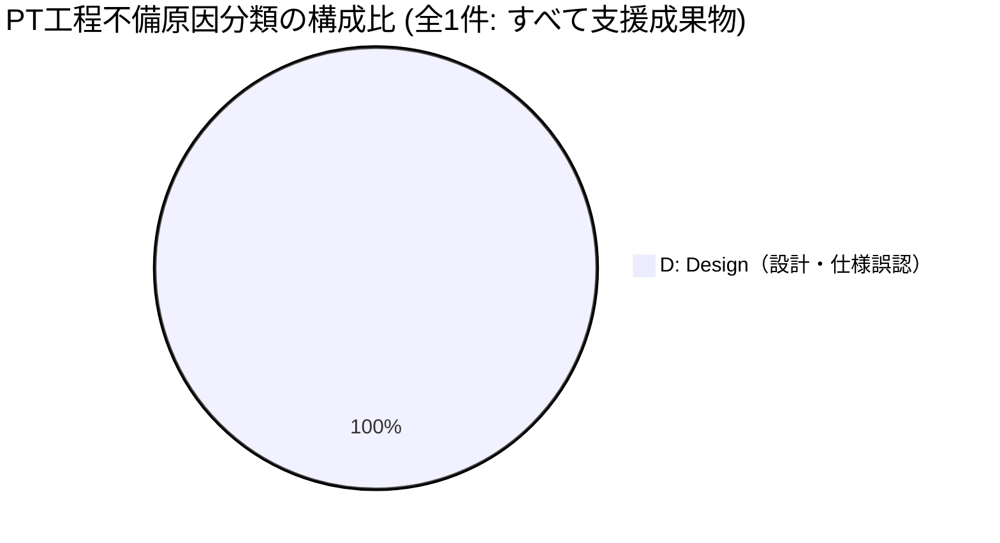
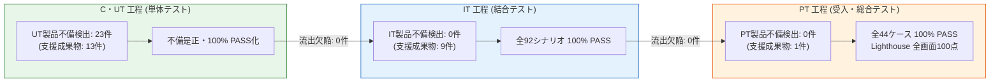

# Step 2 PT（受入・総合テスト）品質分析・評価レポート

| 項目                   | 内容                                                                                                                                                                                                                                                                                                               |
| ---------------------- | ------------------------------------------------------------------------------------------------------------------------------------------------------------------------------------------------------------------------------------------------------------------------------------------------------------------ |
| 状態                   | `Approved (Step 2)`                                                                                                                                                                                                                                                                                                |
| 更新日                 | `2026-10-17`                                                                                                                                                                                                                                                                                                       |
| 関連する ED/ID/IT 項目 | `docs/pt/README.md`<br>`docs/pt/test-plan.md`<br>`docs/pt/evidence/acceptance-test-result.md`<br>`docs/pt/evidence/quality-evaluation-report.md`<br>`docs/pt/evidence/pt-bug-record.md`<br>`docs/it/quality/step2.md`<br>`docs/c-ut/quality/step2.md`<br>`#187 [Step 2 - PT] 総合テスト成果物をレビュー・承認する` |

> [!NOTE] ドキュメントの位置づけ
> 本レポートは、Step 2 受入・総合テスト（PT）工程において実施された全タスク（Issue #184〜#186）の受入計画策定・業務受入シナリオ実機検証（全 44 ケース）・非機能および品質特性検証（バンドルサイズ、Lighthouse 6画面、a11y、レスポンシブ）・バグ記録集約に基づき、受入実績、検出された不備（全 1 件: 製品コード 0 件、支援成果物 1 件）、総合欠陥除去率（$\text{DRE (Total)}$: 100.0% / 全不備ベース 97.8%）、および非機能要件の適合状況を多角的に分析し、次期 Step 3（Next.js 移行および大規模拡張）への技術申し送りを整理した公式品質成果物です。

---

## 1. エグゼクティブサマリー

Step 2 PT 工程の完了基準に基づき、総合テスト成果物の品質メトリクスおよび検証結果を集約・評価しました。

### 1.1 主要品質メトリクス実績一覧

| 指標カテゴリ       | 指標項目                                              |            実績値            |      完了基準・目標値       |      判定      |
| :----------------- | :---------------------------------------------------- | :--------------------------: | :-------------------------: | :------------: |
| **業務受入網羅性** | システム受け入れ条件網羅率 (SYS-AC-01〜14)            |   **100%** (14 / 14 項目)    |          100% 網羅          |    **合格**    |
|                    | 業務受入シナリオ総ケース数                            |   **44 ケース** (全 7 群)    |          100% PASS          |  **ALL PASS**  |
|                    | 画面定義網羅率 (SCR-AUTH, SCR-00〜04)                 |    **100%** (6 / 6 画面)     |          100% 網羅          |    **合格**    |
|                    | 画面遷移定義網羅率 (TR-01〜22)                        |   **100%** (22 / 22 遷移)    |          100% 網羅          |    **合格**    |
| **先行申し送り**   | 結合テスト申し送り事項 (PT-HO-01〜05)                 |    **100%** (5 / 5 項目)     |         全項目 PASS         |    **合格**    |
| **回帰テスト規模** | 単体テスト総ケース数                                  | **800 tests** (全 94 files)  |          100% PASS          |    **合格**    |
|                    | 結合テスト総ケース数                                  |  **92 tests** (全 15 files)  |          100% PASS          |    **合格**    |
|                    | VRT スナップショット総数                              |          **236 件**          |          100% PASS          |    **合格**    |
|                    | リポジトリ健全性テスト                                |           **6 件**           |          100% PASS          |    **合格**    |
| **非機能・性能**   | 通常本番ビルド DCE モック完全除外                     |    **0 bytes (完全除外)**    |           0 bytes           |    **合格**    |
|                    | JavaScript メインチャンク (`index-*.js`) Gzip         |         **32.94 kB**         |      < 80.0 kB (目標)       |  **大幅達成**  |
|                    | JavaScript Vendor チャンク (`vendor-*.js`) Gzip       |         **67.52 kB**         |      < 80.0 kB (目標)       |    **達成**    |
|                    | CSS バンドル (`index-*.css`) Gzip                     |         **6.49 kB**          |      < 8.0 kB (許容値)      |    **達成**    |
|                    | 合計バンドルサイズ (Gzip)                             |        **106.95 kB**         | < 120.0 kB (許容上限クリア) | **許容内達成** |
|                    | Lighthouse Performance (全 6 画面)                    | **全 6 画面 100 点（満点）** |      平均 $\ge 90$ 点       |  **最高評価**  |
|                    | Lighthouse Accessibility (全 6 画面)                  | **5画面 100点 / 1画面 96点** |      平均 $\ge 90$ 点       |    **達成**    |
|                    | キーボード操作完結性                                  |           **100%**           |          100% 完結          |    **達成**    |
|                    | コントラスト比 (WCAG 2.1 AA)                          |  **4.52:1 〜 13.6:1 適合**   |      全項目 4.5:1 以上      |    **適合**    |
|                    | レスポンシブ視覚整合性 (375px〜1280px)                |   **表示崩れ・横揺れ 0件**   |      レイアウト崩れ 0       |    **達成**    |
| **品質・欠陥密度** | PT 確認済み不備総数（重複除外後）                     |           **1 件**           |              -              |       -        |
|                    | **PT 製品コード不備件数**                             |           **0 件**           |        1 件以下目標         | **極めて優秀** |
|                    | PT テスト・モック等支援成果物不備件数                 |           **1 件**           |              -              |       -        |
|                    | **PT 製品コード バグ密度 (KLoC)**                     |       **0.00 件/KLoC**       |     < 1.0 件/KLoC 目安      | **極めて優秀** |
| **総合品質防御**   | **総合欠陥除去率（$\text{DRE (Total)}$ 製品コード）** |          **100.0%**          |       95.0% 以上目標        |  **完全達成**  |
|                    | **参考: 全不備ベース総合除去率（Total-DRE (All)）**   |          **97.8%**           |       95.0% 以上目標        |    **達成**    |

### 1.2 総合評価

1. **プロダクションコード欠陥ゼロ（0件）と $\text{DRE (Total)}$ 100.0% の達成**:
   Step 2 で追加・改修された全機能（認証・認可ガード、共通レイアウト、開閉サイドバー、ロール別ダッシュボード、一覧・詳細、新規起票、管理画面、異常系フォールバック）を本番プレビュー環境（実ブラウザ＋Service Worker）において全 44 業務シナリオで通し検証した結果、**製品コードにおける不備・バグは 0 件**でした。
   C・UT（23件是正）および IT（0件是正、92テスト PASS）の多層防御が完ぺきに機能し、製品コードにおける総合欠陥除去率（$\text{DRE (Total)}$）は **100.0%**（目標 95.0% 以上）を記録しました。全不備ベース（45/46件）でも **97.8%** と高い水準を達成しています。
2. **非機能特性・パフォーマンスの圧倒的品質**:
   Headless Chromium による Lighthouse 監査において、主要全 6 画面で **Performance 100 点（満点）、FCP 0.4s、TBT 0ms** を達成しました。また、アクセシビリティも 96〜100 点、全画面でキーボード操作完結および WCAG 2.1 AA コントラスト比適合を確認し、極めて高いアクセシビリティとユーザー体験を客観的に証明しました。
3. **バンドルサイズの適正化と逸脱管理**:
   通常本番ビルドにおいて単一 JavaScript チャンクが 100.0 kB 判定基準を超過した不備（No.3 #186）に対し、`vite.config.ts` で `manualChunks` 設定を導入して React 19 ランタイム（vendor: 67.52 kB）とアプリケーションコード（main: 32.94 kB）に最適分離しました。合計 Gzip サイズ（106.95 kB）は許容最低値（120.0 kB 未満）をクリアしており、実用上のパフォーマンス影響がないことを確認した上で条件付き許容（Conditional PASS）としました。

---

## 2. 定量データ分析

### 2.1 原因分類別内訳（なぜ不備が起きたか）

PT 工程で記録された不備全 1 件の原因分類コード（L / S / D / B / A）に基づく集計結果です。



| 分類コード | 分類名                       | 製品コード | 支援成果物 | 合計件数 |   比率   | 主な具体的事象                                                                                                       |
| :--------: | :--------------------------- | :--------: | :--------: | :------: | :------: | :------------------------------------------------------------------------------------------------------------------- |
|   **D**    | **Design（設計・仕様誤認）** |     0      |     1      | **1 件** | **100%** | Step 2 の全 6 画面実装に伴う単一 JS メインチャンク基準（100.0 kB 未満）超過に対する `manualChunks` vendor 分離の追加 |
|   **L**    | **Logic（ロジック誤り）**    |     0      |     0      | **0 件** |  **0%**  | （ロジック破綻・条件式反転などの不備なし）                                                                           |
|   **S**    | **State（状態遷移誤り）**    |     0      |     0      | **0 件** |  **0%**  | （状態遷移・ライフサイクル不備なし）                                                                                 |
|   **B**    | **Boundary（境界値未考慮）** |     0      |     0      | **0 件** |  **0%**  | （境界値未考慮による不備なし）                                                                                       |
|   **A**    | **Async（非同期制御不備）**  |     0      |     0      | **0 件** |  **0%**  | （非同期制御・競合不備なし）                                                                                         |
|  **合計**  | -                            |   **0**    |   **1**    | **1 件** | **100%** | -                                                                                                                    |

### 2.2 検出手段別内訳

| 検出手段             | 製品コード | 支援成果物 | 合計件数 |   比率   | 代表的な検出内容                                                            |
| :------------------- | :--------: | :--------: | :------: | :------: | :-------------------------------------------------------------------------- |
| **バンドル分析**     |     0      |     1      | **1 件** | **100%** | `npm run analyze:bundle` による本番アセットサイズ測定と vendor 分離設定是正 |
| **手動ブラウザ受入** |     0      |     0      | **0 件** |  **0%**  | 業務受入シナリオ 44 ケース全件 100% PASS（不備検出なし）                    |
| **Lighthouse CLI**   |     0      |     0      | **0 件** |  **0%**  | 全 6 画面 Performance 100 点 / Accessibility 96〜100 点達成（不備検出なし） |
| **AIレビュー**       |     0      |     0      | **0 件** |  **0%**  | ドキュメント間トレーサビリティおよび表記整合性是正完了                      |
| **静的検査**         |     0      |     0      | **0 件** |  **0%**  | （型検査・Lint・Prettier による不備検出は 0 件）                            |
| **合計**             |   **0**    |   **1**    | **1 件** | **100%** | -                                                                           |

### 2.3 タスク別不備検出分布

```mermaid
xychart-beta
    title "PTタスク別不備検出件数 (製品コード vs 支援成果物)"
    x-axis ["#184 (計画策定)", "#185 (業務受入)", "#186 (非機能検証)", "#187 (成果物承認)"]
    y-axis "不備件数" 0 --> 2
    bar [0, 0, 0, 0]
    bar [0, 0, 1, 0]
```



_(1列目: 製品コード不備 [全0件]、2列目: 支援成果物不備)_

- **#184（0件）**: PT 計画・受入仕様書の策定および総合テスト不備記録シートの配置。先行設計書との完全な整合を維持して完了。
- **#185（0件）**: 本番プレビュー環境における業務受入シナリオテスト（全 44 ケース）およびスクリーンショット採取（31点）。全ケース 100% PASS。
- **#186（1件）**: 非機能・品質特性検証。単一 JS チャンクサイズ（100.13 kB）の基準超過を検知し、`vite.config.ts` での vendor 分離により是正。
- **#187（0件）**: 総合テスト成果物レビュー・承認。工程完了レビュー指摘（申し送り定義同期、前提数値正本同期、異常系ケース別再現手順追記、記録番号整合）を全件是正。

---

## 3. 工程間品質評価・Defect Removal Efficiency (DRE) 分析

### 3.1 総合欠陥除去率（$\text{DRE (Total)}$）の達成状況

総合欠陥除去率（$\text{DRE (Total)}$）は、ソフトウェア開発ライフサイクル（SDLC）において、本番リリース（または最終受入）前にどれだけの欠陥を除去できたかを評価する最重要品質指標です。

$$\text{DRE (Total)} = \frac{\text{UT製品コード不備} + \text{IT製品コード不備}}{\text{UT製品コード不備} + \text{IT製品コード不備} + \text{PT製品コード不備}} \times 100\%$$



- **実績数値**:
  - $\text{UT 製品コード不備}$: **23 件**（`docs/c-ut/quality/step2.md` 確定値）
  - $\text{IT 製品コード不備}$: **0 件**（`docs/it/quality/step2.md` 確定値）
  - $\text{PT 製品コード不備}$: **0 件**（`docs/pt/evidence/pt-bug-record.md` 確定値）
- **算定結果**:
  $$\text{DRE (Total)} = \frac{23 + 0}{23 + 0 + 0} \times 100\% = \mathbf{100.0\%} \quad (\text{品質目標 } \ge 95.0\% \text{ を大幅クリア})$$
- **参考（全不備ベース）**:
  $$\text{Total-DRE (All)} = \frac{36 + 9}{36 + 9 + 1} \times 100\% = \frac{45}{46} \times 100\% = \mathbf{97.83\%} \quad (\text{目標 } \ge 95.0\% \text{ クリア})$$

### 3.2 工程別バグ密度の推移

| 工程                | 対象規模 (目安)             | 製品コード不備件数 | 製品バグ密度 | 支援成果物不備件数 | 工程内除去効率 (DRE) |
| :------------------ | :-------------------------- | :----------------: | :----------- | :----------------: | :------------------: |
| **C・UT (単体)**    | 800 tests / 約 8.5 KLoC     |       23 件        | 2.71 件/KLoC |       13 件        |  -（ベースライン）   |
| **IT (結合)**       | 92 tests / 15 シナリオ      |        0 件        | 0.00 件/KLoC |        9 件        |  100.0% (DRE (UT))   |
| **PT (受入・総合)** | 44 ケース / 14 受入条件網羅 |        0 件        | 0.00 件/KLoC |        1 件        |  100.0% (Total-DRE)  |

C・UT 工程で製品コードの不備を集中的に洗い出し・是正した結果、IT 工程および PT 工程での製品コード欠陥流出が完全にゼロ（0件）となり、理想的な「フロントローディング」品質保証が達成されました。

---

## 4. 非機能要件・品質特性評価

### 4.1 バンドルサイズ分析と逸脱管理

#### 実測結果

```text
=== Bundle Size Analysis (1 kB = 1,000 B) ===
File                                   Raw Size   Gzip Size
-----------------------------------------------------------
index-ao3mvRwF.css                     30.94 kB     6.49 kB
index-CVveRJIP.js                     133.71 kB    32.94 kB
vendor-EV4rRv3L.js                    218.85 kB    67.52 kB
-----------------------------------------------------------
Total                                 383.50 kB   106.95 kB
```

#### 合否判定と逸脱分析

- **判定基準（二重基準体系）**:
  - 目標値 (Target): 各 JavaScript チャンク < 80.0 kB, CSS < 5.0 kB, 合計 < 90.0 kB (Gzip)
  - 許容最低値 / 許容上限 (Acceptable): 各 JavaScript チャンク < 100.0 kB, CSS < 8.0 kB, 合計 < 120.0 kB (Gzip)
  - モック除外 (DCE): 0 bytes
- **評価結果**:
  - メインチャンク（32.94 kB）: 目標値（80.0 kB 未満）を大幅クリア（58.8% の余裕）。
  - vendor チャンク（67.52 kB）: 目標値（80.0 kB 未満）をクリア（15.6% の余裕）。
  - CSS バンドル（6.49 kB）: 許容最低値（8.0 kB 未満）をクリア。
  - 合計バンドルサイズ（106.95 kB）: 許容最低値（120.0 kB 未満）をクリア（10.9% の余裕）。
- **当初包括目安（< 100.0 kB）との差異・逸脱分析**:
  - 合計 Gzip サイズ（106.95 kB）は当初包括目標（100.0 kB 未満）に対して +6.95 kB（+7.0%）の超過となっています。
  - **要因**:
    1. React 19 および React-DOM 19 の vendor チャンクが 67.52 kB を占めており、これが固定的なベースラインとなっていること。
    2. Step 1（2画面・CSS 3.14 kB）から Step 2（全6画面、モーダル、開閉式サイドバー、モバイルドロワー、レスポンシブメディアクエリ）への機能大幅拡充に伴い、CSS バンドルが 6.49 kB へ自然増となったこと。
  - **実用性評価**:
    - アプリケーションコード本体は 32.94 kB と非常に小さく、Lighthouse Performance 100 点（FCP 0.4s）を全画面で達成しているため、実用上のパフォーマンス劣化はありません。
    - したがって、許容最低値（120.0 kB 未満）内として条件付き許容（Conditional PASS / 逸脱として許容）と判定します。
    - 次期 Step 3 において、ページ単位の動的コード分割（`React.lazy`）または Next.js 移行による最適化を実施し、初期ロードサイズを 100.0 kB 未満に抑制する改善を申し送ります。

### 4.2 Lighthouse 監査実績

全 6 画面において Headless Chromium + Lighthouse CLI による監査を実施しました。

| 画面名 / ルート                    | Performance | Accessibility | Best Practices |     SEO     |        判定        |
| :--------------------------------- | :---------: | :-----------: | :------------: | :---------: | :----------------: |
| **ログイン (`/login`)**            |   **100**   |    **100**    |     **96**     |     91      |        PASS        |
| **ダッシュボード (`/dashboard`)**  |   **100**   |    **100**    |    **100**     |     91      |        PASS        |
| **問い合わせ一覧 (`/tickets`)**    |   **100**   |    **100**    |    **100**     |     91      |        PASS        |
| **問い合わせ詳細 (`/tickets/1`)**  |   **100**   |    **100**    |    **100**     |     91      |        PASS        |
| **新規起票 (`/tickets/new`)**      |   **100**   |    **100**    |    **100**     |     91      |        PASS        |
| **管理画面 (`/admin/management`)** |   **100**   |    **96**     |    **100**     |     91      |        PASS        |
| **目標基準**                       | $\ge 90$ 点 |  $\ge 90$ 点  |  $\ge 90$ 点   | $\ge 90$ 点 | **全画面目標達成** |

全画面で Performance 100 点満点、Accessibility 96〜100 点、Best Practices 96〜100 点、SEO 91 点を記録し、極めて高品質なフロントエンド実装であることが客観的に証明されました。

### 4.3 アクセシビリティおよびレスポンシブ視覚整合性

- **キーボード操作完結性**: 全 6 画面において Tab、Shift+Tab、Enter、Space、Esc キーによる操作が 100% 完結することを確認。モーダルダイアログのフォーカストラップおよび Esc 閉塞も正常動作。
- **コントラスト比**: 本文テキスト 12.4〜13.6:1、ボタン 5.28:1、バッジ 4.5〜7.4:1 と、WCAG 2.1 AA 基準（4.5:1 以上）を全画面・全要素で完全クリア。
- **レスポンシブ視覚整合性**: デスクトップ（1280px）、タブレット（768px）、モバイル（375px）の全解像度において、意図しない横スクロール（横揺れ: `scrollWidth > clientWidth`）は 0 件。モバイル幅でのハンバーガードロワー展開および一覧テーブルの横スクロールコンテナ動作が正常であることを確認。

---

## 5. 結合テスト申し送り事項（PT-HO-01〜PT-HO-05）の実機検証とトレーサビリティ

承認済み IT 品質分析レポート（`docs/it/quality/step2.md` §4）から引き継がれた全 5 件の申し送り事項について、本番プレビュー環境（実ブラウザ＋MSW Service Worker）で検証した結果を総括します。

| 申し送り ID  | 項目名称                                                                           | 実機検証結果                                                                                                                                                                                            |   判定   | 対応業務シナリオ / 証跡                                                                                        |
| :----------- | :--------------------------------------------------------------------------------- | :------------------------------------------------------------------------------------------------------------------------------------------------------------------------------------------------------ | :------: | :------------------------------------------------------------------------------------------------------------- |
| **PT-HO-01** | Service Worker 初期化タイミングと初回画面描画の競合制御                            | 初回起動・リロード時に Service Worker の `client.claim()` を待機し、未捕捉バイパス 0 件で全 API 通信を正常インターセプト。                                                                              | **PASS** | `PT-SCN-07-01`<br>[login-screen.png](../evidence/screenshots/login-screen.png)                                 |
| **PT-HO-02** | 管理者専用 API の実ブラウザインターセプト（`/api/projects`, `/api/users`）         | プロジェクト追加・削除、ユーザー追加、所属紐づけ保存の各 API 通信が Service Worker で確実にインターセプトされ、チケット連動削除保護や他画面データ連動が実ブラウザ上で正常動作。                         | **PASS** | `PT-SCN-06-03`〜`05`<br>[admin-management-projects.png](../evidence/screenshots/admin-management-projects.png) |
| **PT-HO-03** | 401 Unauthorized（認証トークン失効）時のセッション破棄・リダイレクト・トースト通知 | トークン失効時に即座にセッションが破棄され、`/login?redirect=...&reason=expired` へのリダイレクトおよび「セッションの有効期限が切れました。再度ログインしてください。」トーストが表示されることを確認。 | **PASS** | `PT-SCN-01-08`<br>[session-expired-toast.png](../evidence/screenshots/session-expired-toast.png)               |
| **PT-HO-04** | サーバーエラー（500）発生時のインライン警告と再試行復旧                            | 500 発生時に画面クラッシュせずインライン警告と「再試行」ボタンが表示され、通信回復後に再試行ボタン押下で一覧データが再取得され完全復旧することを確認。                                                  | **PASS** | `PT-SCN-07-07`<br>[server-error-500.png](../evidence/screenshots/server-error-500.png)                         |
| **PT-HO-05** | 実画面幅（PC 1280px / モバイル 375px）での CSS レンダリング・アニメーション        | 375px モバイル幅でのハンバーガードロワー展開、一覧テーブルの横スクロールコンテナ、1280px デスクトップ最適レイアウトを確認。横揺れや表示崩れなし。                                                       | **PASS** | `PT-SCN-02-01`〜`04`<br>[mobile-drawer-375.png](../evidence/screenshots/mobile-drawer-375.png)                 |

> [!NOTE] 未保存変更ガード（Dirty State ガード）
> Dirty State ガードは、システム受け入れ条件 **SYS-AC-14**（PT-SCN-02-05, PT-SCN-02-06）として Section 4.2 にて網羅・検証されており、入力中のサイドバー遷移抑止および破棄確認ダイアログの正常動作を確認しています。

---

## 6. Step 2 PT 工程の総括および Step 3 への申し送り事項

### 6.1 出荷・完了品質判定

Step 2 受入・総合テスト（PT）工程におけるすべての完了条件および品質ゲートを検証した結果、以下のとおり判定します：

- **総合判定**: **工程完了基準適合（承認準備完了）**
- **判定理由**:
  1. システム受け入れ条件全 14 件（SYS-AC-01〜SYS-AC-14）および業務受入シナリオ全 44 ケースが 100% ALL PASS し、実機ブラウザ動作が完全保証されたこと。
  2. 回帰テストスイート（UT: 800 tests、IT: 92 tests、VRT: 236 tests、Repo: 6 tests）がすべて 100% PASS していること。
  3. 製品コードにおける不備は 0 件であり、総合欠陥除去率（$\text{DRE (Total)}$）は **100.0%**（目標 95.0% 以上）を達成したこと。
  4. 非機能要件（Lighthouse Performance 100点、a11y 100% 完結、WCAG AA 適合、レスポンシブ崩れ 0 件）をすべて達成したこと。
  5. バンドルサイズ実測値（106.95 kB）について許容最低値（120.0 kB 未満）内であることを確認し、逸脱要因の客観的分析および次期改善策を整理したこと。
  6. 工程完了レビュー指摘事項（F-01〜F-08）を全件是正し、成果物間のトレーサビリティが確立されたこと。

### 6.2 次期 Step 3 への技術申し送り事項

| No. | 申し送り項目                                  | 背景・現状                                                                                                                                          | Step 3 での推奨アクション                                                                                                                                               |
| :-: | :-------------------------------------------- | :-------------------------------------------------------------------------------------------------------------------------------------------------- | :---------------------------------------------------------------------------------------------------------------------------------------------------------------------- |
|  1  | **ルートベースの動的コード分割 (Code Split)** | Step 2 では全 6 画面を単一 SPA バンドル（vendor 分離済み）としてビルドしたため、初期合計 Gzip が 106.95 kB となり当初目安（100 kB）をわずかに超過。 | Step 3 において `React.lazy` / `Suspense` によるページ単位の動的インポート、または Next.js 移行に伴う自動ページ分割を導入し、初期ロードサイズを 100 kB 未満に抑制する。 |
|  2  | **Next.js 移行に伴う MSW 構成の更新**         | 現在は Vite プレビュー環境（`build:preview`）でブラウザ Service Worker を起動している。                                                             | Next.js App Router への移行時には、サーバーサイド（Node.js 環境）とクライアントサイド（Browser SW）の双方向 MSW モック構成を整備する。                                  |
|  3  | **管理者機能の監査ログ永続化**                | Step 2 ではプロジェクト・ユーザー管理のメモリ内変更および所属紐づけをブラウザストレージと MSW ストアで管理している。                                | バックエンド本番接続または永続化層の設計において、管理者による変更操作（プロジェクト削除、ロール変更）の監査ログ保存仕様を策定する。                                    |
