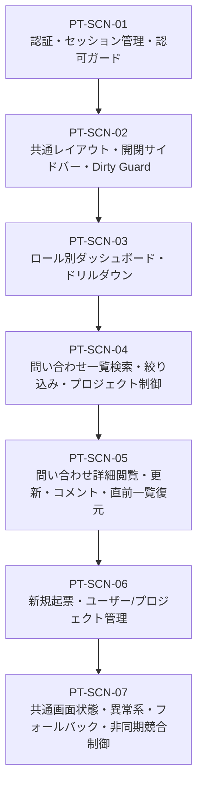

# Step 2 PT 計画・受入仕様書（総合テスト・受入テスト計画書）

| 項目                   | 内容                                                                                                                                                                                                                                                                                                                                                                                                                                                                                                                                |
| ---------------------- | ----------------------------------------------------------------------------------------------------------------------------------------------------------------------------------------------------------------------------------------------------------------------------------------------------------------------------------------------------------------------------------------------------------------------------------------------------------------------------------------------------------------------------------- |
| 状態                   | `Approved (Step 2)`                                                                                                                                                                                                                                                                                                                                                                                                                                                                                                                 |
| 更新日                 | `2026-10-17`                                                                                                                                                                                                                                                                                                                                                                                                                                                                                                                        |
| 関連する ED/ID/IT 項目 | `docs/rd/step2.md`<br>`docs/ed/01-system-overview.md#5-システム全体の受け入れ条件`<br>`docs/ed/02-screen-list.md`<br>`docs/ed/03-screen-transition.md`<br>`docs/ed/screens/`<br>`docs/id/01-frontend-architecture.md`<br>`docs/id/screens/`<br>`docs/it/README.md`<br>`docs/it/test-scenario.md`<br>`docs/it/quality/step2.md#4-pt受入総合テスト工程への申し送り事項`<br>`docs/pt/README.md`<br>`docs/pt/tech-verification.md`<br>`docs/pt/evidence/pt-bug-record.md`<br>`.github/skills/waterfall-github-task-management/SKILL.md` |

このドキュメントでは、社内問い合わせ・チケット管理システム（Step 2）の総合テスト・受入テスト（PT）工程における全体テスト計画、実行環境・検証ツール構成、全 14 件のシステム受け入れ条件（SYS-AC-01〜SYS-AC-14）および全 6 画面（SCR-AUTH, SCR-00〜04）を網羅する業務受入シナリオ詳細仕様、非機能・品質特性（パフォーマンス、Lighthouse、バンドルサイズ、アクセシビリティ、レスポンシブ）の合否判定基準（閾値）、トレーサビリティ、エビデンス管理方針、および後続実施タスク（Issue #185, #186, #187）への作業割り当てを定義します。

---

## 1. 総合テスト・受入テスト（PT）の目的と基本方針

### 1.1 目的

先行する C・UT（単体テスト: 94 files / 800 tests 100% PASS、ラインカバレッジ 90.65%）および IT（結合テスト: 15 files / 92 tests 100% PASS）により、個別コンポーネントおよび画面間・API連携の機能ロジックが仕様通り動作することは機械的に検証済みです。

本 PT（総合テスト・受入テスト）工程では、本番相当環境（受入プレビュー環境 `npm run build:preview` + `npm run preview`）および実ブラウザ環境において、社内利用者の視点に立ち以下の事項を総合的に確認・評価し、Step 2 プロジェクト全体の完了およびリリース可否の判断材料とすることを目的とします。

1. **システム受け入れ条件（SYS-AC-01〜SYS-AC-14）の適合性検証**:
   - 外部設計書（`docs/ed/01-system-overview.md` §5.1）に定義された全 14 件のシステム受け入れ条件、および全 6 画面（SCR-AUTH, SCR-00〜04）の画面受け入れ条件を網羅する一連の業務フローが、実ブラウザ上で円滑に操作・完結できること。
2. **ロール別アクセス制御（RBAC）と職務分掌（SoD）の業務通しシナリオ検証**:
   - 一般ユーザー（自プロジェクト限定、起票・対応・更新・コメント）および管理者ユーザー（全社横断閲覧・監査、ユーザー/プロジェクト管理、詳細閲覧専用）の職務分掌に基づき、各ロールの業務フローが一貫して遂行できること。
3. **非機能要件・品質特性の合否判定基準適合性検証**:
   - 本番クリーンビルド成果物のアセット品質（gzip < 100 kB、Dead Code Elimination によるモックコード完全除外）、主要 6 画面の Lighthouse 監査（全スコア $\ge 90$ 目標）、アクセシビリティ（キーボード操作性・フォーカス可視性・コントラスト比）、およびレスポンシブ視覚整合性（PC 1280px / タブレット 768px / モバイル 375px）が判定基準を満たすこと。
4. **結合テスト（IT）申し送り事項（PT-HO-01〜PT-HO-05）の実機検証**:
   - JSDOM 環境では原理的に検証が完結しなかったブラウザ実環境固有の動作（Service Worker 初期化競合、管理者専用 API インターセプト、401 トークン失効時のセッション破棄・リダイレクト・トースト通知、500 エラー時のインライン警告と再試行復旧、実画面幅でのアニメーション・CSS レンダリング）を実機で完全に検証・合否判定すること。
5. **不備記録の継続と総合欠陥除去率（Total-DRE）による品質評価**:
   - C・UT / IT 工程で確立された不備記録標準（スリム化必須6項目）を継承し、AI 作業中に確認された不備を製品コードと支援成果物に分離して記録する。工程完了時には総合欠陥除去率（$\text{DRE (Total)}$、目標 95% 以上）を算定し、品質分析・評価レポート（`docs/pt/quality/step2.md`）を作成すること。

### 1.2 基本方針

技術検証報告書（`docs/pt/tech-verification.md`）および PT 工程計画書（`docs/pt/README.md`）に基づき、以下の基本方針を採用します。

1. **ハイブリッド受入構成の徹底（案 C の採用）**:
   - 回帰テストおよび詳細な機能分岐・非同期競合制御は、CI 上で稼働する UT（800 tests）、IT（92 tests）、VRT（236 tests）で機械的に 100% 保証します。
   - PT 工程では、過剰な E2E 自動化コードの重複実装を避け（YAGNI 原則）、**実ブラウザでの業務受入チェック**に集中し、視覚的なレイアウト整合性、操作感、およびユーザー体験を人間視点で総合確認します。
2. **本番クリーンビルドによるアセット品質保証**:
   - 通常の本番ビルド（`npm run build`）においてモックコードを完全除外（Dead Code Elimination: DCE）し、実バックエンド接続を想定したクリーンな本番バンドルサイズ（gzip < 100 kB）を主たるフロントエンド品質の判定根拠とします。
3. **受入プレビュー環境（`mode: preview`）による実ブラウザ受入の実施**:
   - 受入テストの実施には、先行技術検証で確立したプレビュー用ビルド（`npm run build:preview` + `npm run preview`）を使用し、実ブラウザ上で Service Worker によるモック API インターセプトを介した受入シナリオを実施します。
4. **DevContainer 環境制約に配慮した品質測定（Headless Chromium + Lighthouse CLI 方式）**:
   - ホスト側実ブラウザの開発者ツールを用いた手動計測に加え、DevContainer 環境内での監査自動化・完全な実行再現性担保および客観的レポート生成（HTML/JSON）のため、**Headless Chromium + Lighthouse CLI 方式**を公式な測定方式として採用します。
5. **合否判定基準の厳格な適用と人による承認**:
   - 非機能要件の閾値（バンドルサイズ、Lighthouse スコア、アクセシビリティ基準）に対する合否判定を行い、すべての結果をエビデンスとして記録した上で、最終的な完了・承認判定（Issue #187）は人間レビュアーが行います。AI は人に代わって承認・クローズしません。

### 1.3 前Step開発範囲の包含・進化とシステム全体受入保証方針（PT標準）

本プロジェクトにおける受入・総合テスト（PT）は、Step 2 で新規追加された機能のみを局所的に確認するのではなく、**Step 1 から継承された全機能（一覧表示、詳細閲覧、検索・絞り込み、ステータス/担当者更新、コメント追加、ブラウザバック復元）を Step 2 のアーキテクチャ（認証必須化、RBAC、プロジェクト制、開閉サイドバー、Dirty Guard）に合わせて包含・進化させたシステム全体の統合業務受入** として実施します。

#### システム全体受入シナリオの体系と包含・進化関係

| 受入条件 ID   | 対象機能 / シナリオ                                       | 位置づけ（Step 1 からの包含・進化内容）                                                                                                                                                                                                              | 担当個別タスク |
| :------------ | :-------------------------------------------------------- | :--------------------------------------------------------------------------------------------------------------------------------------------------------------------------------------------------------------------------------------------------- | :------------: |
| **SYS-AC-01** | **問い合わせ一覧の検索・絞り込み・表示制御**              | **【Step 1 範囲の包含・進化】**<br>・_Step 1_: 全件一覧、ステータス/担当者/キーワード絞り込み、ソート、ページング<br>・_Step 2 進化_: 認証前提化、テーブル「プロジェクト」列追加、一般は自プロジェクト限定、管理者は全社横断＋プロジェクトフィルター |      #185      |
| **SYS-AC-02** | **問い合わせ詳細およびコメント履歴の閲覧**                | **【Step 1 範囲の包含・進化】**<br>・_Step 1_: チケット基本情報表示、時系列コメント履歴、一覧復帰<br>・_Step 2 進化_: 認証前提化、プロジェクト情報表示、権限別レイアウト適用                                                                         |      #185      |
| **SYS-AC-03** | **問い合わせステータスおよび担当者の更新**                | **【Step 1 範囲の包含・進化】**<br>・_Step 1_: セレクター変更、更新保存、即時反映<br>・_Step 2 進化_: 一般ユーザーは更新可能、管理者ユーザーは**閲覧専用（Read-only / フォーム非表示）**                                                             |      #185      |
| **SYS-AC-04** | **問い合わせへの新規コメント追加**                        | **【Step 1 範囲の包含・進化】**<br>・_Step 1_: コメント入力、送信、即時追加、投稿者名<br>・_Step 2 進化_: 一般ユーザーはコメント投稿可能（ログイン中ユーザー名自動設定）、管理者ユーザーは**閲覧専用（Read-only / フォーム非表示）**                 |      #185      |
| **SYS-AC-05** | **共通画面状態およびフィードバックの提示**                | **【Step 1 範囲の包含・進化】**<br>・_Step 1_: ローディング、0件空状態、バリデーションエラー、API 500 エラー表示と再試行<br>・_Step 2 進化_: 全 6 画面共通適用、403 Forbidden、404 Not Found、401 トースト通知                                       |      #185      |
| **SYS-AC-06** | **チケット未存在・不正アクセス時の適切なハンドリング**    | **【Step 1 範囲の包含・進化】**<br>・_Step 1_: 存在しない ID へのアクセス時 404 エラー表示と安全な復帰導線<br>・_Step 2 進化_: 認証状態・サイドバーを維持した一貫したエラーハンドリング                                                              |      #185      |
| **SYS-AC-07** | **OpenAPI 契約（SSOT）への完全準拠**                      | **【Step 1 範囲の包含・進化】**<br>・_Step 1_: 一覧・詳細・更新・コメント API の OpenAPI 準拠<br>・_Step 2 進化_: 認証・プロジェクト・ユーザー・起票 API を含む全 10 エンドポイント準拠                                                              |      #185      |
| **SYS-AC-08** | **ユーザー認証およびセッション管理**                      | **【Step 2 新機能】** ログイン認証、ロール判定、`localStorage` によるセッション保持・復元、ログアウト時のセッション破棄                                                                                                                              |      #185      |
| **SYS-AC-09** | **未認証アクセス制御および権限制御（Auth / Role Guard）** | **【Step 2 新機能】** 未認証時のログイン画面強制リダイレクト、元 URL 復帰、一般ユーザーの管理画面 403 遮断、管理者の起票画面 403 遮断                                                                                                                |      #185      |
| **SYS-AC-10** | **開閉式サイドバーナビゲーションおよびレイアウト制御**    | **【Step 2 新機能】** 展開（240px）/折りたたみ（60px）切り替え、開閉状態の永続化・復元、ロール別「3つの枠」表示、モバイル 375px ドロワー                                                                                                             |      #185      |
| **SYS-AC-11** | **ダッシュボード画面のロール別表示制御**                  | **【Step 2 新機能】** 一般ユーザー（自プロジェクトサマリー・担当チケット一覧）、管理者ユーザー（全社横断総チケット・稼働サマリー・アラート）                                                                                                         |      #185      |
| **SYS-AC-12** | **問い合わせ新規起票機能**                                | **【Step 2 新機能】** 一般専用、タイトル・本文・プロジェクト・担当者入力、バリデーション、登録後自動遷移、二重送信防止                                                                                                                               |      #185      |
| **SYS-AC-13** | **ユーザーおよびプロジェクト管理機能**                    | **【Step 2 新機能】** 管理者専用、プロジェクト追加/削除、ユーザー追加/削除、所属プロジェクト紐づけ設定、他画面への即時反映                                                                                                                           |      #185      |
| **SYS-AC-14** | **画面離脱防止（Dirty State ガード）**                    | **【Step 2 新機能】** 起票・詳細フォーム入力中の未保存変更検知、サイドバー遷移・ブラウザ戻る操作時の破棄確認ダイアログ                                                                                                                               |      #185      |

---

## 2. テスト実行環境・検証手法およびツール構成

### 2.1 採用テスト実行環境

| 環境種別                   | 起動コマンド            | アクセス URL             | 役割・目的                                                                                   |
| :------------------------- | :---------------------- | :----------------------- | :------------------------------------------------------------------------------------------- |
| **受入プレビュー実行環境** | `npm run preview`       | `http://localhost:4173/` | 業務受入シナリオテスト（SYS-AC-01〜14）および実ブラウザでの Lighthouse / a11y 測定を実行する |
| **本番クリーンビルド環境** | `npm run build`         | —                        | モックを除外した純粋な本番成果物を生成し、バンドルサイズおよびアセット構成を分析する         |
| **受入プレビュー用ビルド** | `npm run build:preview` | —                        | 受入プレビュー実行に必要な MSW Service Worker チャンクを含めたプレビュー用成果物を生成する   |

> [!IMPORTANT]
> 受入テスト開始前に、必ず `npm run build:preview` を実行してから `npm run preview` を起動してください。通常本番ビルド（`npm run build`）ではモックコードが除外されるため、プレビュー環境で API エラーとなります。

### 2.2 対象ブラウザおよび解像度

| 項目                   | 条件 / バージョン                                   | 役割                                                                               |
| :--------------------- | :-------------------------------------------------- | :--------------------------------------------------------------------------------- |
| **プライマリ**         | **Google Chrome（最新デスクトップ版）**             | 全受入シナリオ、Lighthouse 計測、キーボード操作性、コンソール検証                  |
| **セカンダリ**         | **Microsoft Edge（最新デスクトップ版）**            | 主要シナリオの表示・動作互換性確認                                                 |
| **標準デスクトップ幅** | **1280px × 800px**（またはそれ以上）                | PC 向け標準レイアウト、一覧テーブル、詳細 2 カラム表示、サイドバー開閉の確認       |
| **タブレット検証幅**   | **768px × 1024px**                                  | 中間幅でのレイアウト破綻なし、余白・折り返し確認                                   |
| **モバイル検証幅**     | **375px × 667px**（Chrome DevTools デバイスモード） | スマートフォン幅でのレスポンシブ視覚整合性、ハンバーガードロワー開閉、横揺れの確認 |

### 2.3 検証ツールと測定方法

| 検証項目             | ツール / コマンド                                                                     | 測定手法 / 備考                                                                                                                                                                                                                                                     |
| :------------------- | :------------------------------------------------------------------------------------ | :------------------------------------------------------------------------------------------------------------------------------------------------------------------------------------------------------------------------------------------------------------------ |
| **業務受入シナリオ** | 実ブラウザ手動操作 + DevTools（Network / Console）                                    | チェックシートの手順に従い手動操作。ネットワーク通信の HTTP ステータスおよびコンソールエラー有無を確認                                                                                                                                                              |
| **バンドルサイズ**   | `npm run analyze:bundle`<br>（`scripts/analyze-bundle.mjs`）                          | 通常本番ビルド成果物（`dist/assets/`）の Raw / Gzip サイズを 10進接頭辞（1 kB = 1,000 B）で精密計測。モックコード除外（DCE）を確認                                                                                                                                  |
| **Lighthouse 監査**  | Google Chrome DevTools Lighthouse パネル<br>または Headless Chromium + Lighthouse CLI | 拡張機能を無効化したシークレットウィンドウ、または DevContainer 内の Headless Chromium（Playwright 管理バイナリ）+ Lighthouse CLI にて計測。モード: Navigation, デバイス: Desktop。全 6 画面の監査証跡ファイル（HTML/JSON）を完全自動・再現性担保で出力・保存する。 |
| **アクセシビリティ** | 実ブラウザキーボード操作（Tab / Shift+Tab / Enter / Space / Esc）                     | 全画面のフォーム要素・リンク・ボタンのフォーカス移動、視覚的リング表示（`:focus-visible`）、WCAG 2.1 AA コントラスト比（4.5:1）実測                                                                                                                                 |
| **レスポンシブ表示** | Chrome DevTools デバイスツールバー                                                    | 375px（モバイル）、768px（タブレット）、1280px（デスクトップ）でのスタイル描画、文字あふれ、バッジ配色、ドロワー開閉確認                                                                                                                                            |

---

## 3. 業務受入シナリオ詳細仕様

システム受け入れ条件（SYS-AC-01〜SYS-AC-14）、各画面受け入れ条件（SCR-AUTH, SCR-00〜04）、画面遷移（TR-01〜TR-22）、および結合テスト申し送り事項（PT-HO-01〜PT-HO-05）を網羅する 7 つの業務受入シナリオ群を策定します。



---

### 3.1 PT-SCN-01: ユーザー認証・セッション管理・認可ガード受入シナリオ

- **関連要件**: `SYS-AC-08`, `SYS-AC-09`, `SCR-AUTH` (AC-01〜AC-07), `TR-01〜TR-06`, `TR-16〜TR-18`, `PT-HO-03`

#### PT-SCN-01-01: 正当な認証情報による一般ユーザーログインとダッシュボード自動遷移

- **受入対象**: `SYS-AC-08`, `SCR-AUTH AC-01`, `TR-02`
- **ロール**: 一般ユーザー
- **事前条件**: 未ログイン状態でログイン画面（`http://localhost:4173/login`）を表示中。
- **操作手順**:
  1. ユーザー名入力欄に `user1` を入力する。
  2. パスワード入力欄に `password123` を入力する。
  3. 「ログイン」ボタンをクリックする。
- **入力データ**: ユーザー名: `user1`、パスワード: `password123`
- **期待結果（判定基準）**:
  - 送信中はボタンが非活性化され、二重送信が防止されること。
  - `POST /api/auth/login` が 200 OK で成功すること。
  - ダッシュボード（`http://localhost:4173/dashboard`）へ自動遷移すること。
  - サイドバー最下部にログインユーザー名「山田 太郎」およびロール「一般」が表示されること。

#### PT-SCN-01-02: 正当な認証情報による管理者ユーザーログインとダッシュボード自動遷移

- **受入対象**: `SYS-AC-08`, `SCR-AUTH AC-01`, `TR-02`
- **ロール**: 管理者ユーザー
- **事前条件**: 未ログイン状態でログイン画面を表示中。
- **操作手順**:
  1. ユーザー名入力欄に `admin` を入力する。
  2. パスワード入力欄に `password123` を入力する。
  3. 「ログイン」ボタンをクリックする。
- **入力データ**: ユーザー名: `admin`、パスワード: `password123`
- **期待結果（判定基準）**:
  - `POST /api/auth/login` が 200 OK で成功すること。
  - ダッシュボード（`http://localhost:4173/dashboard`）へ遷移すること。
  - サイドバー最下部に「システム管理者」およびロール「管理者」が表示されること。

#### PT-SCN-01-03: 不正な認証情報入力時のログインエラー表示と再試行

- **受入対象**: `SYS-AC-08`, `SCR-AUTH AC-02`, `TR-04`
- **ロール**: 未認証
- **事前条件**: ログイン画面を表示中。
- **操作手順**:
  1. ユーザー名に `user1`、パスワードに `wrongpassword` を入力し「ログイン」ボタンをクリックする。
  2. エラーメッセージの表示を確認後、正しいパスワード `password123` を再入力して再度ログインする。
- **入力データ**: パスワード: `wrongpassword` → `password123`
- **期待結果（判定基準）**:
  - `POST /api/auth/login` が 401 Unauthorized となり、画面上に「ユーザー名またはパスワードが正しくありません」という赤字警告が表示されること。
  - 画面遷移せずログイン画面に留まること。
  - 正しいパスワード再入力により正常にログイン・遷移できること。

#### PT-SCN-01-04: 未認証時の保護ルート直接アクセス遮断・ログインリダイレクト・元URL復帰

- **受入対象**: `SYS-AC-09`, `SCR-AUTH AC-03`, `TR-01, TR-03`
- **ロール**: 未認証
- **事前条件**: ログアウト状態でブラウザを開いていること。
- **操作手順**:
  1. ブラウザのアドレスバーに直接 `http://localhost:4173/tickets/1` を入力してアクセスする。
  2. アドレスバーの URL および表示画面を確認する。
  3. 一般ユーザー（`user1` / `password123`）でログインを実行する。
- **入力データ**: URL: `/tickets/1`、認証情報: `user1` / `password123`
- **期待結果（判定基準）**:
  - 保護ルートアクセスが検知され、URL が `http://localhost:4173/login?redirect=%2Ftickets%2F1` へ強制リダイレクトされること。
  - ログイン画面に「ログインが必要です」という案内メッセージが表示されること。
  - ログイン成功後、ダッシュボードではなく元の要求先であるチケット詳細画面（`/tickets/1`）へ直接復帰遷移すること。

#### PT-SCN-01-05: セッション永続性（ブラウザリロード後のログイン維持・`/api/auth/me` 200）

- **受入対象**: `SYS-AC-08`, `SCR-AUTH AC-04`, `PT-HO-03`
- **ロール**: 一般ユーザー
- **事前条件**: `user1` でログインし、チケット詳細画面（`/tickets/1`）を表示中。
- **操作手順**:
  1. キーボードの F5 キー（またはブラウザの再読み込みボタン）を押下してページをリロードする。
  2. リロード後の URL、画面表示、および DevTools Network パネルを確認する。
- **入力データ**: ブラウザ再読み込み操作
- **期待結果（判定基準）**:
  - ログイン画面へ強制リダイレクトされず、チケット詳細画面（`/tickets/1`）がそのまま維持・再描画されること。
  - 初期化時に `GET /api/auth/me` が 200 OK で返却され、ユーザーセッション（`user1`）が正しく復元されること。

#### PT-SCN-01-06: ログアウト操作によるセッション破棄・ログイン画面遷移

- **受入対象**: `SYS-AC-08`, `SCR-AUTH AC-05`, `TR-05`
- **ロール**: ログイン中ユーザー
- **事前条件**: 任意の画面を表示中。
- **操作手順**:
  1. サイドバー最下部の「ログアウト」ボタンをクリックする。
  2. ログアウト後の画面表示を確認する。
  3. ブラウザの「戻る」ボタンをクリックする。
- **入力データ**: ログアウトボタン押下
- **期待結果（判定基準）**:
  - `POST /api/auth/logout` が発行され、ブラウザストレージの認証情報が破棄されること。
  - ログイン画面（`/login`）へリダイレクトされること。
  - ブラウザ「戻る」操作を行っても保護画面は表示されず、未認証ガードによりログイン画面へ再リダイレクトされること。

#### PT-SCN-01-07: ロール認可ガード（一般ユーザーの管理画面遮断・管理者の起票画面遮断）

- **受入対象**: `SYS-AC-09`, `TR-16, TR-17`
- **ロール**: 一般ユーザー / 管理者ユーザー
- **事前条件**: それぞれのアカウントでログイン中。
- **操作手順**:
  1. 一般ユーザー（`user1`）でログインした状態で、アドレスバーに直接 `http://localhost:4173/admin/management` を入力してアクセスする。
  2. 管理者ユーザー（`admin`）でログインした状態で、アドレスバーに直接 `http://localhost:4173/tickets/new` を入力してアクセスする。
- **入力データ**: 一般: `/admin/management`、管理者: `/tickets/new`
- **期待結果（判定基準）**:
  - 一般ユーザーの管理画面アクセス時: 403 Forbidden が検知され、「アクセス権限がありません」という専用エラーメッセージが表示され、画面遷移が遮断されること。
  - 管理者ユーザーの起票画面アクセス時: 同様に 403 Forbidden が検知され、一般専用機能である旨の案内が表示され遮断されること。

#### PT-SCN-01-08: 401 Unauthorized（トークン失効）時のセッション破棄・リダイレクト・トースト通知

- **受入対象**: `SYS-AC-09`, `TR-18`, `PT-HO-03`
- **ロール**: ログイン中ユーザー
- **事前条件**: ログイン状態でチケット詳細画面を表示中。
- **操作手順**:
  1. DevTools の Application > Local Storage から認証トークンを手動削除する（または無効化する）。
  2. 画面上のボタン（コメント送信など）を押下して API を呼び出す。
- **入力データ**: セッショントークン消去後の API 呼び出し
- **期待結果（判定基準）**:
  - API が 401 Unauthorized を返却したことをフロントエンドが即時検知すること。
  - 認証状態が破棄され、ログイン画面（`/login?reason=expired`）へ強制リダイレクトされること。
  - ログイン画面に「セッションの有効期限が切れました。再度ログインしてください。」というトースト通知（または警告バナー）が表示されること。

---

### 3.2 PT-SCN-02: 共通レイアウト・開閉式サイドバー・Dirty Guard 受入シナリオ

- **関連要件**: `SYS-AC-10`, `SYS-AC-14`, `SCR-02 AC-12`, `SCR-03 AC-08`, `TR-08, TR-09, TR-14, TR-15`, `PT-HO-05`

#### PT-SCN-02-01: 開閉トグル（展開 240px ⇄ 折りたたみ 60px）のスムーズな切り替えと表示

- **受入対象**: `SYS-AC-10`
- **ロール**: 一般ユーザー / 管理者ユーザー
- **事前条件**: デスクトップ幅（1280px）でログイン中。
- **操作手順**:
  1. サイドバー右上の開閉トグルボタン（`←`）をクリックする。
  2. サイドバーの幅およびメニュー項目の表示（アイコンのみ）を確認する。
  3. 再度トグルボタン（`→`）をクリックする。
- **入力データ**: サイドバートグルクリック
- **期待結果（判定基準）**:
  - クリックにより、幅約 240px（展開時: アイコン＋テキストラベル）から幅約 60px（折りたたみ時: アイコンのみ）へスムーズに遷移すること。
  - メインコンテンツ領域の横幅がサイドバー幅に連動して自動拡張・縮小し、ガタつきやレイアウト崩れが発生しないこと。

#### PT-SCN-02-02: サイドバー開閉状態の `localStorage`（`sidebar_collapsed`）永続化とリロード後復元

- **受入対象**: `SYS-AC-10`
- **ロール**: ログイン中ユーザー
- **事前条件**: サイドバーを「折りたたみ状態（60px）」にした状態。
- **操作手順**:
  1. ブラウザを再読み込み（F5）する。
  2. 別画面（ダッシュボード → チケット一覧）へ画面遷移する。
- **入力データ**: ページ再読み込み、画面遷移
- **期待結果（判定基準）**:
  - リロード後もサイドバーが「折りたたみ状態」のまま初期描画され、一瞬展開されてから閉じるようなチラつき（CLS）がないこと。
  - `localStorage.getItem('sidebar_collapsed') === 'true'` が保持されていること。

#### PT-SCN-02-03: ロール別「3つの枠」ナビゲーションメニュー表示

- **受入対象**: `SYS-AC-10`, `TR-08, TR-09`
- **ロール**: 一般ユーザー vs 管理者ユーザー
- **事前条件**: それぞれのアカウントでサイドバーを確認。
- **操作手順**:
  1. 一般ユーザー（`user1`）のサイドバーメニュー項目を確認する。
  2. 管理者ユーザー（`admin`）のサイドバーメニュー項目を確認する。
- **入力データ**: メニュー表示確認
- **期待結果（判定基準）**:
  - 一般ユーザー:「ダッシュボード」「問い合わせ一覧」「新規問い合わせ起票」が表示され、「管理」メニューが表示されないこと。
  - 管理者ユーザー:「ダッシュボード」「問い合わせ一覧」「ユーザー・プロジェクト管理」が表示され、「新規問い合わせ起票」が表示されないこと。
  - 各メニューリンクをクリックすると、該当画面へスムーズに遷移し、現在地のアクティブ表示（ハイライト）が正しく切り替わること。

#### PT-SCN-02-04: モバイル画面幅（375px）でのハンバーガードロワー開閉と操作性

- **受入対象**: `SYS-AC-10`, `PT-HO-05`
- **ロール**: ログイン中ユーザー
- **事前条件**: DevTools デバイスモードで解像度を 375px × 667px（モバイル幅）に設定。
- **操作手順**:
  1. 画面初期表示時にサイドバーが非表示であることを確認する。
  2. ヘッダー左上のハンバーガーメニューボタンをタップする。
  3. オーバーレイドロワーおよび背景バックドロップの表示を確認する。
  4. バックドロップ（薄暗い背景領域）をタップする。
  5. 再度ドロワーを開き、ドロワー内の「問い合わせ一覧」リンクをタップする。
- **入力データ**: モバイルタッチ操作
- **期待結果（判定基準）**:
  - 375px 幅ではサイドバーが画面外へ格納され、ヘッダーにハンバーガーアイコンが表示されること。
  - タップによりドロワーが画面左側からスムーズにスライドインし、背景に半透明バックドロップが表示されること。
  - バックドロップタップでドロワーが閉じること。
  - メニューリンクタップにより、ドロワーが自動的に閉じると同時に一覧画面へ遷移すること。
  - 画面全体に意図しない横スクロールが発生しないこと（`document.documentElement.scrollWidth === 375`）。

#### PT-SCN-02-05: 新規起票画面での入力中画面離脱防止（Dirty State ガード）モーダル表示と動作

- **受入対象**: `SYS-AC-14`, `SCR-03 AC-08`, `TR-14, TR-15`
- **ロール**: 一般ユーザー
- **事前条件**: 新規起票画面（`/tickets/new`）を表示中。
- **操作手順**:
  1. タイトル入力欄に「作成中のチケット件名」と入力する。
  2. 保存ボタンを押さず、サイドバーの「ダッシュボード」リンクをクリックする。
  3. 表示される確認ダイアログのメッセージおよびボタンを確認する。
  4. 「編集を続ける」（キャンセル）ボタンをクリックする。
  5. 再度サイドバーの「ダッシュボード」をクリックし、今度は「破棄して移動」ボタンをクリックする。
- **入力データ**: フォーム入力中の中断操作
- **期待結果（判定基準）**:
  - サイドバークリック時に画面遷移が阻止され、画面中央に「未保存の変更があります」という Dirty State ガードモーダルがオーバーレイ表示されること。
  - 背景のスクロールがロックされ、モーダルが視覚的に中央配置されること。
  - 「編集を続ける」クリック時: ダイアログが閉じ、入力中だったタイトル「作成中のチケット件名」が維持されたまま起票画面に留まること。
  - 「破棄して移動」クリック時: 変更が破棄され、ダッシュボード画面へ正常に遷移すること。

#### PT-SCN-02-06: 詳細画面コメント入力中の Dirty State ガード動作

- **受入対象**: `SYS-AC-14`, `SCR-02 AC-12`
- **ロール**: 一般ユーザー
- **事前条件**: チケット詳細画面（`/tickets/1`）を表示中。
- **操作手順**:
  1. コメント入力フォームに「入力途中のコメント本文...」と入力する。
  2. 左上の「< 問い合わせ一覧へ戻る」ボタンをクリックする。
  3. 表示される Dirty State ガードダイアログを確認し、「編集を続ける」を押下する。
- **入力データ**: コメント入力中の一覧戻り操作
- **期待結果（判定基準）**:
  - 画面遷移が阻止され、確認モーダルが表示されること。
  - 「編集を続ける」により入力テキストが消去されず維持されること。

---

### 3.3 PT-SCN-03: ロール別ダッシュボードおよびドリルダウン受入シナリオ

- **関連要件**: `SYS-AC-11`, `SCR-00` (AC-01〜AC-07), `TR-10, TR-11`

#### PT-SCN-03-01: 一般ユーザー（`user1`）ダッシュボード集計表示と自プロジェクトデータスコープ

- **受入対象**: `SYS-AC-11`, `SCR-00 AC-01, AC-03, AC-04`
- **ロール**: 一般ユーザー（`user1`: 所属 `PRJ-01`）
- **事前条件**: `user1` でログイン直後のダッシュボード画面。
- **操作手順**:
  1. 画面上部のサマリーカード（所属プロジェクト別・ステータス別件数）を確認する。
  2. 「自分宛ての担当チケット」一覧テーブルを確認する。
- **入力データ**: ダッシュボード表示確認
- **期待結果（判定基準）**:
  - `GET /api/dashboard/summary` が成功すること。
  - `user1` が所属する「プロジェクトA」（`PRJ-01`）のステータス別集計（未対応、対応中、完了件数）が正確に表示されること。他プロジェクト（`PRJ-02` 等）の集計が含まれないこと。
  - 自分（山田 太郎 / `user-1`）が担当者として割り当てられているチケット一覧が表示されること（未割り当てチケットや他担当者のチケットが表示されないこと）。

#### PT-SCN-03-02: 一般ダッシュボードの担当チケットリンク押下による詳細画面直接遷移

- **受入対象**: `SYS-AC-11`, `SCR-00 AC-05`, `TR-10`
- **ロール**: 一般ユーザー
- **事前条件**: ダッシュボードの自分宛てチケット一覧にチケットが存在すること。
- **操作手順**:
  1. 担当チケットの行（タイトルリンク）をクリックする。
- **入力データ**: チケット行クリック
- **期待結果（判定基準）**:
  - 対象チケットの詳細画面（`/tickets/:id`）へ直接遷移すること。
  - 詳細画面左上の戻るボタンが「< ダッシュボードへ戻る」（または一覧戻り）として機能すること。

#### PT-SCN-03-03: 管理者ユーザー（`admin`）ダッシュボード表示（全社横断集計・稼働サマリー・アラート）

- **受入対象**: `SYS-AC-11`, `SCR-00 AC-02, AC-06`
- **ロール**: 管理者ユーザー（`admin`）
- **事前条件**: `admin` でログイン直後のダッシュボード画面。
- **操作手順**:
  1. 全社横断総チケット件数およびステータス集計（未対応、対応中、完了、合計）を確認する。
  2. プロジェクト別チケット稼働サマリー表を確認する。
  3. 未割り当て・滞留案件アラートパネルを確認する。
- **入力データ**: 管理者ダッシュボード表示確認
- **期待結果（判定基準）**:
  - 全社すべてのプロジェクト（`PRJ-01`, `PRJ-02` 等）を合算した全 25 件のチケット集計が表示されること。
  - 各プロジェクト行ごとにチケット数と稼働状況が一覧表示されること。
  - 担当者が未設定の案件や、対応中のまま一定期間経過した滞留チケットがアラートとして明瞭に可視化されていること。

#### PT-SCN-03-04: ダッシュボードサマリーカードからのチケット一覧ドリルダウン遷移

- **受入対象**: `SYS-AC-11`, `SCR-00 AC-05`, `TR-11`
- **ロール**: 管理者ユーザー / 一般ユーザー
- **事前条件**: ダッシュボードを表示中。
- **操作手順**:
  1. サマリーカードの「未対応」ステータス件数カード（またはリンク）をクリックする。
  2. 遷移先の一覧画面の URL および抽出結果を確認する。
- **入力データ**: サマリーカードクリック
- **期待結果（判定基準）**:
  - 一覧画面へ遷移し、URL が `http://localhost:4173/tickets?status=open` となること。
  - 一覧テーブルにステータス「未対応」のチケットのみが絞り込まれて初期表示されること。

---

### 3.4 PT-SCN-04: 問い合わせ一覧の検索・絞り込み・プロジェクト制御受入シナリオ

- **関連要件**: `SYS-AC-01`, `SCR-01` (AC-01〜AC-10), `TR-07, TR-11, TR-12`

#### PT-SCN-04-01: 一覧初期表示とプロジェクト列・既定ソート・ページネーション確認

- **受入対象**: `SYS-AC-01`, `SCR-01 AC-01, AC-08, AC-10`
- **ロール**: ログイン中ユーザー
- **事前条件**: 一覧画面（`http://localhost:4173/tickets`）を表示。
- **操作手順**:
  1. テーブルの各列（ID、プロジェクト、タイトル、ステータス、担当者、起票者、起票日時）を確認する。
  2. 初期ソート順およびページネーション表示を確認する。
- **入力データ**: なし
- **期待結果（判定基準）**:
  - テーブルに「プロジェクト」列が正常に表示されていること。
  - デフォルトで「起票日時」の「降順（新しい順）」（▼ アイコン）でソートされていること。
  - 1 ページあたり 10 件のデータが表示され、総件数およびページ送りボタンが適切に表示されること。

#### PT-SCN-04-02: 一般ユーザーのデータスコープ（自プロジェクト限定表示）

- **受入対象**: `SYS-AC-01`, `SCR-01 AC-02`
- **ロール**: 一般ユーザー（`user1`: 所属 `PRJ-01`）
- **事前条件**: `user1` で一覧画面を表示。
- **操作手順**:
  1. テーブルに表示されている全チケットの「プロジェクト」列を確認する。
  2. ページネーションで次ページへ進み、全件確認する。
- **入力データ**: ページ送り
- **期待結果（判定基準）**:
  - 表示される全 15 件のチケットがすべて「プロジェクトA」（`PRJ-01`）のものであること。
  - 他プロジェクト（`PRJ-02` 社内基盤刷新 等）のチケットが 1 件も混入・表示されないこと。
  - 単一所属ユーザーのため、プロジェクト選択プルダウンは自プロジェクト固定（または非表示）であること。

#### PT-SCN-04-03: 複数プロジェクト所属一般ユーザー（`user2`）のプロジェクト絞り込み

- **受入対象**: `SYS-AC-01`, `SCR-01 AC-02`
- **ロール**: 一般ユーザー（`user2`: 所属 `PRJ-01`, `PRJ-02`）
- **事前条件**: `user2` で一覧画面を表示。
- **操作手順**:
  1. プロジェクトフィルタープルダウンの選択肢を確認する。
  2. 「プロジェクトB」（`PRJ-02`）を選択して絞り込む。
- **入力データ**: プロジェクト: `PRJ-02`
- **期待結果（判定基準）**:
  - プロジェクト選択肢に「すべて（自所属全件）」「プロジェクトA」「プロジェクトB」が表示され、未所属の「プロジェクトC」は選択肢に含まれないこと。
  - 「プロジェクトB」選択時、`PRJ-02` 配下のチケット（全 10 件）のみが抽出表示されること。

#### PT-SCN-04-04: 管理者ユーザー（`admin`）の全社横断一覧表示およびプロジェクト絞り込み

- **受入対象**: `SYS-AC-01`, `SCR-01 AC-02`
- **ロール**: 管理者ユーザー（`admin`）
- **事前条件**: `admin` で一覧画面を表示。
- **操作手順**:
  1. 一覧初期表示の総件数を確認する。
  2. プロジェクトフィルタープルダウンで「プロジェクトA」を選択する。
  3. 再度プルダウンで「全プロジェクト」を選択する。
- **入力データ**: プロジェクトフィルター切り替え
- **期待結果（判定基準）**:
  - 初期表示で全社全 25 件のチケットが横断表示されること。
  - プロジェクトフィルターに全プロジェクト（プロジェクトA, B, C）が候補として表示されること。
  - 「プロジェクトA」選択時、15 件に正しく絞り込まれ、全プロジェクト選択で 25 件に戻ること。

#### PT-SCN-04-05: 複合絞り込み（ステータス・担当者・キーワード・日付）の受入確認

- **受入対象**: `SYS-AC-01`, `SCR-01 AC-03, AC-04, AC-05, AC-07`
- **ロール**: 一般ユーザー（`user1`）
- **事前条件**: 一覧画面を表示中。
- **操作手順**:
  1. ステータスで「未対応」（`open`）を選択する。
  2. キーワード検索に「ログイン」と入力して検索する。
  3. 起票日フィルターで `2026-09-01` 〜 `2026-09-30` を指定する。
  4. URL のクエリパラメータを確認する。
- **入力データ**: ステータス: `open`、キーワード: `ログイン`、日付: `2026-09-01`〜`2026-09-30`
- **期待結果（判定基準）**:
  - すべての条件を同時に満たす（AND 条件）チケット（チケット #1「ログインができない」等）のみが表示されること。
  - URL に `status=open&q=%E3%83%AD%E3%82%B0%E3%82%A4%E3%83%B3&from=2026-09-01&to=2026-09-30` が同期されること。
  - ページ番号が 1 ページ目に自動リセットされること。

#### PT-SCN-04-06: ソート順切り替えと表示整合性の受入確認

- **受入対象**: `SYS-AC-01`, `SCR-01 AC-10`
- **ロール**: ログイン中ユーザー
- **事前条件**: 一覧画面を表示中。
- **操作手順**:
  1. 列ヘッダーの「ID」をクリックする（昇順 ▲）。
  2. 再度「ID」をクリックする（降順 ▼）。
  3. 列ヘッダーの「タイトル」をクリックする。
  4. 列ヘッダーの「起票日時」をクリックする。
- **入力データ**: 列ヘッダークリック
- **期待結果（判定基準）**:
  - 1 回目クリックで昇順（1, 2, 3...）に並び替わり、2 回目で降順（15, 14, 13...）に反転すること。
  - タイトル、起票日時も同様に正しく並び替わり、URL クエリ（`sort`, `order`）が更新されること。

#### PT-SCN-04-07: 表示件数切り替え（10/20/50件）とページネーション操作の受入確認

- **受入対象**: `SYS-AC-01`, `SCR-01 AC-08, AC-09`
- **ロール**: ログイン中ユーザー
- **事前条件**: 一覧画面を表示中。
- **操作手順**:
  1. ページネーションの「次へ >」ボタンをクリックする。
  2. 表示件数プルダウンを「10件」から「20件」に変更する。
  3. 「50件」に変更する。
- **入力データ**: ページ送り、表示件数変更
- **期待結果（判定基準）**:
  - 次へ押下で 2 ページ目に遷移し、該当チケットが表示されること。
  - 表示件数を「20件」に変更した瞬間に自動的に 1 ページ目へリセットされ、全件が 1 ページ内に収まること。

---

### 3.5 PT-SCN-05: 問い合わせ詳細閲覧・更新・コメント・直前一覧復元受入シナリオ

- **関連要件**: `SYS-AC-02`, `SYS-AC-03`, `SYS-AC-04`, `SCR-02` (AC-01〜AC-13), `TR-12, TR-13, TR-13M`

#### PT-SCN-05-01: 一覧から詳細への遷移と基本情報・コメント時系列閲覧受入確認

- **受入対象**: `SYS-AC-02`, `SCR-02 AC-01, AC-02`, `TR-12`
- **ロール**: 一般ユーザー（`user1`）
- **事前条件**: 一覧画面を表示中。
- **操作手順**:
  1. チケット #1「ログインができない」のタイトルリンクをクリックする。
  2. 詳細画面の各表示項目およびコメント履歴を確認する。
- **入力データ**: チケット #1 行クリック
- **期待結果（判定基準）**:
  - URL が `http://localhost:4173/tickets/1` に遷移すること。
  - チケット情報（ID: 1、タイトル:「ログインができない」、プロジェクト:「プロジェクトA」、ステータス:「未対応」、担当者:「未設定」、起票者:「佐藤 次郎」、起票日時、問い合わせ本文）が正確に表示されること。
  - コメント履歴に 2 件のコメントが投稿日時の昇順（古い順）で表示され、投稿者「山田 太郎」および本文が表示されること。

#### PT-SCN-05-02: 一般ユーザーによるステータス・担当者更新および一覧画面即時反映（Fresh Fetch）

- **受入対象**: `SYS-AC-03`, `SCR-02 AC-03, AC-04, AC-07`
- **ロール**: 一般ユーザー（`user1`）
- **事前条件**: チケット #1 の詳細画面を表示中。
- **操作手順**:
  1. ステータスプルダウンで「対応中」（`in_progress`）を選択する。
  2. 担当者プルダウンで「山田 太郎」を選択する。
  3. 「更新を保存」ボタンをクリックする。
  4. 完了通知を確認後、「< 問い合わせ一覧へ戻る」ボタンで一覧画面に戻る。
- **入力データ**: ステータス: `対応中`、担当者: `山田 太郎`
- **期待結果（判定基準）**:
  - 送信中はボタンが非活性となり、二重送信が防止されること。
  - `PATCH /api/tickets/1` が成功し、画面上に「更新が完了しました」という成功メッセージが表示されること。
  - ステータスバッジが「未対応」（灰）から「対応中」（青）へ変化し、担当者が「山田 太郎」に更新されること。
  - 一覧へ戻った際、Fresh Fetch により一覧テーブル上のチケット #1 の行が「対応中」「山田 太郎」に即時反映されていること。

#### PT-SCN-05-03: 一般ユーザーによる新規コメント追加と時系列反映・投稿者名自動設定

- **受入対象**: `SYS-AC-04`, `SCR-02 AC-05, AC-07`
- **ロール**: 一般ユーザー（`user1`: 山田 太郎）
- **事前条件**: チケット #1 の詳細画面を表示中。
- **操作手順**:
  1. コメント入力フォームに「受入テストからの確認コメントです。対応を継続します。」と入力する。
  2. 「コメントを送信」ボタンをクリックする。
- **入力データ**: 本文: `受入テストからの確認コメントです。対応を継続します。`
- **期待結果（判定基準）**:
  - 送信中はボタンが非活性化されること。
  - `POST /api/tickets/1/comments` が 201 Created で成功すること。
  - コメント入力欄が空にクリアされ、コメント履歴の最末尾に 3 件目として即時追加されること。
  - 投稿者名としてログイン中ユーザー「山田 太郎」が自動設定されていること。

#### PT-SCN-05-04: コメント入力バリデーション（必須・空文字・文字数上限超過）

- **受入対象**: `SYS-AC-04`, `SYS-AC-05`, `SCR-02 AC-06`
- **ロール**: 一般ユーザー
- **事前条件**: チケット詳細画面のコメント入力フォーム。
- **操作手順**:
  1. 未入力（空文字）のまま「コメントを送信」ボタンをクリックする。
  2. スペース文字のみを入力して送信する。
  3. 1,001 文字（上限 1,000 文字超過）を入力して送信する。
- **入力データ**: 空白、超過文字列
- **期待結果（判定基準）**:
  - 入力欄直下に「コメントを入力してください」または「コメントは1,000文字以内で入力してください」という赤字バリデーションメッセージが表示されること。
  - API 通信がブラウザ側で遮断されること。

#### PT-SCN-05-05: 管理者ユーザーでの詳細閲覧専用（Read-only）制御

- **受入対象**: `SYS-AC-03`, `SYS-AC-04`, `SCR-02 AC-13`
- **ロール**: 管理者ユーザー（`admin`）
- **事前条件**: `admin` でログインし、チケット #1 の詳細画面（`/tickets/1`）を表示。
- **操作手順**:
  1. 画面右側の更新フォームおよびコメント欄の表示を確認する。
- **入力データ**: 表示確認
- **期待結果（判定基準）**:
  - ステータス変更プルダウン、担当者変更プルダウン、「更新を保存」ボタンが表示されない（または非活性である）こと。
  - コメント入力欄および「コメントを送信」ボタンが表示されないこと。
  - 「管理者アカウントは閲覧専用です」といったガイダンスが表示され、誤操作・データ改変が完全に防止されていること。

#### PT-SCN-05-06: 「問い合わせ一覧へ戻る」ボタンおよびブラウザ「戻る」による直前検索条件完全復元

- **受入対象**: `SYS-AC-01`, `SYS-AC-02`, `SCR-02 AC-08`, `TR-13, TR-13M`
- **ロール**: ログイン中ユーザー
- **事前条件**: 一覧画面でステータス「対応中」、表示件数「20件」に設定した状態でチケット詳細画面へ遷移していること。
- **操作手順**:
  1. 「< 問い合わせ一覧へ戻る」ボタンをクリックする。
  2. 一覧画面復帰後の URL およびフィルター状態を確認する。
  3. チケット詳細へ再遷移後、ブラウザの「戻る」ボタンを押下する。
- **入力データ**: 一覧戻るボタン押下、ブラウザ戻るボタン押下
- **期待結果（判定基準）**:
  - URL クエリパラメータ（`?status=in_progress&limit=20`）が完全復元されて一覧に戻ること。
  - フィルター選択肢およびテーブル表示が直前の検索条件通りに再描画されること。
  - ブラウザの「戻る」ボタンでも同様に直前の一覧画面と条件が正確に復元されること。

---

### 3.6 PT-SCN-06: 問い合わせ新規起票およびユーザー・プロジェクト管理受入シナリオ

- **関連要件**: `SYS-AC-12`, `SYS-AC-13`, `SCR-03` (AC-01〜AC-10), `SCR-04` (AC-01〜AC-09), `TR-19`, `PT-HO-02`

#### PT-SCN-06-01: 一般ユーザーによる新規起票と入力バリデーション・自動遷移

- **受入対象**: `SYS-AC-12`, `SCR-03 AC-01〜07`, `TR-19`
- **ロール**: 一般ユーザー（`user1`）
- **事前条件**: 新規起票画面（`http://localhost:4173/tickets/new`）を表示中。
- **操作手順**:
  1. タイトル、本文を未入力のまま「起票する」ボタンをクリックする（バリデーション確認）。
  2. タイトルに「社内Wi-Fiの接続不調について」と入力する。
  3. 本文に「会議室BにおいてWi-Fi接続が途切れる現象が発生しています。調査をお願いします。」と入力する。
  4. プロジェクトプルダウンで「プロジェクトA」を選択する。
  5. 担当者プルダウンで「未設定」を選択する。
  6. 「起票する」ボタンをクリックする。
- **入力データ**: タイトル: `社内Wi-Fiの接続不調について`、本文: 上記、プロジェクト: `PRJ-01`
- **期待結果（判定基準）**:
  - 未入力時にタイトル・本文の必須バリデーションエラーが表示され、通信が抑止されること。
  - 送信中はボタンが非活性化され、二重登録が防止されること。
  - `POST /api/tickets` が 201 Created で成功すること。
  - 作成された新規チケットの詳細画面（`/tickets/26` 等）へ自動遷移すること。
  - 詳細画面の起票者欄にログイン中ユーザー「山田 太郎」が自動設定されていること。

#### PT-SCN-06-02: 管理者ユーザーによる新規起票アクセス遮断（403 ガード）

- **受入対象**: `SYS-AC-09`, `SYS-AC-12`, `SCR-03 AC-09`, `TR-17`
- **ロール**: 管理者ユーザー（`admin`）
- **事前条件**: `admin` でログイン中。
- **操作手順**:
  1. アドレスバーに直接 `http://localhost:4173/tickets/new` を入力してアクセスする。
- **入力データ**: URL: `/tickets/new`
- **期待結果（判定基準）**:
  - 403 Forbidden が検知され、「管理者は問い合わせを起票できません」という専用メッセージが表示されアクセスが遮断されること。

#### PT-SCN-06-03: 管理者ユーザーによるプロジェクト管理（一覧・新規追加・削除・チケット連動保護）

- **受入対象**: `SYS-AC-13`, `SCR-04 AC-01〜04`, `PT-HO-02`
- **ロール**: 管理者ユーザー（`admin`）
- **事前条件**: 管理画面（`http://localhost:4173/admin/management`）の「プロジェクト管理」タブを表示中。
- **操作手順**:
  1. プロジェクト一覧（プロジェクトA, B, C）および各チケット数を確認する。
  2. 「新規プロジェクト追加」フォームで、プロジェクト名に「プロジェクトD」、説明に「新規事業推進」を入力し「追加」をクリックする。
  3. チケットが 15 件存在する「プロジェクトA」の「削除」ボタンをクリックする。
  4. チケットが 0 件の「プロジェクトC」の「削除」ボタンをクリックする。
- **入力データ**: プロジェクト名: `プロジェクトD`、削除対象: `PRJ-01`, `PRJ-03`
- **期待結果（判定基準）**:
  - `GET /api/projects` が Service Worker でインターセプトされ一覧が表示されること（`PT-HO-02`）。
  - `POST /api/projects` が成功し、一覧に「プロジェクトD」が即時追加されること。
  - チケットを保有するプロジェクトAの削除時: 400 Bad Request（`PROJECT_HAS_TICKETS`）が返却され、「チケットが存在するプロジェクトは削除できません」という警告メッセージが表示され削除が阻止されること。
  - チケット 0 件のプロジェクトCの削除時: `DELETE /api/projects/PRJ-03` が 204 No Content で成功し、一覧から正常に削除されること。

#### PT-SCN-06-04: 管理者ユーザーによるユーザー管理（一覧・新規追加・所属プロジェクト紐づけ・削除）

- **受入対象**: `SYS-AC-13`, `SCR-04 AC-05〜08`, `PT-HO-02`
- **ロール**: 管理者ユーザー（`admin`）
- **事前条件**: 管理画面の「ユーザー管理」タブを表示中。
- **操作手順**:
  1. ユーザー一覧（システム管理者、山田 太郎、佐藤 次郎、鈴木 花子）を確認する。
  2. 「新規ユーザー追加」フォームで、ユーザー名 `user4`、表示名「加藤 三郎」、パスワード `password123`、ロール「一般」、所属「プロジェクトA」を指定して追加する。
  3. 「山田 太郎」の所属プロジェクト設定で「プロジェクトB」を追加チェックし、保存する。
- **入力データ**: 新規ユーザー情報、所属変更
- **期待結果（判定基準）**:
  - `GET /api/users` が Service Worker でインターセプトされ一覧が表示されること（`PT-HO-02`）。
  - `POST /api/users` が成功し、一覧に「加藤 三郎」が即時追加されること。
  - `PUT /api/users/user-1/projects` が成功し、山田 太郎の所属プロジェクトに「プロジェクトB」が追加反映されること。

#### PT-SCN-06-05: 管理画面での設定変更の他画面への即時連動

- **受入対象**: `SYS-AC-13`
- **ロール**: 管理者ユーザー / 一般ユーザー
- **事前条件**: PT-SCN-06-03, 04 でプロジェクトおよびユーザーを追加・変更した直後。
- **操作手順**:
  1. 管理者でチケット一覧画面を表示し、プロジェクトフィルターの選択肢を確認する。
  2. 一般ユーザー（`user1`）で再ログインし、一覧画面および新規起票画面の所属プロジェクト選択肢を確認する。
- **入力データ**: 画面遷移確認
- **期待結果（判定基準）**:
  - 一覧画面のフィルター選択肢に新規追加した「プロジェクトD」が即座に反映されていること。
  - 山田 太郎の所属に「プロジェクトB」が追加されたことにより、`user1` での一覧や起票画面で「プロジェクトB」が選択可能になっていること。

---

### 3.7 PT-SCN-07: 共通画面状態・異常系・フォールバック・非同期競合制御受入シナリオ

- **関連要件**: `SYS-AC-05`, `SYS-AC-06`, `SYS-AC-07`, `SCR-00〜SCR-04` 共通受け入れ条件, `TR-20, TR-21`, `PT-HO-01, PT-HO-04`

#### PT-SCN-07-01: Service Worker 初期化タイミングと初回画面描画の競合防止

- **受入対象**: `SYS-AC-07`, `PT-HO-01`
- **ロール**: 未認証 / ログイン中ユーザー
- **事前条件**: ブラウザキャッシュおよび Service Worker を完全クリアした初期状態。
- **操作手順**:
  1. ブラウザの新規シークレットウィンドウで `http://localhost:4173/` にアクセスする。
  2. DevTools の Console パネルおよび Network パネルを確認する。
- **入力データ**: 初回アクセス
- **期待結果（判定基準）**:
  - Console パネル最上部に `[MSW] Mocking enabled.` が表示されること。
  - Service Worker の起動完了前に API 通信がネットワーク層へ素通りして 404 エラーとなる競合が一切発生しないこと。
  - すべての API 通信の Size 列に `(ServiceWorker)` と表示され、正常にモック応答すること。

#### PT-SCN-07-02: 通信中ローディングインジケーター表示と操作抑止

- **受入対象**: `SYS-AC-05`, `SCR-00 AC-07`, `SCR-01 AC-12`, `SCR-02 AC-11`, `SCR-03 AC-10`, `SCR-04 AC-09`
- **ロール**: ログイン中ユーザー
- **事前条件**: 各画面表示中。
- **操作手順**:
  1. 画面初回表示時、検索実行時、フォーム送信時におけるローディング表示を目視確認する。
- **入力データ**: 各通常操作
- **期待結果（判定基準）**:
  - データ取得中はスピナーまたはスケルトンが表示され、処理中であることが明確に伝わること。
  - 通信中の二重クリックや不正な連打操作が適切に抑止されること。

#### PT-SCN-07-03: 絞り込み 0 件時の空状態ガイダンス表示

- **受入対象**: `SYS-AC-05`, `SCR-01 AC-12`
- **ロール**: ログイン中ユーザー
- **事前条件**: 一覧画面を表示中。
- **操作手順**:
  1. キーワード検索欄に、絶対に一致しない文字列（`存在しないチケットxyz999`）を入力して検索する。
- **入力データ**: キーワード: `存在しないチケットxyz999`
- **期待結果（判定基準）**:
  - テーブル領域に「条件に一致する問い合わせは見つかりませんでした」という分かりやすい空状態メッセージが表示されること。
  - ページネーションが 0 件表示または適切に非活性化されること。

#### PT-SCN-07-04: 日付入力バリデーションエラー（開始日 > 終了日）

- **受入対象**: `SYS-AC-05`, `SCR-01 AC-06`
- **ロール**: ログイン中ユーザー
- **事前条件**: 一覧画面を表示中。
- **操作手順**:
  1. 起票日フィルターの開始日に `2026-10-10`、終了日に `2026-10-01`（開始日 > 終了日）を入力する。
- **入力データ**: 開始日: `2026-10-10`、終了日: `2026-10-01`
- **期待結果（判定基準）**:
  - 日付入力欄の直下に「開始日は終了日以前の日付を指定してください」という赤字バリデーションメッセージが表示されること。
  - 不整合な条件での API 検索通信がブラウザ側で遮断されること。

#### PT-SCN-07-05: 存在しないチケット ID（404）直接アクセス時のエラー表示と一覧復帰導線

- **受入対象**: `SYS-AC-06`, `SCR-02 AC-09`, `TR-21`
- **ロール**: ログイン中ユーザー
- **事前条件**: ログイン状態。
- **操作手順**:
  1. アドレスバーに直接 `http://localhost:4173/tickets/9999` を入力してアクセスする。
  2. 画面上のエラー表示および「問い合わせ一覧へ戻る」ボタンをクリックする。
- **入力データ**: URL: `/tickets/9999`
- **期待結果（判定基準）**:
  - 画面がクラッシュ（白化）せず、API 404 レスポンスをハンドリングして「指定された問い合わせは見つかりませんでした」というエラーメッセージが表示されること。
  - 「問い合わせ一覧へ戻る」ボタンが表示され、クリックにより正常に一覧画面（`/tickets`）へ戻れること。

#### PT-SCN-07-06: 未定義ルート（NotFoundPage）直接アクセス時の共通 404 フォールバックと復帰導線

- **受入対象**: `TR-20`
- **ロール**: ログイン中ユーザー
- **事前条件**: ログイン状態。
- **操作手順**:
  1. アドレスバーに直接 `http://localhost:4173/unknown-nonexistent-path` を入力してアクセスする。
  2. 画面上の戻りリンクをクリックする。
- **入力データ**: URL: `/unknown-nonexistent-path`
- **期待結果（判定基準）**:
  - 共通 NotFound 画面（「ページが見つかりません」）が表示されること。
  - 「ダッシュボードへ戻る」（または一覧戻り）リンクが表示され、安全に通常画面へ復帰できること。

#### PT-SCN-07-07: サーバーエラー（500）発生時のインライン警告と再試行復旧

- **受入対象**: `SYS-AC-05`, `PT-HO-04`
- **ロール**: ログイン中ユーザー
- **事前条件**: 一覧画面または詳細画面を表示中。
- **操作手順**:
  1. DevTools またはモックハンドラーで一時的に 500 エラーを返却させる。
  2. 画面上のインラインエラー表示および「再読み込み」「再試行」ボタンの挙動を確認する。
  3. 正常レスポンスに戻した状態で「再試行」ボタンをクリックする。
- **入力データ**: 500 エラーシミュレーション
- **期待結果（判定基準）**:
  - 画面全体がクラッシュせず、専用のエラーバナー・インライン警告が表示されること。
  - 「再試行」ボタン押下により API が再送され、正常な表示へ復旧すること。

#### PT-SCN-07-08: 全通信の OpenAPI 契約（SSOT）完全準拠・ネットワークコンソール確認

- **受入対象**: `SYS-AC-07`
- **ロール**: 全ロール
- **事前条件**: DevTools Network パネルおよび Console パネルを開いた状態で全受入シナリオを実施。
- **操作手順**:
  1. 全受入シナリオで発行されるすべての HTTP 通信（ログイン、ログアウト、ユーザー情報、ダッシュボード集計、一覧、詳細、起票、更新、コメント、プロジェクト/ユーザー管理）のリクエスト・レスポンスを確認する。
- **入力データ**: 全シナリオ操作
- **期待結果（判定基準）**:
  - すべての通信が `docs/ed/api/openapi.yaml` で定義されたメソッド、URL パス、クエリパラメータ、ヘッダー、JSON スキーマ、ステータスコードに完全に合致していること。
  - 想定外の 500 エラーや CORS エラー、キャッチされない Promise 例外が出力されていないこと。

---

## 4. 非機能および品質特性検証仕様

### 4.1 合否判定基準の閾値一覧（SSOT）

技術検証報告書（`docs/pt/tech-verification.md` セクション 4.4）および PT 工程計画書（`docs/pt/README.md`）で確立した判定基準（Single Source of Truth）を正式な合否判定ラインとして採用します。

| 区分                       | 対象項目 / 指標                  | 目標値 (Target)       | 許容最低値 (Acceptable) | 単位 / 計測コマンド                                  | 備考                                                    |
| :------------------------- | :------------------------------- | :-------------------- | :---------------------- | :--------------------------------------------------- | :------------------------------------------------------ |
| **バンドルサイズ (本番)**  | **JavaScript 各チャンク**        | **80.0 kB 未満**      | **100.0 kB 未満**       | Gzip kB (1 kB = 1,000 B)<br>`npm run analyze:bundle` | 通常本番ビルド（メイン / vendor、モック除外 DCE）で評価 |
| **バンドルサイズ (本番)**  | **CSS バンドル**                 | **5.0 kB 未満**       | **8.0 kB 未満**         | Gzip kB (1 kB = 1,000 B)<br>`npm run analyze:bundle` | 通常本番ビルドの実測値で評価（全6画面・モーダル統合）   |
| **バンドルサイズ (本番)**  | **合計バンドルサイズ**           | **90.0 kB 未満**      | **120.0 kB 未満**       | Gzip kB (1 kB = 1,000 B)<br>`npm run analyze:bundle` | 通常本番ビルドの実測値で評価                            |
| **Lighthouse (Desktop)**   | **Performance**                  | **90 点以上**         | **80 点以上**           | Headless Chromium + CLI<br>`Navigation / Desktop`    | 主要 6 画面すべてで測定。モックのオーバーヘッド考慮     |
| **Lighthouse (Desktop)**   | **Accessibility**                | **90 点以上**         | **85 点以上**           | Headless Chromium + CLI<br>`Navigation / Desktop`    | 主要 6 画面すべてで測定。ARIA・ラベル・コントラスト     |
| **Lighthouse (Desktop)**   | **Best Practices**               | **90 点以上**         | **85 点以上**           | Headless Chromium + CLI<br>`Navigation / Desktop`    | 主要 6 画面すべてで測定。コンソールエラーなし           |
| **Lighthouse (Desktop)**   | **SEO**                          | **90 点以上**         | **80 点以上**           | Headless Chromium + CLI<br>`Navigation / Desktop`    | 主要 6 画面すべてで測定。メタタグ・インデックス適性     |
| **アクセシビリティ実操作** | **キーボード操作完結性**         | **100% 完結**         | **全主要操作完結**      | 実ブラウザ手動確認 (Tab/Enter/Space/Esc)             | 全 6 画面の全フォーム・リンク・モーダル操作が可能       |
| **アクセシビリティ実操作** | **コントラスト比 (WCAG 2.1 AA)** | **全項目 4.5:1 以上** | **全項目 4.5:1 以上**   | 相対輝度比計算 (WCAG AA)                             | 本文 12.4〜13.6:1, バッジ 4.5〜7.4:1, ボタン 5.28:1     |
| **レスポンシブ視覚整合性** | **レイアウト崩れ・文字あふれ**   | **0 件（完全準拠）**  | **致命的欠損なし**      | 375px / 768px / 1280px 表示確認                      | テーブルコンテナ横スクロール、ドロワー開閉、横揺れ無    |

---

### 4.2 本番クリーンビルド & DCE・バンドルサイズ測定手順

本番用バンドルサイズは、実バックエンドへの接続を想定した「モックコードを含まないクリーンな本番ビルド（`npm run build`）」に対して計測します。

1. ターミナルで通常本番ビルドを実行する:
   ```bash
   npm run build
   ```
2. バンドル分析スクリプトを実行する:
   ```bash
   npm run analyze:bundle
   ```
3. 出力ログに表示された各アセットの Raw / Gzip サイズ（1 kB = 1,000 B 換算）を記録し、モック関連コード（`src/mocks/`）がバンドルに含まれていないこと（Dead Code Elimination: DCE の成立）を確認する。
4. 計測値を [4.1 合否判定基準の閾値一覧](#41-合否判定基準の閾値一覧ssot) の閾値と比較評価し、`docs/pt/evidence/quality-evaluation-report.md` に記録する。

---

### 4.3 Lighthouse CLI 監査手順（主要 6 画面）

Lighthouse 計測には、手動操作用の **方式 A（ホスト側 Google Chrome DevTools）** と、DevContainer 環境での監査証跡完全自動化・再現性担保のための **方式 B（Headless Chromium + Lighthouse CLI）** の2方式を定義します。エビデンス（HTML/JSON）の再現性と追跡可能性の観点から、実施報告では **方式 B を公式測定手法** として採用します。

#### 測定対象 6 画面

1. **ログイン画面**: `http://localhost:4173/login`
2. **ダッシュボード画面**: `http://localhost:4173/dashboard`
3. **問い合わせ一覧画面**: `http://localhost:4173/tickets`
4. **問い合わせ詳細画面**: `http://localhost:4173/tickets/1`
5. **新規起票画面**: `http://localhost:4173/tickets/new`
6. **ユーザー・プロジェクト管理画面**: `http://localhost:4173/admin/management`

#### 方式 B: DevContainer 環境での Headless Chromium + Lighthouse CLI 実行手順（監査証跡推奨）

1. **受入プレビューサーバーの起動**:
   ```bash
   npm run build:preview
   npm run preview &
   ```
2. **主要 6 画面の自動計測実行コマンド**:
   Playwright 管理下の Chromium および Lighthouse CLI を用いて、各画面の HTML/JSON 証跡を出力します。

   ```bash
   # 1. ログイン画面
   npx lighthouse http://localhost:4173/login \
     --chrome-flags="--headless=new --no-sandbox --disable-gpu --disable-dev-shm-usage" \
     --preset=desktop \
     --output=html,json \
     --output-path=docs/pt/evidence/lighthouse-login

   # 2. 一覧画面
   npx lighthouse http://localhost:4173/tickets \
     --chrome-flags="--headless=new --no-sandbox --disable-gpu --disable-dev-shm-usage" \
     --preset=desktop \
     --output=html,json \
     --output-path=docs/pt/evidence/lighthouse-list

   # 3. 詳細画面
   npx lighthouse http://localhost:4173/tickets/1 \
     --chrome-flags="--headless=new --no-sandbox --disable-gpu --disable-dev-shm-usage" \
     --preset=desktop \
     --output=html,json \
     --output-path=docs/pt/evidence/lighthouse-detail

   # 4. 新規起票画面
   npx lighthouse http://localhost:4173/tickets/new \
     --chrome-flags="--headless=new --no-sandbox --disable-gpu --disable-dev-shm-usage" \
     --preset=desktop \
     --output=html,json \
     --output-path=docs/pt/evidence/lighthouse-create

   # 5. ダッシュボード画面
   npx lighthouse http://localhost:4173/dashboard \
     --chrome-flags="--headless=new --no-sandbox --disable-gpu --disable-dev-shm-usage" \
     --preset=desktop \
     --output=html,json \
     --output-path=docs/pt/evidence/lighthouse-dashboard

   # 6. 管理画面
   npx lighthouse http://localhost:4173/admin/management \
     --chrome-flags="--headless=new --no-sandbox --disable-gpu --disable-dev-shm-usage" \
     --preset=desktop \
     --output=html,json \
     --output-path=docs/pt/evidence/lighthouse-admin
   ```

> [!NOTE]
> 認証が必要な画面（ダッシュボード、起票、管理等）については、必要に応じて事前にストレージへ認証セッションを設定したプロファイルで実行するか、セッション有効下で監査を行います。

---

### 4.4 アクセシビリティ実操作・コントラスト比検証手順

#### 4.4.1 キーボードナビゲーション操作性の確認

マウスを一切使用せず、キーボードのみで全画面の主要業務操作を完結できることを検証します。

1. **フォーカス移動順序**:
   - `Tab` キーを押下するごとに、ヘッダー → サイドバーメニュー → 検索フィルター → テーブル/フォーム → ページネーションへと自然な視覚順序でフォーカスが移動すること。
   - `Shift + Tab` で逆順にフォーカスが戻ること。
2. **フォーカスインジケータ（視覚リング）**:
   - フォーカスを受領したすべての要素に、明瞭なアウトライン表示（`:focus-visible`）が視認できること。
3. **キーボードによる決定・モーダル制御**:
   - プルダウン要素: `↑` / `↓` 矢印キーで選択肢を変更できること。
   - ボタン / リンク: `Enter` キーまたは `Space` キーでクリックが発火すること。
   - Dirty Guard モーダル表示時: `Esc` キーまたはフォーカス移動による選択でモーダルを閉じられること。

#### 4.4.2 コントラスト比の検証

主要テキストおよび UI コンポーネントのコントラスト比が WCAG 2.1 レベル AA（4.5:1 以上、非テキスト 3.0:1 以上）を満たしていることを実測確認します。

- 本文・タイトル: `#18332b` / `#ffffff`（13.6 : 1）および `#f3f5ef`（12.4 : 1）⇒ **PASS**
- ラベル・補足: `#68766d` / `#f3f5ef`（4.58 : 1）⇒ **PASS**
- ステータス「未対応」: `#495057` / `#f1f3f5`（7.35 : 1）⇒ **PASS**
- ステータス「対応中」: `#1971c2` / `#e7f5ff`（4.52 : 1）⇒ **PASS**
- ステータス「完了」: `#237834` / `#ebfbee`（5.14 : 1）⇒ **PASS**
- プライマリボタン: `#ffffff` / `#b8472d`（5.28 : 1）⇒ **PASS**
- エラーメッセージ・バリデーション: `#b02a2a` / `#ffffff`（6.48 : 1）および `#ffe3e3`（5.32 : 1）⇒ **PASS**

---

### 4.5 レスポンシブレイアウト・視覚的整合性検証手順

Chrome DevTools のデバイスツールバー（`Ctrl+Shift+M`）を用いて、以下の解像度で表示・動作を確認します。

1. **デスクトップ表示（幅 1280px）**:
   - サイドバー展開時（240px）および折りたたみ時（60px）において、一覧テーブルや詳細 2 カラムレイアウトが整然と表示され、テキストの不自然な重なりがないこと。
2. **タブレット表示（幅 768px）**:
   - 余白が自動調整され、要素の突き抜けや崩れがないこと。
3. **モバイル表示（幅 375px）**:
   - サイドバーが画面外ドロワー化し、ハンバーガーメニューから呼び出せること。
   - 一覧テーブルはテーブルコンテナ（`.ticket-table-container`）による横スクロール表示となり、画面全体の横揺れ（`scrollWidth > 375`）が発生しないこと。
   - フォーム入力欄やボタンの幅が画面幅にフィットし、タップターゲットが 44px 以上確保されていること。

---

## 5. テストデータおよび事前準備

### 5.1 シードデータの構成

受入テストでは、`src/mocks/db/seed.ts` の正本データを使用します。

- **プロジェクトデータ (3件)**:
  - `PRJ-01`: プロジェクトA（ECサイト刷新プロジェクト、チケット 15 件）
  - `PRJ-02`: プロジェクトB（社内基盤刷新プロジェクト、チケット 10 件）
  - `PRJ-03`: プロジェクトC（CRM導入検討プロジェクト、チケット 0 件）
- **ユーザーデータ (4名)**:
  - `user-admin`（ユーザー名: `admin` / パスワード: `password123` / ロール: `admin` / 所属: なし）
  - `user-1`（ユーザー名: `user1` / パスワード: `password123` / ロール: `general` / 所属: `PRJ-01`）
  - `user-2`（ユーザー名: `user2` / パスワード: `password123` / ロール: `general` / 所属: `PRJ-01`, `PRJ-02`）
  - `user-3`（ユーザー名: `user3` / パスワード: `password123` / ロール: `general` / 所属: `PRJ-02`）
- **担当者マスター (3名)**:
  - `user-1`: 山田 太郎
  - `user-2`: 佐藤 次郎
  - `user-3`: 鈴木 花子
- **チケット総件数**: 全 25 件（ID: 1 〜 25）
  - `PRJ-01` 配下: 15 件（ID: 1〜15）
  - `PRJ-02` 配下: 10 件（ID: 16〜25）
  - `PRJ-03` 配下: 0 件

### 5.2 テスト実施前後のデータリセット方針

受入プレビュー環境（`mode: preview`）において、Service Worker およびモック DB はブラウザストレージおよびメモリ内にデータを保持します。

1. **シナリオ間のデータ連動**:
   - 同一タブ・同一セッション内での更新（ステータス変更、コメント追加、新規起票、プロジェクト/ユーザー追加）は保持され、連動確認に利用します。
2. **初期シード状態へのリセット**:
   - 初期状態に戻す場合は、DevTools > Application > Storage >「Clear site data」を実行し、ブラウザをリロード（F5）します。これによりストレージおよび Service Worker が初期シードデータへ完全にリセットされます。

---

## 6. トレーサビリティ・マトリクス

業務要件、システム受け入れ条件、画面受け入れ条件、画面遷移、IT申し送り事項、および非機能要求と、本 PT 計画の検証項目の対応関係を示します。

| 要求・設計項目 | 項目名・概要                                       | 対応する業務受入シナリオ / 非機能検証項目                                                 |
| :------------- | :------------------------------------------------- | :---------------------------------------------------------------------------------------- |
| **SYS-AC-01**  | 問い合わせ一覧の検索・絞り込み・表示制御           | `PT-SCN-04-01`, `PT-SCN-04-02`, `PT-SCN-04-03`, `PT-SCN-04-04`, `04-05`, `04-06`, `04-07` |
| **SYS-AC-02**  | 問い合わせ詳細およびコメント履歴の閲覧             | `PT-SCN-05-01`, `PT-SCN-05-06`                                                            |
| **SYS-AC-03**  | 問い合わせステータスおよび担当者の更新             | `PT-SCN-05-02`, `PT-SCN-05-05`（管理者閲覧専用）                                          |
| **SYS-AC-04**  | 問い合わせへの新規コメント追加                     | `PT-SCN-05-03`, `PT-SCN-05-04`, `PT-SCN-05-05`（管理者閲覧専用）                          |
| **SYS-AC-05**  | 共通画面状態およびフィードバックの提示             | `PT-SCN-07-02`, `PT-SCN-07-03`, `PT-SCN-07-04`, `PT-SCN-07-07`                            |
| **SYS-AC-06**  | チケット未存在・不正アクセスのハンドリング         | `PT-SCN-07-05`                                                                            |
| **SYS-AC-07**  | OpenAPI 契約（SSOT）への完全準拠                   | `PT-SCN-07-01`, `PT-SCN-07-08`                                                            |
| **SYS-AC-08**  | ユーザー認証およびセッション管理                   | `PT-SCN-01-01`, `PT-SCN-01-02`, `PT-SCN-01-03`, `PT-SCN-01-05`, `PT-SCN-01-06`            |
| **SYS-AC-09**  | 未認証アクセス制御および権限制御 (Auth Guard)      | `PT-SCN-01-04`, `PT-SCN-01-07`, `PT-SCN-01-08`, `PT-SCN-06-02`                            |
| **SYS-AC-10**  | 開閉式サイドバーおよびレイアウト制御               | `PT-SCN-02-01`, `PT-SCN-02-02`, `PT-SCN-02-03`, `PT-SCN-02-04`                            |
| **SYS-AC-11**  | ダッシュボード画面のロール別表示制御               | `PT-SCN-03-01`, `PT-SCN-03-02`, `PT-SCN-03-03`, `PT-SCN-03-04`                            |
| **SYS-AC-12**  | 問い合わせ新規起票機能                             | `PT-SCN-06-01`, `PT-SCN-06-02`                                                            |
| **SYS-AC-13**  | ユーザーおよびプロジェクト管理機能                 | `PT-SCN-06-03`, `PT-SCN-06-04`, `PT-SCN-06-05`                                            |
| **SYS-AC-14**  | 画面離脱防止（Dirty State ガード）                 | `PT-SCN-02-05`, `PT-SCN-02-06`                                                            |
| **PT-HO-01**   | Service Worker 初期化競合制御                      | `PT-SCN-07-01`                                                                            |
| **PT-HO-02**   | 管理者専用 API 実ブラウザインターセプト            | `PT-SCN-06-03`, `PT-SCN-06-04`, `PT-SCN-06-05`                                            |
| **PT-HO-03**   | 401 Unauthorized（トークン失効）時の実ブラウザ動作 | `PT-SCN-01-08`                                                                            |
| **PT-HO-04**   | 500 エラー再試行・インライン警告復旧               | `PT-SCN-07-07`                                                                            |
| **PT-HO-05**   | 実画面幅 CSS・ドロワーアニメーション               | `PT-SCN-02-01`, `PT-SCN-02-02`, `PT-SCN-02-03`, `PT-SCN-02-04`, セクション 4.5            |
| **NFR-BUNDLE** | バンドルサイズ基準 (JS/CSS/Total/DCE)              | セクション 4.1, 4.2 (`npm run analyze:bundle`)                                            |
| **NFR-LH**     | Lighthouse 6画面監査 (4カテゴリ)                   | セクション 4.1, 4.3 (Headless Chromium + CLI)                                             |
| **NFR-A11Y**   | アクセシビリティ (操作性・コントラスト比)          | セクション 4.1, 4.4 (キーボード操作確認, WCAG AA 比)                                      |
| **NFR-RESP**   | レスポンシブ視覚整合性                             | セクション 4.1, 4.5 (375px / 768px / 1280px)                                              |

---

## 7. エビデンス管理方針

テスト実施結果および測定エビデンスは、`docs/pt/evidence/` 配下に保存・整理します。

### 7.1 作成・管理するエビデンス成果物

| 成果物ファイルパス                              | 記録内容                                                                                                                                            |   担当タスク   |
| :---------------------------------------------- | :-------------------------------------------------------------------------------------------------------------------------------------------------- | :------------: |
| `docs/pt/evidence/acceptance-test-result.md`    | 全業務受入シナリオ（PT-SCN-01〜07）の実施結果、確認日時、テスター、各ステップの合否、特記事項、および PT-HO-01〜05 実機検証ログ                     | **Issue #185** |
| `docs/pt/evidence/screenshots/`                 | 各受入シナリオの実行画面キャプチャ（ログイン、ダッシュボード、一覧、詳細、起票、管理、Dirty Guard モーダル、モバイルドロワー、トースト通知等）      | **Issue #185** |
| `docs/pt/evidence/quality-evaluation-report.md` | 本番クリーンビルド DCE・バンドルサイズ分析ログ、Lighthouse 6画面スコア、アクセシビリティ評価（キーボード/コントラスト比）、レスポンシブ検証レポート | **Issue #186** |
| `docs/pt/evidence/lighthouse-*.{html,json}`     | 主要 6 画面（login, dashboard, list, detail, create, admin）の Lighthouse 計測生レポート（HTML/JSON）                                               | **Issue #186** |
| `docs/pt/evidence/pt-bug-record.md`             | 総合テスト工程におけるスリム化不備記録（必須6項目、製品コード vs 支援成果物分離、原因分類、集計サマリー枠）                                         | **#184〜#187** |
| `docs/pt/quality/step2.md`                      | Step 2 総合テスト品質分析・評価レポート（総合欠陥除去率 Total-DRE 算定、品質目標達成度、Step 3 への引き継ぎ）                                       | **Issue #187** |

### 7.2 エビデンス記録のルール

- 実施結果には「合否（PASS / FAIL）」を明記し、判定基準を満たさない点があった場合は不備記録シート（`pt-bug-record.md`）に即座に記録し、改修後に再テストを実施します。
- スクリーンショットやログは客観的な監査証跡として保存します。

---

## 8. 後続タスク割り当てと実施計画

本計画に基づき、後続の PT 作業を以下の GitHub Issue に割り当てて推進します。

| Issue 番号 | Issue タイトル                                                                                                                                                                                   | 主な作業内容                                                                                                                                                                 | 主な成果物                                                                                                                        |
| :--------- | :----------------------------------------------------------------------------------------------------------------------------------------------------------------------------------------------- | :--------------------------------------------------------------------------------------------------------------------------------------------------------------------------- | :-------------------------------------------------------------------------------------------------------------------------------- |
| **#185**   | [[Step 2 - PT] 本番プレビュー環境における業務受入シナリオテストの実施とエビデンス記録](https://github.com/high-soar/react-practice-notes/issues/185)                                             | 受入プレビュー環境（`mode: preview`）で全 14 受入条件（PT-SCN-01〜07）および IT 申し送り事項（PT-HO-01〜05）の実機検証を実施し、結果とスクリーンショットを記録する           | `docs/pt/evidence/acceptance-test-result.md`<br>`docs/pt/evidence/screenshots/`                                                   |
| **#186**   | [[Step 2 - PT] 非機能・品質特性（パフォーマンス、Lighthouse、バンドルサイズ、アクセシビリティ、レスポンシブ）の検証とレポート作成](https://github.com/high-soar/react-practice-notes/issues/186) | 本番クリーンビルド DCE・バンドルサイズ分析、主要 6 画面の Lighthouse CLI 監査、アクセシビリティ（操作性・コントラスト比）、および 3 画面幅のレスポンシブ検証を実施・評価する | `docs/pt/evidence/quality-evaluation-report.md`<br>`docs/pt/evidence/lighthouse-*.{html,json}`                                    |
| **#187**   | [[Step 2 - PT] 総合テスト成果物をレビュー・承認する](https://github.com/high-soar/react-practice-notes/issues/187)                                                                               | PT 工程全体の成果物を人間がレビューし、不備記録集計・総合 DRE（目標 95% 以上）算定・品質分析レポート作成を行い、リリース可否を判定・承認する                                 | 人によるレビューコメント、`docs/pt/quality/step2.md`、全 PT 成果物の一括 `Approved` 更新、Issue #187 クローズ、マイルストーン完了 |

---

## 9. 未確定事項および承認に関する注意事項

1. **非機能判定基準の閾値に関する人による承認**:
   - セクション 4.1 に記載した非機能判定基準の閾値（バンドルサイズ、Lighthouse スコア、アクセシビリティ基準）は、技術検証（`docs/pt/tech-verification.md`）に基づく基準です。
   - 本受入仕様書（`docs/pt/test-plan.md`）がマイルストーン承認（Issue #187）において人間レビュアーの承認を受けることで、正式な合否基準として確定します。
2. **AI による自律承認の禁止**:
   - `AGENTS.md` の基本方針に従い、AI は自身でドキュメント状態を `Approved` に変更したり、Issue #187 やマイルストーンを直接クローズしてはなりません。個別作業 Issue は状態 `Review` で PR マージされ、最終判断は常に人間が行います。
